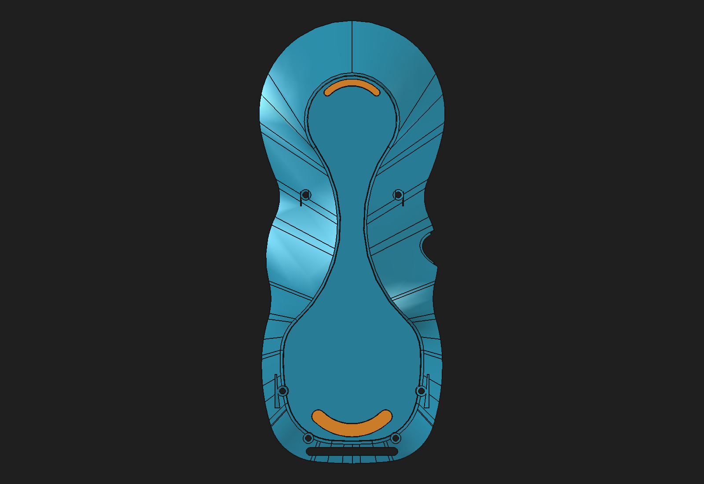
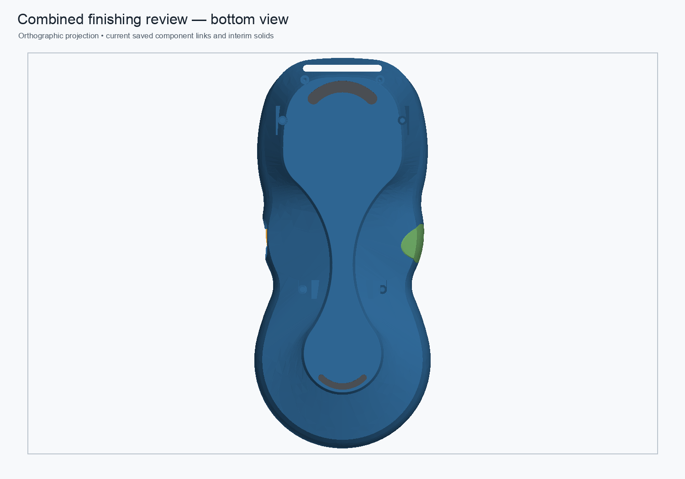
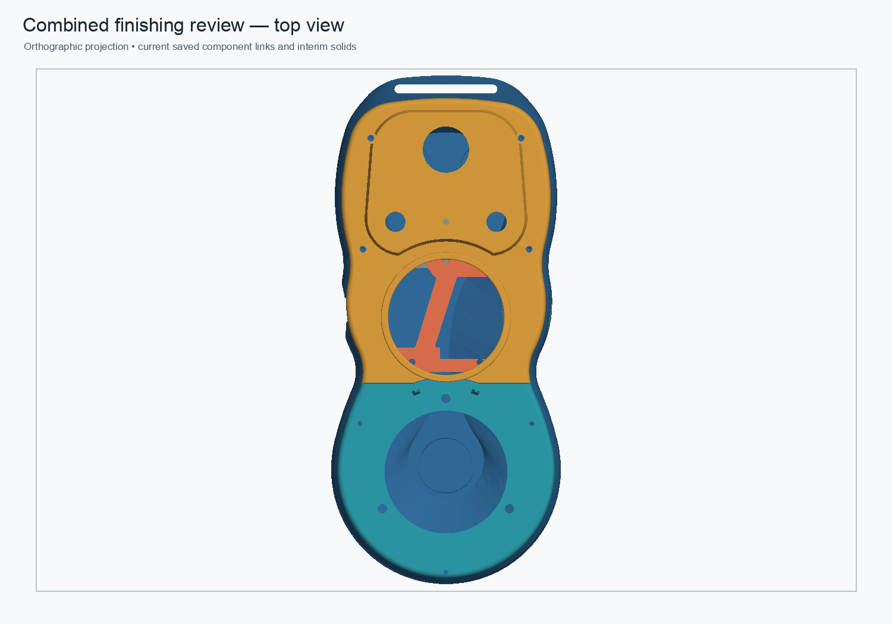
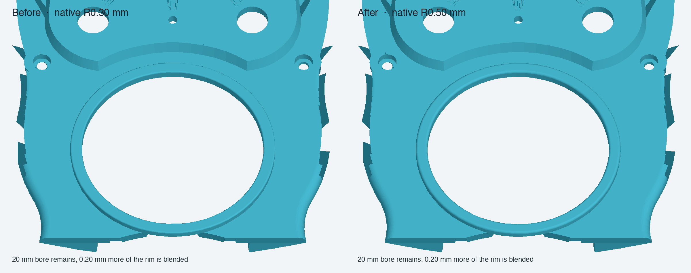

# Combined pendant finishing review — 0.6 mm crescent pads

Status: **validated disposable assembly; not production approved.**

This review combines the live hybrid upper-faceplate component with its native R0.50 mm bezel fillet, the fresh-fuse rear-shell candidate with its native 0.25 mm bottom-perimeter fillet, and separate upper/lower TPU crescent pad links with 0.60 mm proud height (0.10 mm seat engagement; 0.70 mm total pad length). The corrected-label pad source changes only feature/body labels; the pad volumes and geometry are unchanged from the validated 0.60 mm variant. Compared with the 0.80 mm-proud pads, the 0.20 mm height reduction removes 34.503059 mm³ from the upper pad and 13.119473 mm³ from the lower pad. It preserves source placements and leaves the protected monolith and production assembly unchanged.

## Previews

The assembly views show the overall arrangement; the pad planform is unchanged from the measured 0.60 mm variant, and the exact pad heights are reported below.

## Reversible parameter propagation

On a disposable copy of the combined assembly, `LowerWebP2XAbs` changed from 9.9 to 10.0 mm and restored; the rear link and assembly root updated, then returned to baseline volume. `DisplayBezelFilletRadius` changed from 0.50 to 0.55 mm and restored; the faceplate link and assembly root updated, then returned to baseline. The source component documents were not saved. The test copy was saved, closed, reopened, and recomputed with all nine links valid. Full measurements are in the [JSON validation](combined-finishing-0p6-crescents-review-2026-11-01.json).

## Validation

The combined assembly was recomputed, saved, closed, reopened, and recomputed. Its live links resolve. The rear shell is one valid solid with a closed manifold mesh; both crescent pads remain separate and have zero positive-volume overlap with the shell. Their exposed contact planes are coplanar. The assembly-level rear neighbor intersections are recorded in the [machine-readable validation](combined-finishing-0p6-crescents-review-2026-11-01.json).

The rear shell remains a hybrid review Body with a stored-shape base. Six constrained M2 passages have 2.30 mm nominal diameters; 2.00 mm diameter shank gauges pass through the full shell thickness with zero BRep intersection, leaving 0.15 mm nominal radial clearance in the model. This geometric check does not account for print tolerance or screw-head seating. The legacy 475.701580 mm³ cached-stage volume delta is not an exact material map, and structural equivalence and PLA load capacity remain unverified. Keep this assembly as a review candidate.

The saved `Pocket015 - Magnet Slot` removal tool (4,071.504079 mm³) has zero BRep overlap with the final rear Tip. The earlier upper “Magnet Clearance” region follows a multi-step history: `Pocket` removes 523.889961 mm³; `Pad019 - Mag Bulk` restores 447.273399 mm³ there; and `Pocket015 - Magnet Slot` removes part again, leaving 168.000373 mm³ intersecting that earlier tool. The same residual carries through the saved downstream shell and the fresh-fuse candidate, consistent with the feature sequence. This is not a new collision from the reconstruction; actual magnet fit and tolerance still need verification.

## Files

- [Combined review assembly](../master-driven-leadins-candidate/pendant-modular-combined-finishing-0p6-crescents-review-2026-11-01.FCStd)
- [Rear-shell review component](../pendant-bodies/rear-shell-fresh-fuse-structural-review-2026-11-01.FCStd)
- [Correctly labeled 0.60 mm crescent-pad component](../pendant-bodies/rear-shell-anti-slip-crescent-pads-parametric-0p6-corrected-labels-review-2026-11-01.FCStd)
- [0.60 mm pad variant validation](rear-shell-crescent-0p6-review-2026-11-01.md)
- [Reusable builder and validator](../scripts/build_combined_finishing_0p6_crescent_review.py)
- [JSON results](combined-finishing-0p6-crescents-review-2026-11-01.json)
