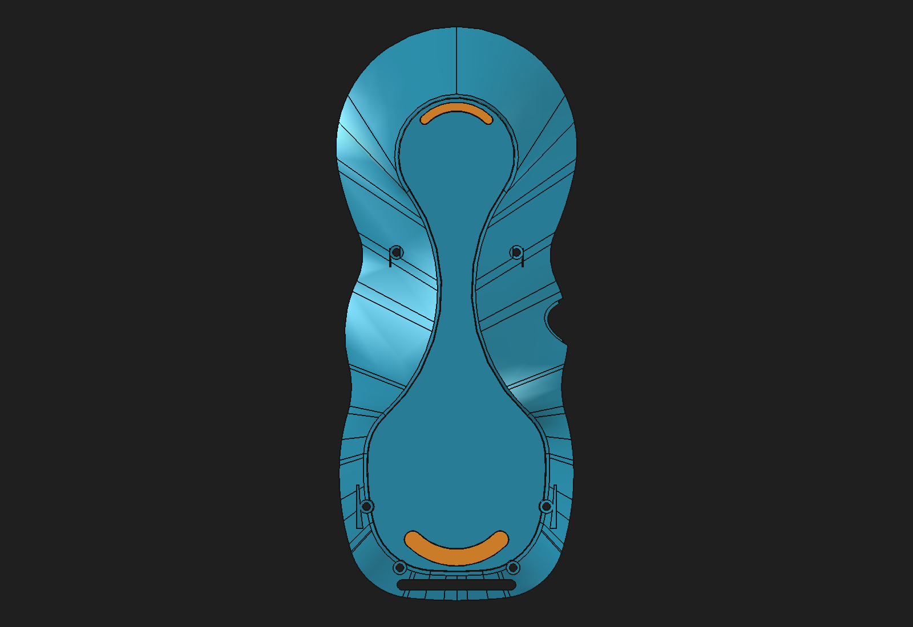
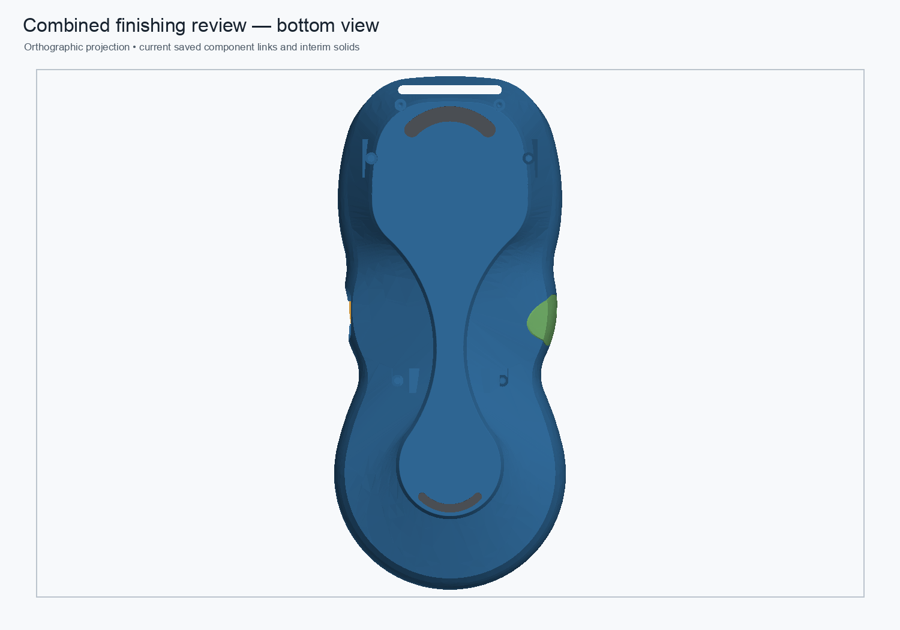
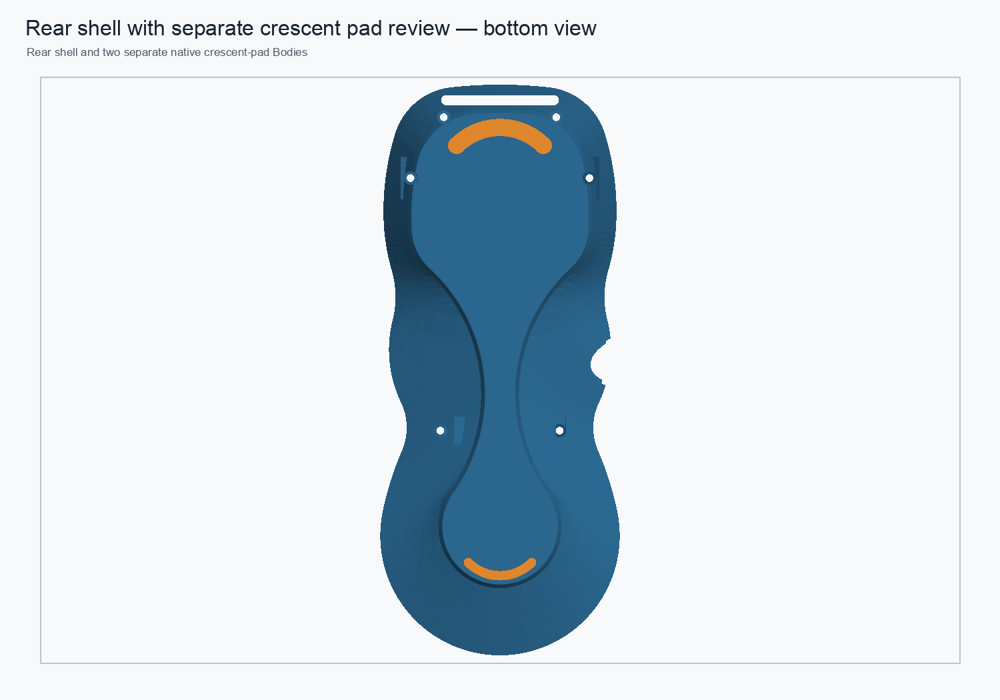

# Combined 0.60 mm crescent and rear shoulder-finish review

Status: **validated disposable assembly; not production approved.**

The assembly combines the live R0.50 mm display-bezel component, the fresh-fuse rear shell with its R0.25 mm bottom-perimeter fillet and native R1.0 mm upper-boss shoulder chamfers, and separate 0.60 mm-proud upper/lower crescent pads. The corrected crescent source labels match the measured geometry. The protected monolith and production assembly remain unchanged.

## Embedded visual context

The assembly views document component arrangement. The underside planform image documents the crescent footprints; the chamfers are small local transitions around the upper screw-boss shoulders and should be inspected in the linked FreeCAD component.

## Validation

The assembly was recomputed, saved, closed, reopened, and recomputed. All live links resolve. The rear shell remains one valid solid; its 0.08 mm mesh is closed with zero boundary, over-incident, or degenerate edges. The six 2.00 mm shank gauges pass through the modeled 2.30 mm passages. The 1.0 mm chamfers change the two upper-boss shoulder arcs without changing the inherited magnet-clearance intersection. Both crescent pads remain separate one-solid components with coplanar contact faces and zero shell intersection. The rear parameter `LowerWebP2XAbs` propagated through the chamfered PartDesign chain and live link at 10.0 mm, then restored the 9.9 mm baseline.

This combined assembly is a review model. The rear shell still has a stored-shape base, and the legacy 475.701580 mm³ stage delta remains spatially unresolved. No structural equivalence, PLA load rating, or 5× proof-load capacity is claimed. Measurements and the exact retained interim representation list are in the [JSON validation](combined-finishing-0p6-shoulder-chamfer-review-2026-11-01.json).

## Files

- [Combined review assembly](../master-driven-leadins-candidate/pendant-modular-combined-finishing-0p6-shoulder-chamfer-review-2026-11-01.FCStd)
- [Rear component with native R1.0 chamfer](../pendant-bodies/rear-shell-native-shoulder-chamfer-review-2026-11-01.FCStd)
- [Reusable builder and validator](../scripts/build_combined_finishing_0p6_shoulder_chamfer_review.py)
- [JSON results](combined-finishing-0p6-shoulder-chamfer-review-2026-11-01.json)
