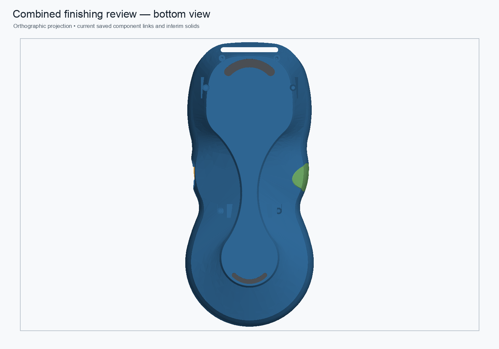
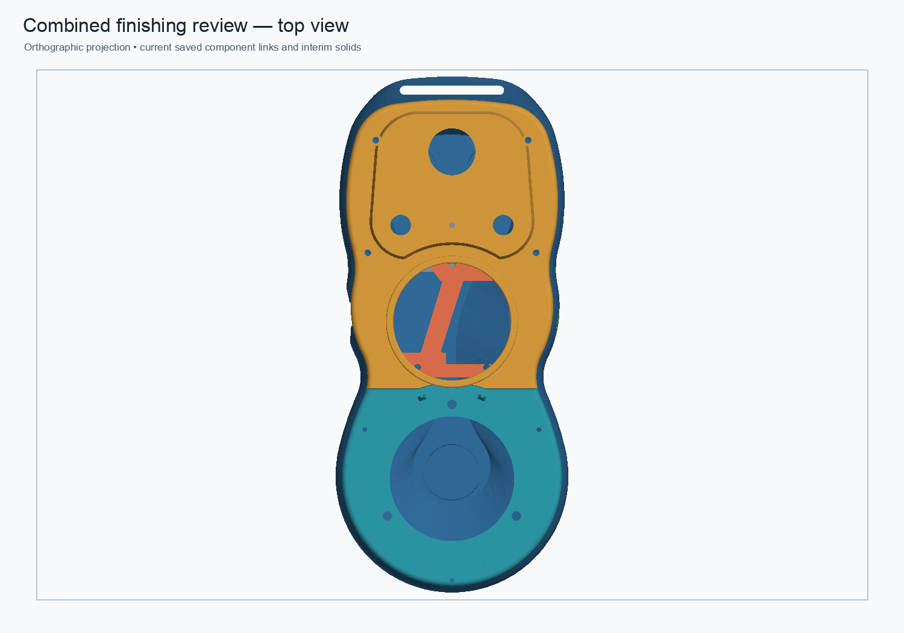
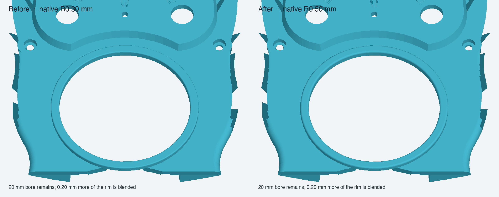

# Combined pendant finishing review

Status: **validated disposable assembly; not production approved.**

This review combines the live hybrid upper-faceplate component with its native R0.50 mm bezel fillet, the fresh-fuse rear-shell candidate with its native 0.25 mm bottom-perimeter fillet, and separate upper/lower TPU crescent pad links. It preserves the source placements and leaves the protected monolith and production assembly unchanged.

## Previews

## Reversible parameter propagation

On a disposable copy of the combined assembly, `LowerWebP2XAbs` changed from 9.9 to 10.0 mm and restored; the rear link and assembly root updated, then returned to baseline volume. `DisplayBezelFilletRadius` changed from 0.50 to 0.55 mm and restored; the faceplate link and assembly root updated, then returned to baseline. The source component documents were not saved. The test copy was saved, closed, reopened, and recomputed with all nine links valid. Full measurements are in the [JSON validation](combined-finishing-review-2026-11-01.json).

## Validation

The combined assembly was recomputed, saved, closed, reopened, and recomputed. Its live links resolve. The rear shell is one valid solid with a closed manifold mesh; both crescent pad sketches remain fully constrained in their separate component document, and the pads have zero positive-volume overlap with the shell. Their exposed contact planes are coplanar. The assembly-level rear neighbor intersections are recorded in the [machine-readable validation](combined-finishing-review-2026-11-01.json).

The rear shell remains a hybrid review Body with a stored-shape base. Its legacy 475.701580 mm³ cached-stage volume delta is not an exact material map, and its structural equivalence and PLA load capacity remain unverified. Keep this assembly as a review candidate.

## Files

- [Combined review assembly](../master-driven-leadins-candidate/pendant-modular-combined-finishing-review-2026-11-01.FCStd)
- [Reusable builder and validator](../scripts/build_combined_finishing_review.py)
- [JSON results](combined-finishing-review-2026-11-01.json)
