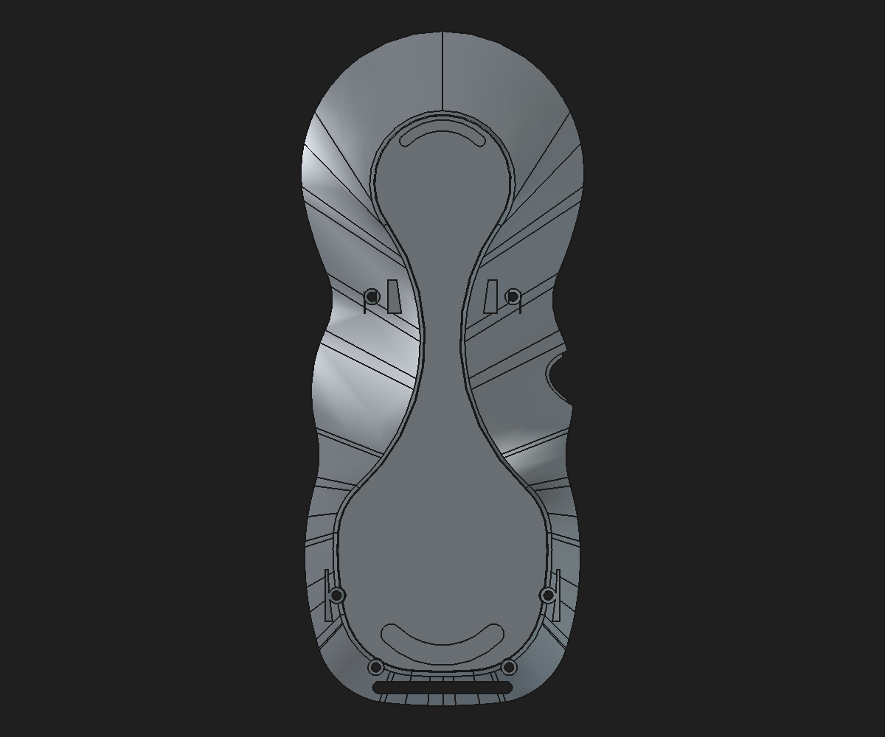
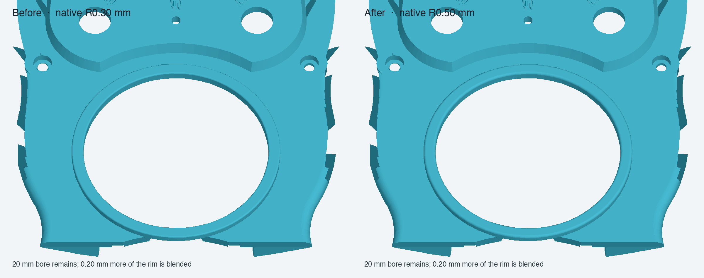

# Combined rear-shell finish and display-bezel review assembly

Status: **validated disposable assembly candidate; not production-approved.**

This candidate combines the base-preserving rear-shell reconstruction, its native R0.25 mm bottom-perimeter fillet, the separate upper/lower crescent anti-slip insert links, and the R0.50 mm hybrid upper-faceplate link. The protected monolith and production modular assembly remain unchanged.

## Assembly structure

The saved, reopened assembly recomputes to a valid root with 11 solids and nine resolved `App::Link` objects. It has two active static interim representations: the front shell and the fused encoder faceplate/pocket. The rear-shell link resolves to `FinishOrder_AntiSlipSeatPocket`, whose preceding native feature chain includes four boss-support Pads, six screw passages, two lower inner-web Pads, the R0.25 bottom fillet, and the shallow anti-slip seats. The crescent inserts remain separate linked Bodies.

## Validation

| Check | Result |
|---|---:|
| Assembly root after cold reopen | Valid, 11 solids |
| Resolved live links | 9; none broken |
| R0.50 upper-faceplate link | Valid, 1 solid, source geometry resolves |
| Faceplate bounding box | Matches the replaced static representation within 1e-6 mm |
| Faceplate/other component intersection changes | 0 mm³ for all checked neighbors |
| Root assembly volume change | −14.330017 mm³ |
| Direct faceplate replacement volume change | −14.326786 mm³ |

The 0.003231 mm³ difference between aggregate root-volume change and direct component-volume change is retained in the record as a small recompute/compound tolerance. The pre-existing front-shell intersection is 12.955740 mm³ both before and after this edit; the faceplate change did not alter it. The faceplate also remains clear of the encoder interim, both locator links, display retainer, USB cover, breakout board, rear shell, and crescent pads in the Boolean checks.

## Limitations

The rear shell remains a review reconstruction, not an approved replacement. Its final Tip is a valid single solid with a closed tessellated mesh and includes the measured R0.25 bottom fillet, but it remains 113.497 mm³ below the cached legacy Tip. The legacy mesh is non-manifold, and the remaining geometry difference has not been classified well enough to claim equivalence or structural adequacy. The imported rear-shell base and the upper-faceplate base are static geometry; only the added support/finish operations and bezel fillet are native editable features. No PLA proof-load claim is made.

## Files

- [Combined review assembly](../pendant-modular-structural-first-fillet-bezel-r0p50-review-assembly-2026-10-31.FCStd)
- [R0.50 hybrid faceplate component](../master-driven-leadins-candidate/pendant-bodies/upper-faceplate-bezel-hybrid-r0p50-review.FCStd)
- [Rebuild and cold-open integration script](../scripts/integrate_bezel_r050_into_rear_fillet_review_assembly.py)
- [Machine-readable validation](combined-rear-fillet-bezel-review-assembly-2026-10-31.json)
