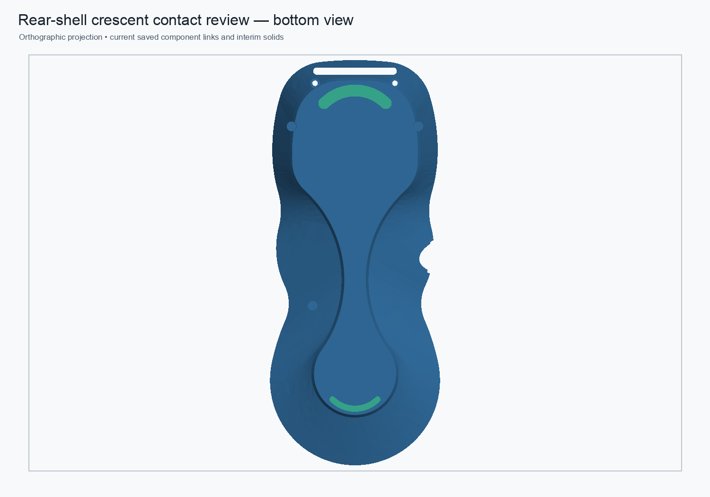

# Native crescent contact-pad review — 2026-11-01

## Candidate

The review assembly now links the upper and lower swept-crescent pads to a dedicated two-Body FreeCAD source document. The new source has no redundant rear-shell Body: it contains the two native PartDesign pad histories, their constrained sketches, a fixed outline-reference sketch, and a component-local spreadsheet. Its `PadThickness` expression is `SeatDepth + PadProudHeight`, currently 0.10 mm + 0.25 mm.

The saved assembly cold-opens and recomputes with nine live links. The two pad links resolve to `UpperCrescentContactPad` and `LowerCrescentContactPad` in the dedicated source; source paths are stored repo-relative. Two static interim faceplate representations remain. The protected monolith and production modular assembly were not modified.

## Checks

- Both pad source Bodies cold-open as valid, one-solid PartDesign Bodies. Their baseline volumes are 57.7828813 mm³ (upper) and 21.1760644 mm³ (lower).
- The new pad Bodies have zero Boolean symmetric difference from the prior two-pad review geometry. Their contact areas are 165.0939 mm² and 60.5030 mm². Their contact planes are parallel (normal dot 1.0) and coplanar within 2.13×10⁻¹⁴ mm.
- Previously measured clearances for this unchanged pad geometry show zero common volume with either shell, and zero pad-to-pad common volume.
- A targeted seat-contact check on the current rear load-path review assembly found that each inboard pad face coincides with the shell over the full face area: upper 165.0939466 mm² of 165.0939466 mm²; lower 60.5030412 mm² of 60.5030412 mm². The exact face intersection was valid and had no volumetric intersection. This complements the earlier whole-body zero-volume check without requiring a slow Boolean over both complete high-face-count solids.
- The two exposed pad faces remain coplanar in the same assembly: their normals are parallel (0° angle), and the plane-offset difference is 7.34×10⁻¹⁴ mm.
- A reversible native parameter probe changed `PadProudHeight` 0.25→0.35→0.25 mm. Recomputing the source and then the assembly changed both linked pad volumes to 74.2922760 mm³ and 27.2263686 mm³, then restored them within 1.5×10⁻¹⁴ mm³ of baseline.
- The altered probe state was not saved. The saved review assembly and dedicated source were reopened and recomputed in a fresh headless FreeCAD process.

## Limits and next decisions

This validates editable component separation, source-to-link recomputation, and the current geometric placement. It does not establish grip performance, TPU/rubber wear, adhesion, magnetic holding force, or tabletop stability. The pads stand 0.25 mm proud, which also increases magnet-to-steel separation by that amount. Keep this as a review candidate until the material, contact behavior, and magnetic tradeoff are evaluated. Shell strength and the 5× complete-pendant proof-load target remain unverified.

The complete shell-to-pad interference check still relies on the earlier successful zero-common-volume measurements for these unchanged shell and pad shapes; the timed-out combined comparison did not complete. The new inboard-face coincidence check directly validates the designed seat contact area, but does not establish pad retention strength, TPU compression, friction, or magnetic performance.

The machine-readable measurements are in [the JSON validation record](crescent-contact-pad-native-review-2026-11-01.json). The repeatable read-only cold-open and parameter validator is [validate_crescent_contact_pad_review.py](../scripts/validate_crescent_contact_pad_review.py).
