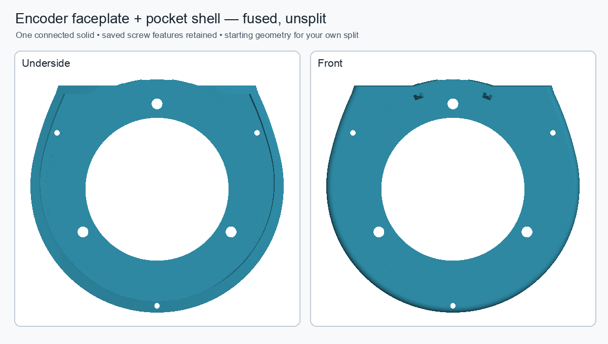

# Unsplit encoder faceplate + pocket handoff

`../../encoder-faceplate-pocket-unsplit-user-split.FCStd` is a single-solid, fused starting shape for the user's own sketch and split. It combines the saved `Body_EncoderFacePlate` Tip with the saved `EncoderPocketShellReleaseNoFaceplateRetention` pocket-shell shape from `pendant-encoder-fused-working.FCStd`. The faceplate and pocket are no longer shown as separate split pieces in this handoff.

The standalone document contains one static `Part::Feature` BREP and no external links. This keeps FreeCAD's fragile upstream shell recomputation out of the manual-split file. The native feature histories remain unchanged in `pendant-encoder-fused-working.FCStd`; this handoff is not a new independently parametric component.

The two saved source shapes were valid single solids. Their union is a valid one-solid shape (14,630.093 mm³, 103 faces, 293 edges). Boolean checks found zero source material missing from the union. The kernel union reports 0.0695 mm³ more volume than the sum of its inputs; this is a small Boolean tolerance residue (about 0.0005% of the total). The target screw openings and pilot surfaces remain in the fused shape. The exact source feature/geometry values and cold save/reopen/recompute check are in `validation.json`.

FreeCAD initially reports a broad analytic bounding box inherited from the source surfaces. Recompute tightens that box to the actual tessellated extents; the tessellation hash, volume, area, face/edge counts, and solid count remain identical. Use the rendered image for visual orientation.

Open `hardware/freecad/encoder-faceplate-pocket-unsplit-user-split.FCStd` and select `EncoderFaceplatePocketUnsplit` as the starting solid for your own split sketch. The existing editable source remains available in `hardware/freecad/pendant-encoder-fused-working.FCStd`.
