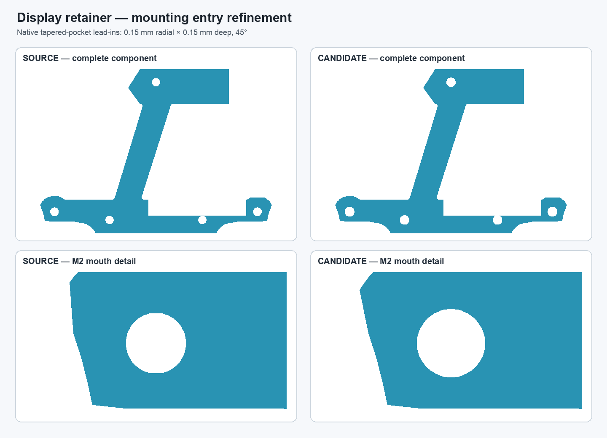
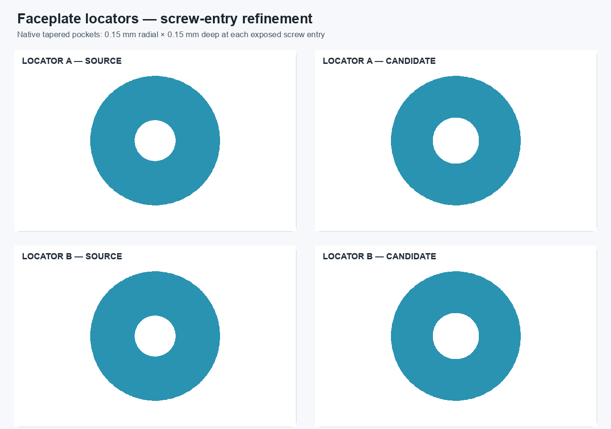

# Master-driven fastener entry lead-ins — validation

## Result

The retainer and two faceplate locators keep their native Sketcher profiles and `PartDesign::Pocket` lead-ins, and their shared entry size/depth now reads from a candidate-only `InternalHardware.FastenerEntryRadialDepth` master parameter. The baseline remains `0.15 mm`; the existing `-45°` taper is unchanged. Coupling the radial expansion to the pocket depth preserves the nominal cylindrical passage at the bottom of the tapered entry.

The parameter was changed from `0.15 mm` to `0.20 mm` in a disposable copy. All three component bodies changed on recompute. Restoring `0.15 mm` returned the retainer and both locators to their starting shapes with `0 mm³` measured symmetric difference. After save, close, reopen, and recompute, the expressions remained present and the bodies remained valid one-solid PartDesign shapes. Nominal screw-bore gauges reported zero intersection in all seven checked passages.

The retainer and locator documents also opened individually from cold starts, each resolving the sibling candidate master and all master expressions. The combined candidate assembly cold-opened with six live component links, a valid nine-solid root, and unchanged overall bounds (`[-64.2162, 64.2162, -92.3647, 86.6891, -36.8450, 5.0000] mm`). A relocated copy also opened with every link resolving inside the relocated folder; a `0.15 → 0.20 → 0.15 mm` master change propagated and restored in that copy. The relocation test is reproducible with `scripts/test_master_driven_fastener_entry_relocation.py`.

## Scope and limits

The default geometry is unchanged from the already validated lead-in candidates. The candidate master and linked assembly are isolated under `master-driven-leadins-candidate/`; the protected monolith, production master, and production assembly were not modified. This assembly still contains interim static front-shell, upper-faceplate, and fused encoder representations, and the rear shell remains the previously documented hybrid repair candidate. It is not the completed fully editable pendant architecture. The parameterization validates lead-in geometry response only; it says nothing about screw preload or structural capacity.

Detailed metrics and expression records are in `master-driven-fastener-entry-validation.json`.
