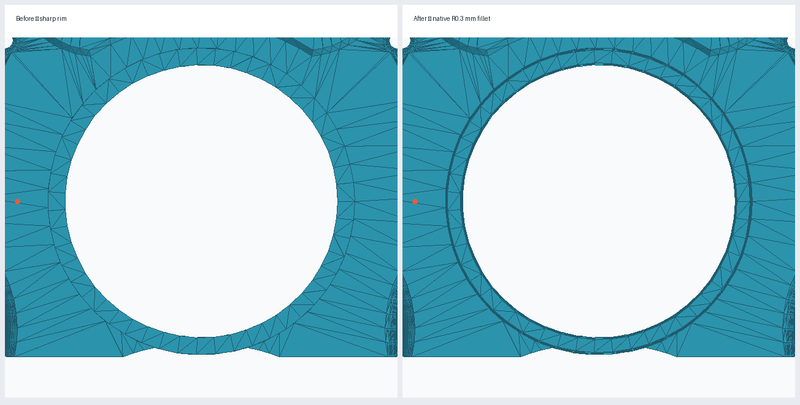
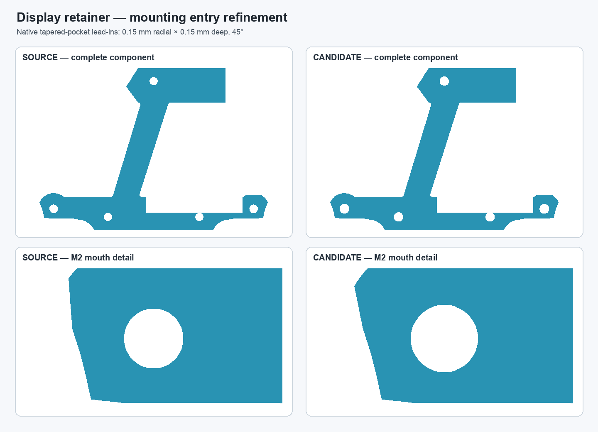
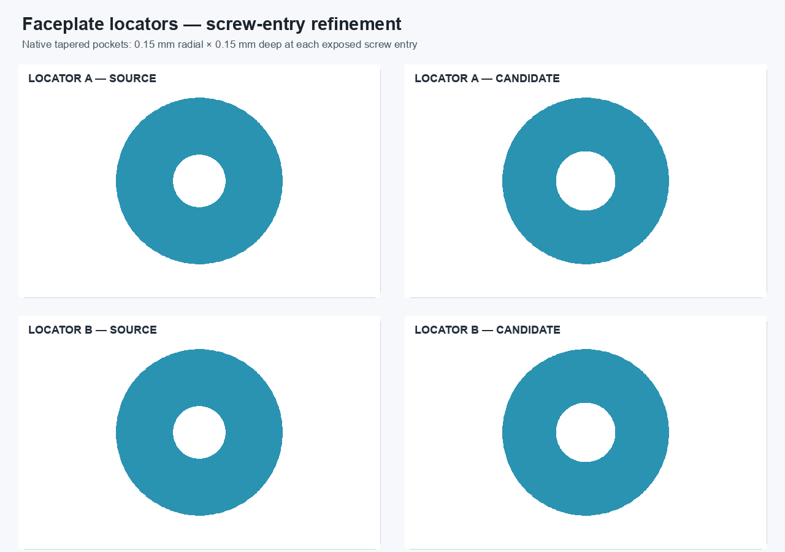

# Mechanical CAD candidate improvements — 2026-10-31

## Display bezel soft edge

A disposable copy of `pendant.FCStd` now has a native `PartDesign::Fillet` named `DisplayBezelSoftEdge` on the two top-facing circular rim edges of `Body003` (`Body003FullWidthSeat`). The two concentric edges were identified geometrically at center `(0, 2.99855, 4.0) mm`, radii `20.0` and `22.5 mm`; the feature uses `R = 0.3 mm`.

The resulting top flat annulus is about `1.9 mm` wide instead of `2.5 mm`. The glass-relief sketch radius is `21.7 mm`, leaving about `0.5 mm` between that relief radius and the post-fillet top outer rim at `22.2 mm`. This is a CAD clearance estimate; no physical glass model or hardware was installed.

The original upper-faceplate Tip and filleted candidate are each one valid solid. Recomputing the original `Body003FullWidthSeat` first reproduced its saved shape exactly (symmetric difference `0 mm³`). The candidate then recomputed, saved, closed, reopened, and recomputed successfully. Its tessellated mesh is closed. Filleting removes `5.157565 mm³`, adds no material, and leaves the overall faceplate bounds unchanged. The before/after preview is `display-bezel-fillet-before-after.png`.

A disposable full assembly candidate, `pendant-modular-design-improvements-candidate.FCStd`, replaces only the upper-faceplate interim shape with the filleted result and uses the existing rear load-path candidate. After save/reopen/recompute, the assembly root is valid with nine solids; component placements are unchanged and the five independently editable links resolve. The bezel remains an interim static shape in this assembly candidate; the native feature is preserved in the separate monolith-derived candidate.

The protected monolith SHA-256 remains `dc2aeddf7be327c73022a1dc053bf8a27d5cf476e9cd68468a4ee73ab8264881`.

## Rear-shell non-manifold redesign candidate

The defect is not at the old seam tongue-and-groove alignment grooves. The existing audit locates it at the four rear screw-boss-to-wall reinforcement paths (`RearBossToWallLoadPaths`). The tracked `rear-shell.stl` reports `335` boundary edges and `12` edges with more than two incident facets at `1e-5 mm` vertex-weld tolerance.

The existing hybrid candidate `pendant-bodies/rear-shell-loadpath-repair-candidate.FCStd` replaces the non-manifold stored-shape load-path feature with four native PartDesign Pads and restores six M2 passages with a native Pocket. It is one valid solid, preserves the source outer bounds, and its FreeCAD export has `19,076` facets with zero boundary edges, zero over-incident edges, and zero degenerate facets. The M2 and magnet clearances are unchanged in the candidate construction.

This is a deliberate redesign candidate, not an exact geometry-preserving repair: candidate rear-shell volume is `40,609.693 mm³` versus `40,961.359 mm³` in the defective original Tip, a reduction of `351.666 mm³` (`0.858%`). The candidate base is a static BREP and the old shoulder/ramp history is not reproduced. It is therefore **not promoted as a fully editable shell or as structurally proven**. A combined assembly candidate is supplied for review, but the protected production monolith and production assembly remain unchanged. The five-times-pendant-weight load target still requires mass, boundary-condition and physical-load validation.

## Display-retainer mounting lead-ins

The five M2 mounting passages in `Body_DisplayRetainer_EditableV2` now have a small sketch-defined conical lead-in on the accessible `z = -7.061467 mm` face. The native `PartDesign::Pocket` removes material from a fully constrained five-circle sketch, using `0.15 mm` radial expansion, `0.15 mm` depth, and a `-45°` taper so the opening returns to its existing nominal radius at the end of the lead-in. This sketch-based feature avoids the failed edge chamfer at one generated hole edge and treats all five passages uniformly.

The saved source and candidate are each a valid single solid. The candidate removes `0.406960 mm³`, adds no material, and has exactly the same bounding box as the source. Exact-radius through-cylinder checks show `0 mm³` interference at all five original passage diameters (`2.30 mm` for two shell mounts and `2.20 mm` for three display mounts), before and after. The candidate mesh is closed before and after save/reopen/recompute (2,744 facets after reopen); the sketch is fully constrained. The source component and production assembly were not modified.

The retainer change is also linked into a disposable assembly copy, [pendant-modular-retainer-leadin-candidate.FCStd](../pendant-modular-retainer-leadin-candidate.FCStd). On cold reopen, all six external App::Links resolve to valid one-solid targets, the root is a valid nine-solid compound, and the display-retainer link retains its original placement. The rear shell and some faceplate representations in this assembly are still interim candidates; this does not promote those parts to fully editable modules.

## Faceplate-locator screw-entry lead-ins

Both native locator Bodies now have a small tapered entry at the exposed M2 passage. Each fully constrained profile drives a `PartDesign::Pocket` with `0.15 mm` radial expansion, `0.15 mm` depth, and a `-45°` taper. The existing larger screw-head seats remain untouched. This removes `0.084823 mm³` from each locator, leaves both exterior bounds and their `z = -1.5 mm` Body placements unchanged, and preserves zero interference against the nominal `2.30 mm` cylindrical screw-clearance gauge.

The two candidates cold-open and recompute as valid single solids. Their tessellations are closed with zero boundary edges and zero over-incident edges (2,394 and 2,392 facets). The before/after plan previews show the uniform entry enlargement while preserving the locator outline.

The change is present only in `faceplate-locators-leadin-candidate.FCStd`. A disposable assembly copy, [pendant-modular-locator-leadin-candidate.FCStd](../pendant-modular-locator-leadin-candidate.FCStd), redirects both locator links to the new native source. After close/reopen/recompute, all six external links resolve to valid one-solid targets; the root remains a valid nine-solid assembly with unchanged overall bounds. The production locator source and assembly are unchanged.

## Candidate files

- `../pendant-modular-design-improvements-candidate.FCStd` — combined assembly candidate, saved beside its relative component links.
- `../pendant-modular-retainer-leadin-candidate.FCStd` — follow-on assembly candidate with the display-retainer source link redirected to the new native lead-in component file.
- `../pendant-bodies/display-retainer-mounting-leadin-candidate.FCStd` — native PartDesign candidate for the five retainer mounting entries.
- `../pendant-bodies/faceplate-locators-leadin-candidate.FCStd` — native PartDesign candidate for both locator screw-entry lead-ins.
- `../pendant-modular-locator-leadin-candidate.FCStd` — assembly candidate linking the retainer and locator refinements.
- `pendant-display-bezel-fillet-candidate.FCStd` — full monolith-derived native bezel-filleting candidate (local disposable file; regenerate using `../scripts/create_display_bezel_candidate.py`).
- `display-bezel-fillet-before-after.png` — preview.
- `display-retainer-mounting-leadin-before-after.png` — preview for the retainer lead-ins.
- `faceplate-locators-leadin-before-after.png` — preview for the locator lead-ins.
- `rear-shell-loadpath-repair-candidate.stl` — exported mesh for candidate edge-incidence comparison.

No production CAD or STL was overwritten.
