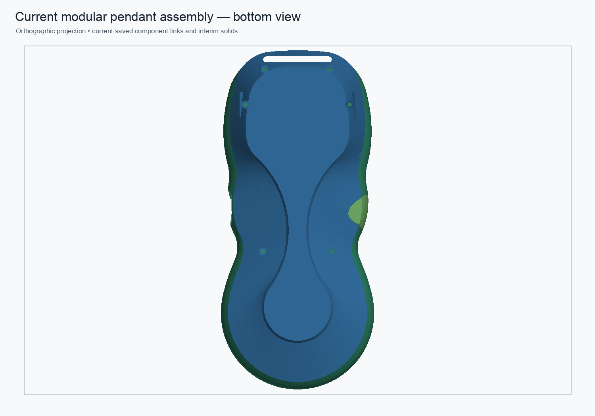
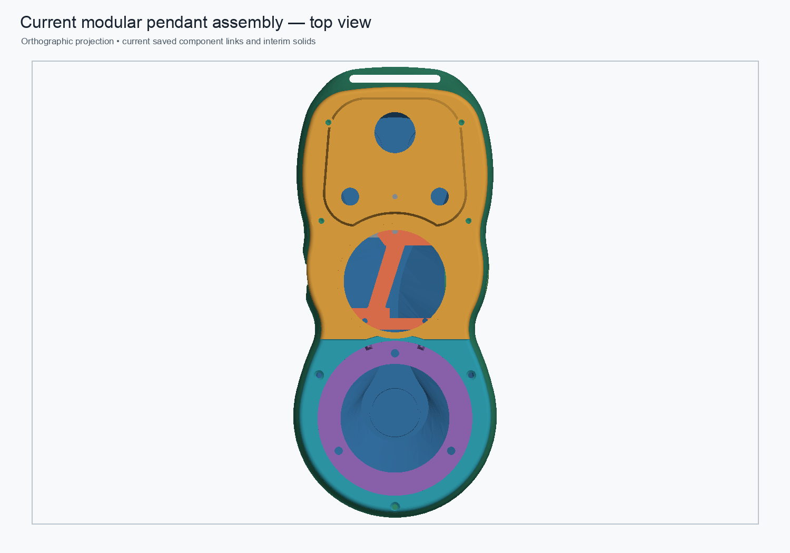
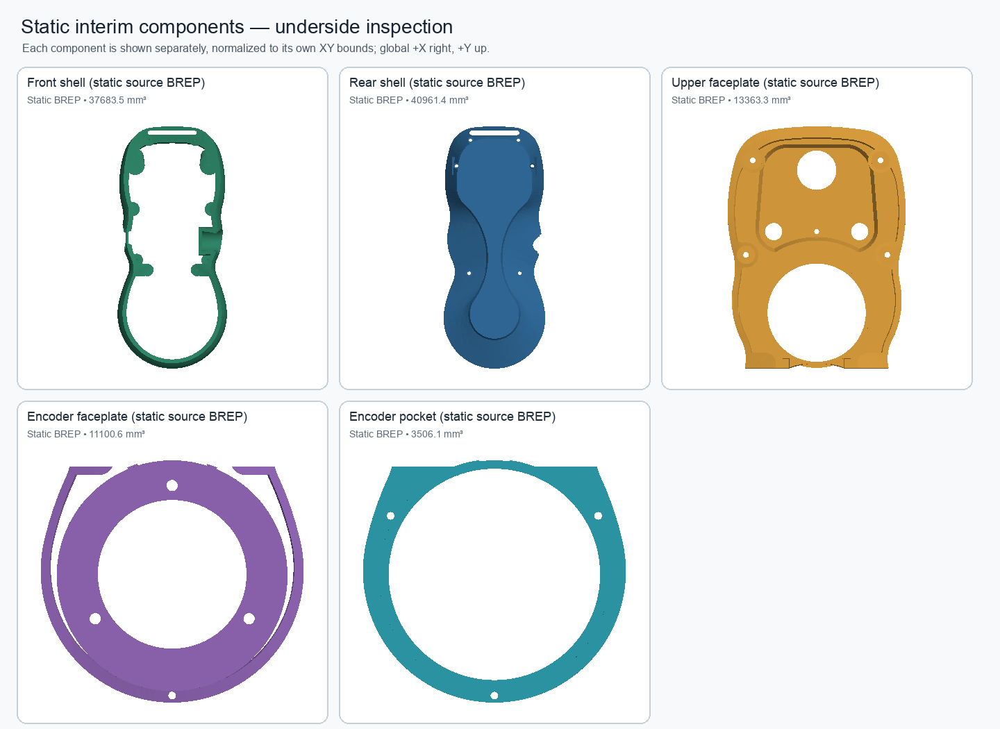

# Headless modular assembly visual review

Generated from `pendant-modular-assembly.FCStd` with FreeCADCmd; the FreeCAD GUI was not used. The exporter only opens and tessellates saved shapes. It does not recompute or save any CAD document.

The assembly previews overlay all five current live App::Links and five static interim solids. The component sheet shows the five remaining static shell, faceplate, and encoder-pocket solids separately from their undersides; the breakout board is now a live editable link. Each component is normalized to its own XY bounds for shape inspection. The previews use an orthographic software rasterizer and are intended for visual review, not as proof of exact geometric equivalence.

The exporter confirmed 10 valid single-solid preview shapes and matched every live link against its source Body by volume and bounding box. The five interim solids remain static BREP representations; the images do not imply they are independently editable.

Regenerate from the repository root with:

```sh
python3 hardware/freecad/scripts/render_modular_preview.py
```

NumPy and Pillow must be available to the Python running the script. FreeCADCmd must be installed. The script refuses to run while the FreeCAD GUI is open and never saves a CAD document.






