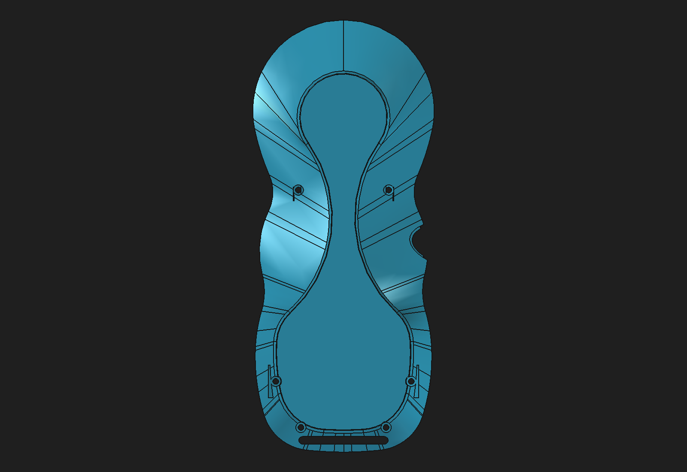
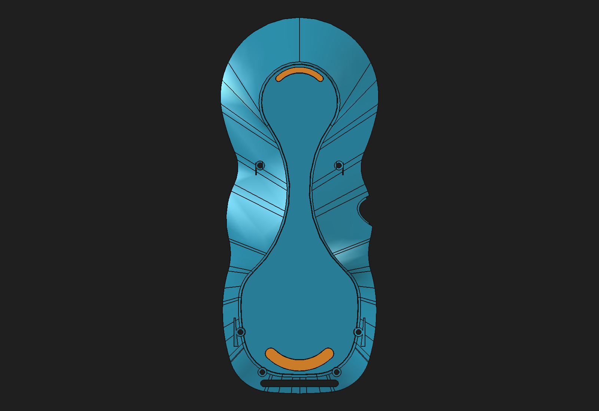
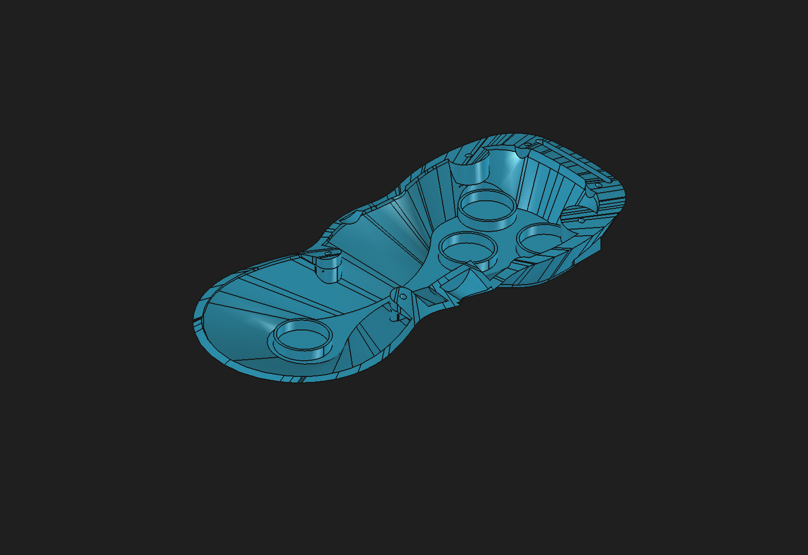

# Rear-shell anti-slip contact candidate — 2026-10-31

## Result

Created a disposable, native-feature candidate for two swept-crescent contact inserts on the rear shell. The crescents follow the existing upper and lower teardrop contours, stay outside the four reserved magnet pockets and six M2 screw passages, and share the measured tilted underside contact plane. Variant C is the current preferred geometry for review; it is not approved or connected to the protected production assembly.

The source remains the previously validated bottom-fillet candidate. Its 0.25 mm `BottomPerimeterFinish` is a native PartDesign fillet on 19 lower-perimeter edges. The anti-slip seats are a subsequent 0.20 mm PartDesign Pocket. Two independent native PartDesign Bodies hold the replaceable contact pads. The profile sketches are fully constrained with the current outline coordinates fixed; the spreadsheet drives seat depth and pad thickness.

The source shell already contains the hybrid rear-shell support reconstruction. Its `BaseShell` is an imported static shape and its support profiles remain fixed at the current geometry. The shell is still 351.666 mm³ below the legacy saved Tip before these seats. Variant C removes another 47.621 mm³ for the seats. The lower load-path discrepancy is unresolved, so this does not replace or certify the original shell design.

## Visual comparison

Before adding the contact seats:

Variant A gives a slightly larger footprint, but its upper seat leaves only about 0.025 mm to the 10.5 mm magnet keepout. Variant B moves the upper crescent outward and broadens it, but leaves only 0.427 mm to the shell boundary and 0.372 mm to the magnet keepout. Both were rejected as too tight for a review candidate.

Variant C lifts the upper crescent by 1 mm and trims the lower crescent's outer radius by 0.2 mm. That preserves a broad integrated footprint while leaving at least 1.02 mm to a 10.5 mm magnet keepout and 1.15 mm to the shell boundary in the measured underside plane.

The isometric view below looks at the shell's internal side, so the external contact pads are hidden. It helps show that the seat design leaves the existing interior bosses and magnet/screw features in place.

## Geometry and validation

| Measurement | Variant A | Variant B | Variant C |
|---|---:|---:|---:|
| Exposed pad contact area | 231.132 mm² | 256.900 mm² | 225.597 mm² |
| Minimum seat-to-magnet keepout | 0.025 mm | 0.372 mm | 1.024 mm |
| Minimum seat-to-shell outer edge | 0.951 mm | 0.427 mm | 1.151 mm |
| Minimum seat-to-expanded M2 keepout | 4.482 mm | 2.481 mm | 3.689 mm |
| Footprints contained on underside face | Yes | Yes | Yes |
| Seat/magnet or seat/screw overlap | None | None | None |

The clearances are measured from the seat outline to projected magnet circles enlarged to 10.5 mm radius, screw passages enlarged by 1.5 mm, and the outer wire of the planar rear contact face. Variant C is preferred over A and B for its larger minimum magnet and shell-edge margins; this is a geometric screening decision, not a grip or structural test.

Variant C's final values:

- Seat depths: 0.20 mm, driven by `AntiSlipParameters.SeatDepth`.
- Pad thicknesses: 0.45 mm, driven by `AntiSlipParameters.PadThickness`.
- Pad proud height: 0.25 mm beyond the original underside plane.
- Seat outline clearance: 0.10 mm around the pad profiles, fixed in the fully constrained seat sketch.
- Upper and lower exposed contact areas: 165.094 mm² and 60.503 mm².
- Rear shell after the seat cut: 40,560.734 mm³, one valid solid.
- Each pad: one valid solid in its own PartDesign Body.
- Tessellation at 0.08 mm: rear shell 92,486 facets; each pad 756 facets. Each mesh has zero boundary and zero over-incident edges.
- All features remain up to date after save, close, reopen, and full recompute.
- Nine normal section samples along each crescent centerline found minimum remaining shell material of 9.66 mm at the upper pad and 2.44 mm at the lower pad. This is a local sample, not a global thickness guarantee.

### Correction: lower-seat wall probe

A follow-up geometry check found that the earlier global-Z probe at X=0, Y=−59.51 mm was outside the lower crescent profile (0.586 mm from its filled face). Its 2.00 mm interval is not a thickness measurement under the seat and should not be used as one. The actual lower crescent is centered near (0, −48.010, −31.145) mm and occupies an annular sweep; the corrected centerline sample and a shallow-seat candidate are documented in [the separate shallow-seat validation](rear-shell-anti-slip-shallow-seat-candidate-2026-10-31.md). The earlier 2.44 mm value remains only a local normal-section sample, not a global minimum-thickness certification.

The reversible parameter check changed seat depth 0.20→0.25 mm and pad thickness 0.45→0.50 mm, recomputed the shell and both pads, then restored the original values. All three volumes returned to within 1e-10 mm³ of baseline. The test passed again after saving and reopening.

## Limits and next steps

The candidate keeps the magnet pockets, hanger, screw passages, and shell interfaces in the source geometry; the seats were checked against projected keepout regions and do not overlap them. The broad shell Tip remains a hybrid static-base/native-feature model, not a fully native independent shell module. The pad Bodies have no validated TPU material model, adhesive/retention method, measured magnet force, friction coefficient, assembled center of mass, or tabletop stability test. No claim is made about magnetic holding performance or load capacity.

## Disposable assembly integration

The candidate rear shell and both pad Bodies are linked into [pendant-modular-rear-anti-slip-review-candidate.FCStd](https://github.com/Cdaprod/lolin-s2-mini-cnc-mpg-pendant-controller/blob/hardware-integration/hardware/freecad/pendant-modular-rear-anti-slip-review-candidate.FCStd). After save, close, reopen, and recompute, all eight App::Links resolve. The assembly root is valid with 11 solids; the shell module is valid with four solids (front interim representation, rear shell, and two inserts). The rear shell link matches its source volume within `2.5e-6 mm³`. Both pad links resolve to valid single solids, and each has `0 mm³` volumetric intersection with the rear shell at the seat-floor contact.

A separate disposable refresh test edited the component spreadsheet from 0.20/0.45 mm to 0.25/0.50 mm. The rear-shell link changed from 40,560.734289 to 40,548.828652 mm³, and the upper/lower pad links changed from 74.292276/27.226369 to 82.546973/30.251521 mm³. Closing and reopening the assembly retained those updates; restoring the original dimensions and cold-reopening recovered all three baseline volumes within `1e-10 mm³`. This tested refresh in the repository directory; relocation of the full linked package was not tested.

The shell fit to the front counterpart and internal electronics still needs review. Keep the protected monolith and production assembly unchanged until the shell reconstruction discrepancy and mechanical fit are resolved.

### Follow-up: USB-cover overlap baseline

A pairwise BREP check found two small positive-volume intersections between the rear shell and the linked USB-tethered cover: 0.491428 mm³ near (X≈30.15, Y≈7.81, Z≈−19.53) and 0.289042 mm³ near (X≈29.59, Y≈−2.25, Z≈−19.14), for 0.780472 mm³ total. The same two regions and volume are present against both `Body002FullWidthSeat` and the saved monolithic `Body002` Tip, and the intersection is unchanged across the candidate's reinforcement, fillet, and anti-slip features. Feature-level intersection checks localize it to the component's explicitly named `USBSoftPressFitStem` geometry: that feature overlaps the shell by 0.830458 mm³ before the final lead-in chamfer, and the finished USB cover overlaps by 0.780472 mm³. This is consistent with intentional TPU press-fit engagement, not a new shell clash. Its fit pressure/tolerance has not been measured, so preserve the geometry and validate physical fit before changing it.

Candidate file: [rear-shell-anti-slip-contact-candidate.FCStd](https://github.com/Cdaprod/lolin-s2-mini-cnc-mpg-pendant-controller/blob/hardware-integration/hardware/freecad/pendant-bodies/rear-shell-anti-slip-contact-candidate.FCStd).

Machine-readable evidence: [rear-shell-anti-slip-contact-candidate-2026-10-31.json](rear-shell-anti-slip-contact-candidate-2026-10-31.json).
