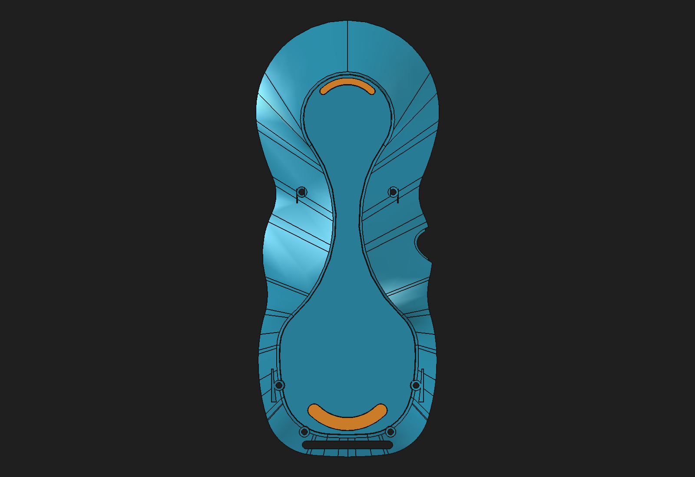

# Rear-shell anti-slip pad proud-height propagation — 2026-10-31

## Result

The existing shallow-seat crescent candidate successfully propagates its local `PadProudHeight` parameter through both native TPU insert Bodies and their live assembly links. This is a reversible parameter check only; the saved 0.25 mm design was restored and no CAD document was saved during the test.

## Reversible test

The cold-opened source component and its disposable linked assembly were recomputed at the saved value, changed from 0.25 to 0.35 mm, recomputed, and restored to 0.25 mm.

| Measurement | Saved value | Test value | Restored error |
|---|---:|---:|---:|
| `AntiSlipParameters.PadProudHeight` | 0.25 mm | 0.35 mm | 0 mm |
| `PadThickness` (`SeatDepth + PadProudHeight`) | 0.35 mm | 0.45 mm | — |
| Rear-shell Body volume | 40,584.545561 mm³ | unchanged | 0 mm³ |
| Upper pad volume | 57.782881 mm³ | 74.292276 mm³ | < 2×10⁻¹⁴ mm³ |
| Lower pad volume | 21.176064 mm³ | 27.226369 mm³ | < 2×10⁻¹⁴ mm³ |
| Upper assembly-link volume | 57.782881 mm³ | 74.292276 mm³ | < 2×10⁻¹⁴ mm³ |
| Lower assembly-link volume | 21.176064 mm³ | 27.226369 mm³ | < 2×10⁻¹⁴ mm³ |

The upper and lower pad volume increases were 16.509395 and 6.050304 mm³, matching their exposed profile areas multiplied by the 0.10 mm thickness change. The shell did not change. The assembly has eight resolved live links after cold reopen.

Increasing pad proud height by 0.10 mm also increases the magnet-to-steel separation at the pad contact locations by 0.10 mm. That tradeoff is directly controlled by the parameter. The existing 0.25 mm setting remains the saved review value; no magnet holding-force or physical friction claim is made.

## Limits

This confirms that the two pad lengths and assembly links respond to the spreadsheet parameter. It does not establish TPU retention, magnet performance, complete pendant load capacity, print durability, or suitability for production. The existing shallow-seat candidate itself remains review-only because the rear-shell legacy reinforcement difference and full structural validation are unresolved.

Machine-readable measurements: [`rear-shell-anti-slip-pad-proud-height-propagation-2026-10-31.json`](rear-shell-anti-slip-pad-proud-height-propagation-2026-10-31.json).
