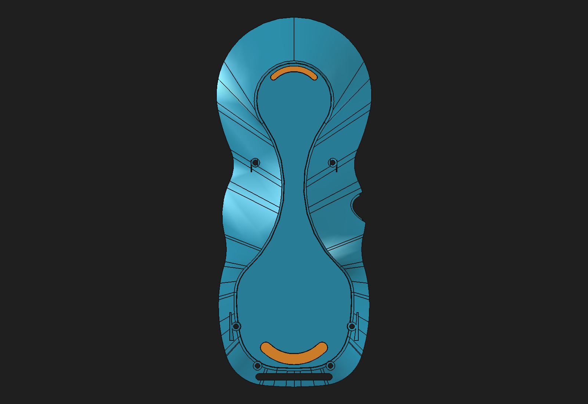

# Rear-shell shallow anti-slip seat candidate — 2026-10-31

## Change

Created the disposable component [`rear-shell-anti-slip-shallow-parametric-seat-candidate.FCStd`](https://github.com/Cdaprod/lolin-s2-mini-cnc-mpg-pendant-controller/blob/hardware-integration/hardware/freecad/pendant-bodies/rear-shell-anti-slip-shallow-parametric-seat-candidate.FCStd) from the validated variant-C anti-slip candidate. The seat depth is reduced from 0.20 to 0.10 mm to retain more shell material beneath the lower crescent. The exposed pad contact plane and crescent footprints are preserved.

The first shallow-seat trial changed only the spreadsheet numbers. It produced 22.56 mm³ of pad/shell overlap and shifted the pad's outside face, so it was rejected. The accepted disposable candidate adds a stable parametric relationship:

- `AntiSlipParameters.SeatDepth` drives the seat Pocket and the pad profile sketches' plane offset.
- `AntiSlipParameters.PadProudHeight` is 0.25 mm.
- `AntiSlipParameters.PadThickness` is the spreadsheet formula `SeatDepth + PadProudHeight`.
- Both pad lengths reference `PadThickness`; their profile placements follow the seat-floor plane on the existing 2.5° contact datum.

The preview above shows the unchanged footprint; the 0.10 mm depth change is not visible at this image scale.

## Validation

| Check | Original variant C | Shallow-seat candidate |
|---|---:|---:|
| Seat depth | 0.20 mm | 0.10 mm |
| Pad thickness | 0.45 mm | 0.35 mm |
| Proud height | 0.25 mm | 0.25 mm |
| Rear-shell volume | 40,560.734289 mm³ | 40,584.545561 mm³ |
| Upper pad volume | 74.292276 mm³ | 57.782881 mm³ |
| Lower pad volume | 27.226369 mm³ | 21.176064 mm³ |
| Upper/lower exposed contact area | 165.094 / 60.503 mm² | unchanged |
| Pad/shell common volume | 0 mm³ | 0 mm³ |
| Pad/shell minimum distance | ≤1.5×10⁻¹⁴ mm | ≤7.2×10⁻¹⁵ mm |

Both pads' exposed contact planes remain coplanar with the original candidate. Their measured plane normal is (0, −0.0436193874, −0.9990482216), and the plane offset is unchanged at 33.65919931 mm. The shell gains 23.811272 mm³ by reducing the seat cuts. The two insert bodies become thinner while maintaining the same external contact plane and outline.

The shell recomputed as one valid solid. At 0.08 mm linear deflection and `AngularDeflection=0.1` in the FreeCAD MeshPart API, the rear mesh had 92,486 facets, zero boundary edges, zero over-incident edges, and zero degenerate triangles. Each pad recomputed as one valid solid; each 756-facet mesh also had zero boundary, over-incident, or degenerate edges. These are the same tessellation settings used by the variant-C baseline. No feature errors were reported after recompute.

The sheet parameter test ran 0.10→0.20→0.10 mm. At 0.20 mm, `PadThickness` returned to 0.45 mm, both pad profiles returned to the original seat-floor placement, and the shell and pad volumes matched the original variant-C outputs within 1×10⁻⁷ mm³. Restoring 0.10 mm recovered the shallow candidate; save, close, reopen, and recompute returned the same shell and pad volumes and manifold mesh counts.

## Lower web section sample

The lower crescent centerline uses a 13.4909 mm midpoint radius, centered near (0, −48.0101, −31.1447) mm, with nine section samples over the 225°–315° sweep. Rays start at the seat-floor plane and run along its inward normal. The baseline sample range was 2.446988–2.515207 mm; the shallow-seat candidate range is 2.545578–2.613535 mm. The sampled minimum increases by 0.098590 mm. This is a local centerline sample, not a global thickness analysis or a structural rating.

The prior 2.00 mm global-Z result at (0, −59.51) mm was not under the lower seat; that point is 0.586 mm outside the lower profile. It is excluded from the wall-thickness evidence.

## Disposable assembly integration

The candidate shell and both insert Bodies are linked into [`pendant-modular-rear-anti-slip-shallow-review-candidate.FCStd`](https://github.com/Cdaprod/lolin-s2-mini-cnc-mpg-pendant-controller/blob/hardware-integration/hardware/freecad/pendant-modular-rear-anti-slip-shallow-review-candidate.FCStd). All eight App::Links resolve after cold reopen; `AssemblyRoot` is valid and contains 11 solids. Both insert links remain tangent to the rear-shell seat with zero common volume.

The component-link refresh test changed `SeatDepth` from 0.10 to 0.20 mm in the source document. The assembly links updated to the original variant-C values (shell 40,560.734289 mm³; upper/lower pads 74.292276/27.226369 mm³). Restoring 0.10 mm returned all three linked shapes to the shallow candidate values. The source and assembly were saved, closed, reopened, and recomputed; all eight links remained resolved and the shallow volumes were preserved. This validates link refresh within the current repository layout; relocating the linked package was not tested.

## Disposition

Keep this as a review candidate. It is a small, reversible geometry change that increases sampled lower-seat web thickness while preserving the pad contact plane, footprint, screw passages, magnet clearances, and current valid one-solid/manifold state. It now passes disposable assembly integration and source-to-link refresh. It does not resolve the rear-shell legacy reinforcement difference, demonstrate whole-shell minimum wall thickness, validate TPU retention/friction, or establish load capacity. The protected monolith and production assembly remain unchanged.

Machine-readable results: [`rear-shell-anti-slip-shallow-seat-candidate-2026-10-31.json`](rear-shell-anti-slip-shallow-seat-candidate-2026-10-31.json).
