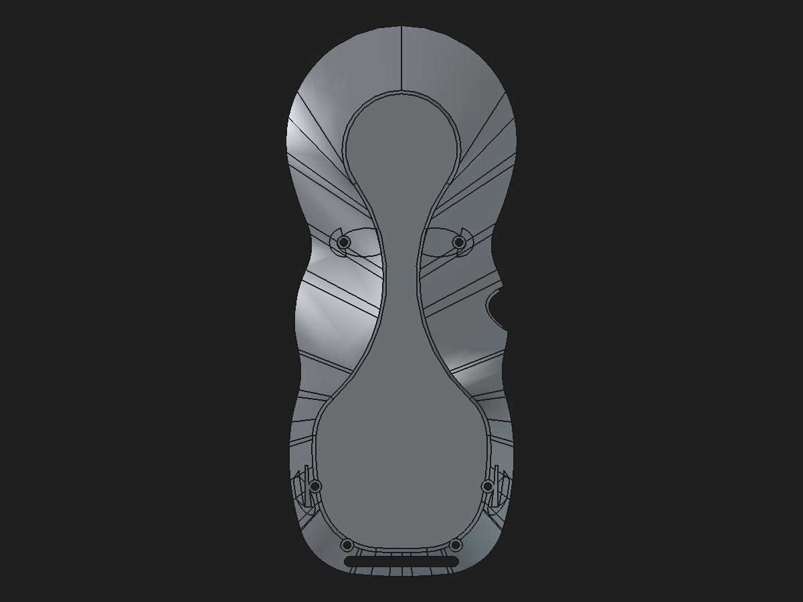
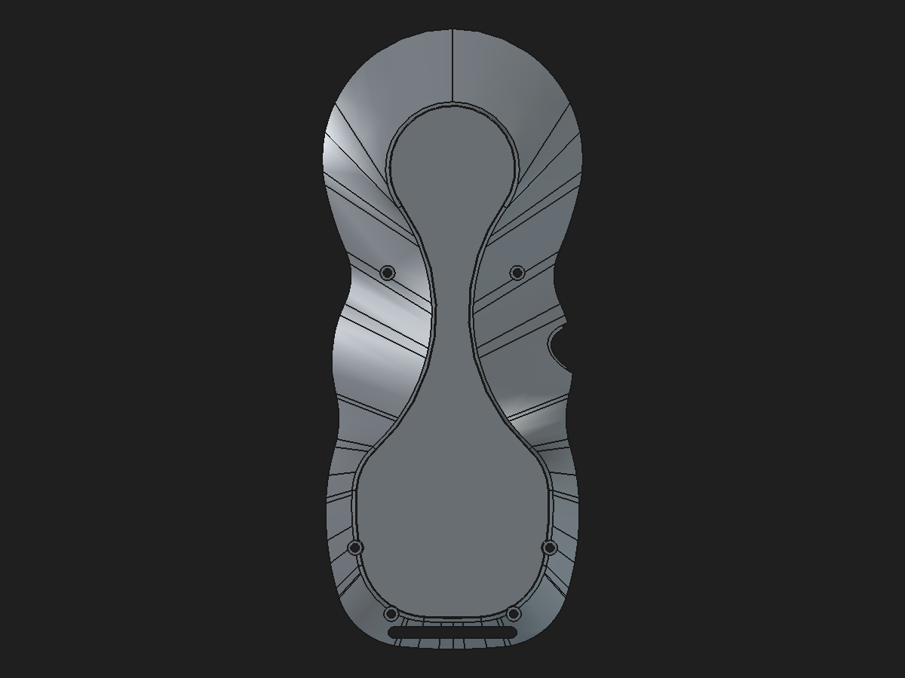

# Rear-shell load-path and bottom-perimeter fillet study

Date: 2026-10-31 · Source branch baseline: `hardware-integration` at `e96e3bf`

## Load-path material accounting

The protected monolith's saved rear-shell history measures 40,485.657428 mm³ at `Body002FullWidthSeat` and 40,961.359008 mm³ at the active `RearBossWallRamps45` Tip: a net increase of **475.701580 mm³**. The stages account for that net change as follows:

| Feature stage | Volume (mm³) | Change (mm³) | Mechanical role inferred from feature name/location |
| --- | ---: | ---: | --- |
| `Body002FullWidthSeat` | 40,485.657428 | — | Clean shell with screw bosses and seat geometry |
| `RearBossToWallLoadPaths` | 40,869.391004 | +383.733575 | Adds boss-to-wall support material at four screw bosses |
| `RearBossShoulderTransitions` | 40,854.429554 | −14.961450 | Trims/reshapes the shoulder transition surfaces |
| `RearBossWallRamps45` | 40,961.359008 | +106.929454 | Adds the final wall-ramp material |

The non-manifold edge audit localizes the defective tessellation to the same four screw-boss-to-wall regions: upper left, upper right, lower left, and lower right. It records 335 boundary edges and 12 edges incident to three facets in the final mesh; the first defect appears in `RearBossToWallLoadPaths`, with 10 more boundary edges appearing downstream. These names and locations support a structural-support purpose, but they do not establish load capacity.

The recorded defect clusters are in model coordinates:

| Boss-to-wall region | X range (mm) | Y range (mm) | Z range (mm) | Boundary edges | Three-facet edges |
| --- | ---: | ---: | ---: | ---: | ---: |
| Upper left | −28.2333 to −25.3131 | 56.4541 to 60.5113 | −23.7202 to −21.1299 | 33 | 0 |
| Upper right | 24.9780 to 27.9514 | 56.4532 to 60.5309 | −24.5359 to −21.6406 | 49 | 0 |
| Lower left | −20.2116 to −15.9498 | −22.2528 to −13.2604 | −26.1457 to −21.3817 | 185 | 5 |
| Lower right | 15.9521 to 20.7808 | −19.7778 to −13.4442 | −26.1456 to −21.0867 | 58 | 7 |

This maps the malformed tessellation to the shell material around the four screw bosses where each boss transitions into the rear wall. It distinguishes the intended support role from the defect itself: preserving a support at these locations is mechanically motivated, while the old stored-shape tessellation is not safe to keep as-is.

The existing four-rib native Pad/Pocket reconstruction reproduces the old local upper wedges within its declared triangular profile prisms (about 51.45 mm³ per side). It adds about 10.56 mm³ in each lower prism where the saved legacy Tip contains no material. The candidate is 351.666 mm³ smaller than the legacy Tip overall. Thus the omitted old shoulder/load-path geometry is not yet fully localized or mechanically classified. A direct whole-shape Boolean difference was retried on the tracked monolith; `cut` and `common` all failed with `ValueError('Null shape')`. The spatial edge map and bounded local-profile checks remain the reliable evidence. **No conclusion that the missing material is redundant is justified.**

A separate disposable cleanup probe applied OpenCascade `removeSplitter()` to the saved legacy `RearBossWallRamps45` BRep before tessellation. Reject this route: it returned an invalid shape and removed `248.110866 mm³` (`40,961.359008 → 40,713.248142 mm³`), while contracting the X/Y bounds. At 0.1 mm tessellation, the result still had 211 boundary edges and 7 edges used by more than two facets. The experiment was read-only and no CAD document was saved. It neither repairs the legacy geometry nor preserves the target solid; continue using the separately reconstructed native support candidate for mesh closure.

## Bottom contact-face finish study

A separate disposable study starts from the clean `Body002FullWidthSeat` shape, whose volume agrees with the tracked monolith to within 0.000001 mm³. A native `PartDesign::Fillet` applies **R = 0.25 mm** to the 19 edges bounding the broad lower contact face. This removes 1.335600 mm³; the result remains a valid single solid. After save, close, reopen, and recompute, the shape remains valid and its 0.12 mm tessellation has zero boundary or over-incident edges.

This study's base is a stored reference BREP; only the fillet feature is native and editable. It omits the unresolved legacy load-path/shoulder features and is **not** a replacement rear shell. The 0.25 mm treatment is therefore retained as a tested finishing option, not applied to the structural reconstruction candidate. Do not promote until the load paths are reconstructed and their clearances and wall sections are checked.

## Four-rib candidate assembly fit check

The already-saved four-rib hybrid candidate was checked against the components in `pendant-modular-repair-candidate.FCStd`. All intersections below were computed as FreeCAD shape Booleans in the saved assembly coordinate frame:

| Other component | Candidate rear-shell intersection (mm³) |
| --- | ---: |
| Front shell | 0 |
| Upper faceplate | 0 |
| Fused encoder faceplate/pocket | 0 |
| Display retainer | 0 |
| Faceplate locator A | 0 |
| Faceplate locator B | 0 |
| Breakout board | 0 |
| USB tethered cover | 0.780472 |

The same 0.780472 mm³ USB-cover intersection occurs against the clean original `Body002FullWidthSeat` base, so the native support Pads did not create or increase it. This small overlap/contact remains a separate pre-existing assembly fit issue; it has not been waived as acceptable. The support reconstruction introduced no new component collisions in this check.

Candidate: [`rear-shell-bottom-perimeter-fillet-study-2026-10-31.FCStd`](https://github.com/Cdaprod/lolin-s2-mini-cnc-mpg-pendant-controller/blob/hardware-integration/hardware/freecad/reports/rear-shell-bottom-perimeter-fillet-study-2026-10-31.FCStd)

## Visual comparison

Before: saved final shell with the defective stored-shape reinforcement chain.

After: clean pre-load-path reference with the R0.25 mm bottom-perimeter fillet.

## Preservation and next step

The protected monolith, production modular assembly, and recovery snapshots were not modified. The filtered study remains a disposable candidate. Next, compare/reconstruct the four support regions using native sketch-and-pad geometry, retaining the hanger, magnet pockets, shell mating, and screw passages. Recheck whole-shell mesh closure and local wall sections, then integrate the fillet only if the reinforced shell passes. Structural strength still needs physical testing against the specified 5× complete pendant mass; the mass is currently unknown.
