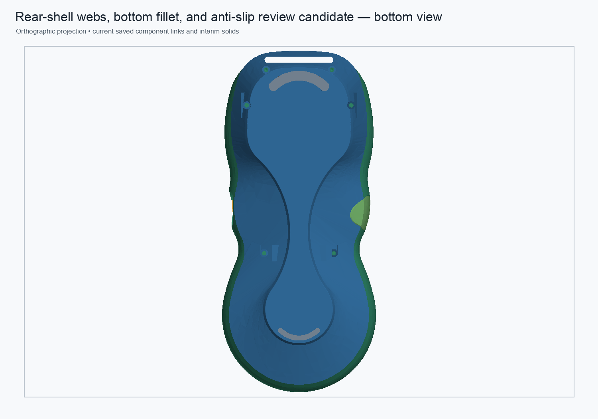

# Rear-shell cached-stage regional probe

Date: 2026-10-31  
Status: read-only diagnostic of saved cached stage shapes; no production document recomputed or saved.

## Purpose

Bounded local common-volume measurements were taken on the four boss/wall envelopes around the known non-manifold clusters. The saved monolith stages were `Body002FullWidthSeat`, `RearBossToWallLoadPaths`, `RearBossShoulderTransitions`, and `RearBossWallRamps45`. All four cached shapes were valid one-solid shapes with identity object/shape placements. Each local Boolean intersection also reported valid.

## Measurements

The diagnostic envelopes are deliberately broader than the triangle-edge clusters; their volumes include existing shell material and must not be read as the reinforcement volume alone.

| Region envelope | Clean base | Load-path stage | Shoulder stage | Ramp Tip | Stage deltas: load paths / shoulder / ramps |
|---|---:|---:|---:|---:|---:|
| Upper-left boss/wall | 3,990.7651 | 0.0000 | 3,985.5514 | 4,037.0008 | −3,990.7651 / +3,985.5514 / +51.4493 |
| Upper-right boss/wall | 3,994.4684 | 3,997.1989 | 3,989.4250 | 4,040.8959 | +2.7305 / −7.7739 / +51.4709 |
| Lower-left boss/wall | 1,407.9496 | 1,491.9650 | 1,491.9650 | 1,491.9650 | +84.0154 / ~0 / 0 |
| Lower-right boss/wall | 1,407.7406 | 1,509.5944 | 1,509.5944 | 1,509.5944 | +101.8539 / ~0 / 0 |

These stage-local measurements do **not** explain the global `+475.701580 mm³` net change. In particular, the saved `RearBossToWallLoadPaths` shape contains no material in the broad upper-left probe box, then the saved shoulder stage restores almost all of that box's base volume. The global stages remain valid one-solid BReps, but this local behavior cautions against describing the cached feature sequence as four simple additive pads. It may reflect nonlocal edits or inconsistent stored feature shapes; the probe alone cannot decide which.

The tight triangle-defect clusters remain centered at all four screw-boss-to-wall transitions as documented in [`rear-shell-nonmanifold-edge-map-2026-10-30.json`](rear-shell-nonmanifold-edge-map-2026-10-30.json). Those locations and feature labels support the intended role of boss reinforcement. The current probe is insufficient to label all `475.702 mm³` as necessary reinforcement or to identify every removed/added surface.

## Method and limits

This was a read-only headless FreeCAD run over saved shapes. It did not recompute the monolithic feature history. For each envelope, it intersected the cached shape at each history stage with an axis-aligned box surrounding the defect region. The boxes are spatial probes, not native design profiles; their full intersection volume includes the pre-existing shell and other nearby geometry. All resulting intersections passed `isValid()`.

This does not establish exact symmetric difference, intended manufactured geometry, stress capacity, or mesh repair. Continue to use the recomputing native candidate as the manifold review path while investigating the legacy stages. Preserve both the saved source and current candidate.

### Conservation check of a finer BRep box map

A follow-up 20 mm grid tiled the complete `Body002FullWidthSeat` bounding box (4 × 9 × 2 cells) and intersected every cell with both the clean base and final cached Tip. Although all individual `common()` results reported valid, the cell sums failed to conserve the parent shapes: clean-base intersections summed to `39,970.299511 mm³` versus `40,485.657428 mm³` (−`515.357918 mm³`), while final-Tip intersections summed to `45,358.083440 mm³` versus `40,961.359008 mm³` (+`4,396.724432 mm³`). The summed cell deltas were `+5,387.783929 mm³`, not the known global `+475.701580 mm³`. Some cells reported implausibly large local gains and losses.

Therefore the box-common results above are **not accepted as a material accounting map**. A valid flag on each intersection is insufficient for these cached shapes. The exact location of the global difference remains unresolved; use a validated tessellation-based occupancy method or reconstruct the suspect feature from native operations before drawing spatial conclusions.

Machine-readable measurements: [`rear-shell-cached-stage-regional-probe-2026-10-31.json`](rear-shell-cached-stage-regional-probe-2026-10-31.json).
