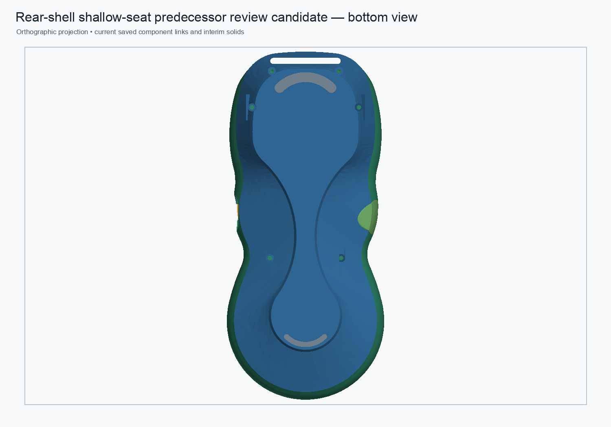
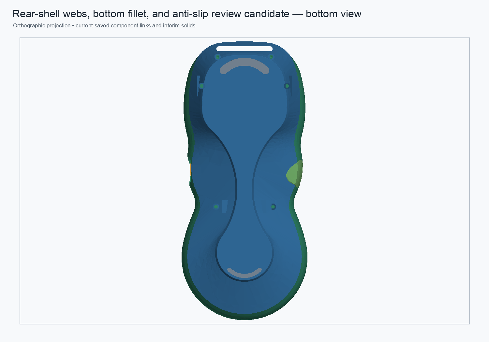

# Rear-shell combined web, bottom-fillet, and anti-slip review candidate

Date: 2026-10-31
Status: disposable native-feature review candidate; not a production replacement.

## CAD change

Combined the validated 0.25 mm native bottom-perimeter fillet and the 0.10 mm shallow crescent-seat design with the two mesh-informed lower inner-web features. The starting component was the shallow-seat candidate. Two mirrored, block-constrained sketches and 8.5 mm native PartDesign Pads were appended after its seat Pocket:

- Profile span: `y = −13.5…−22.0 mm`.
- Sketch outline, left side: `(-13.9, −18.6)`, `(-13.4, −21.15)`, `(-9.9, −25.0)`, `(-9.9, −28.7)`, `(-13.9, −28.7) mm` in X/Z; the right profile is mirrored.
- Their intended geometric role is to restore lower inner boss/web material suggested by the stored legacy mesh sections. This is a geometric hypothesis, not a validated strength claim.

The overall rear Body remains hybrid: its starting shell is an imported static BREP, the four screw-boss supports and six M2 clearances are native features, the bottom fillet is native, and the lower inner webs are now native Pads. The TPU crescents remain two separate editable PartDesign Bodies. This candidate does not make the shell fully native or independent.

## Before and after underside previews

Before: the shallow-seat predecessor, with the same shell, fillet, and anti-slip seat design but without the added inner-web Pads.

After: the combined review assembly. The new webs lie inside the shell and therefore do not change the exterior underside silhouette at this view scale.

The sampled lower inner-web section used to place the new feature is shown below. It is tessellation-derived and approximate, not an exact BREP difference.

## Validation

The candidate was recomputed, saved, closed, reopened, and recomputed. Its active Tip is `LowerRightInnerWebPad`.

| Check | Result |
|---|---:|
| Rear Body validity / solids | Valid / 1 |
| Rear volume after cold reopen | `40,847.861698 mm³` |
| Volume added over shallow-seat predecessor | `263.316136 mm³` |
| Bottom fillet | `BottomPerimeterFinish`, R = `0.25 mm`, 19 lower-contact perimeter edges, Up-to-date |
| Anti-slip seat | `AntiSlipSeatPocket`, depth `0.10 mm`, Up-to-date |
| Crescent insert Bodies | 2 valid one-solid Bodies; each has zero common volume with the shell |
| MeshPart tessellation | 92,560 facets; closed according to FreeCAD |
| Independent STL edge-incidence audit | 138,840 welded edges; 0 boundary, 0 over-incident, 0 degenerate |
| Parameter probe | Right web Pad `8.5 → 8.6 → 8.5 mm`; Tip change `+1.658228 mm³`; restore error `7.3×10⁻¹² mm³` |

The existing screw-passage diagnostic overlap remained `0 mm³` before and after the Pads. The legacy magnet-clearance diagnostic remained `168.000280 mm³` before and after; this nonzero baseline is an unresolved alignment/diagnostic limitation and is not an absolute magnet-clearance pass. The feature-chain tests do not claim structural adequacy.

A disposable review assembly now links this component. After cold reopen, all 8 App::Links resolve and the assembly root is valid with 11 solids. Shape intersection checks show no new intersection with the front shell, upper faceplate, fused encoder interim, display retainer, locators, breakout board, or USB cover. The USB-cover intersection remains the same pre-existing `0.780472 mm³`. The two anti-slip pad links remain tangent to their seats with zero common volume.

Machine-readable evidence: [`rear-shell-combined-web-fillet-anti-slip-candidate-2026-10-31.json`](rear-shell-combined-web-fillet-anti-slip-candidate-2026-10-31.json). Candidate component: [`rear-shell-webs-bottom-fillet-anti-slip-review-candidate.FCStd`](https://github.com/Cdaprod/lolin-s2-mini-cnc-mpg-pendant-controller/blob/hardware-integration/hardware/freecad/pendant-bodies/rear-shell-webs-bottom-fillet-anti-slip-review-candidate.FCStd). Candidate assembly: [`pendant-modular-rear-webs-bottom-fillet-anti-slip-review-candidate.FCStd`](https://github.com/Cdaprod/lolin-s2-mini-cnc-mpg-pendant-controller/blob/hardware-integration/hardware/freecad/pendant-modular-rear-webs-bottom-fillet-anti-slip-review-candidate.FCStd).

## Geometry difference and disposition

The protected monolith's saved legacy rear Tip remains `40,961.359008 mm³`; the combined candidate is `113.497311 mm³` lower by volume. The legacy features add a net `475.701580 mm³` over `Body002FullWidthSeat` (`RearBossToWallLoadPaths +383.733575`, `RearBossShoulderTransitions −14.961450`, `RearBossWallRamps45 +106.929454`). The current candidate's added inner webs improve the previous candidate's local lower-web coverage, but the mesh-derived section fit does not establish exact spatial equivalence. The candidate also contains the deliberate R0.25 mm perimeter removal and shallow anti-slip seat cuts. The residual volume cannot be classified as redundant or acceptable from volume alone.

The original non-manifold edge map places the defective stored-shape transitions at all four screw-boss-to-wall zones: upper-left (33 boundary edges), upper-right (49), lower-left (185 boundary and 5 three-facet edges), and lower-right (58 boundary and 7 three-facet edges). Reconstructing the supports and web features with native Pads produces a closed mesh in this candidate. This repairs exported mesh topology for the candidate but does not prove that every legacy support surface has been reproduced or that the load path meets the PLA 5× proof-load target.

Keep this as a review candidate. Do not replace the protected monolith or production assembly. Continue by mapping the remaining legacy-only/excess material at the four boss transitions and reviewing the actual screw-boss/web load path; preserve the fillet and anti-slip design while testing changes. The complete pendant mass and physical proof load remain unknown.
