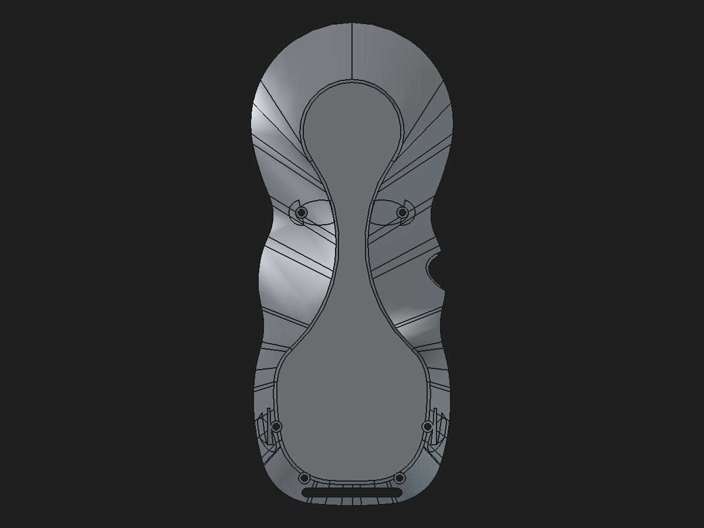

# Rear shell mesh repair and crescent-pad assembly review

Date: 2026-11-01
Status: **Validated disposable review assembly; not production-approved.**

## Visual review

Legacy rear-shell mesh with the reported open-edge defect:

Fresh-fuse structural candidate with its bottom edge treatment, screw bosses, and crescent seats:

## Validated candidate and assembly

The fresh-fuse rear shell is linked into a disposable copy of the eight-link review assembly. The rear link's original placement is preserved. The full assembly saves, closes, reopens, recomputes, and resolves all eight live links.

| Check | Result |
|---|---:|
| Reopened rear shell | Valid, one solid |
| Rear-shell volume | 40,847.861698 mm³ |
| Faces / edges | 522 / 1,509 |
| Mesh at 0.08 mm / 0.35 rad | 16,050 facets |
| Boundary / over-incident / degenerate mesh edges/facets | 0 / 0 / 0 |
| Upper and lower anti-slip pad overlap with shell | 0 mm³ each |
| Upper/lower exposed pad-face normal angle | 0° |
| Upper/lower exposed pad-face plane separation | < 4×10⁻¹⁴ mm |
| Linked components after reopen | 8, all valid |
| Reversible `UpperBossXAbs` change, 24.8 → 24.9 → 24.8 mm | Propagated and restored exactly by volume |
| 0.25 mm bottom perimeter fillet | 19 selected edges; native feature in the validated shell chain |

The two crescent pads are separate linked solids with zero positive-volume intersection against the rear shell. Their exposed faces share the plane `0.043619 y + 0.999048 z = −34.209199 mm` (within numerical tolerance), so the Z-coordinate difference between the pads is the intended roughly 2.5° slope, not a contact-height mismatch. This establishes geometric coplanarity; real-world grip and TPU compression still need physical evaluation.

## Focused defect probes

Two bounded experiments were run in disposable in-memory copies and discarded:

1. Setting `FinishOrder_UpperLeftSupportPad.Refine=False` kept that pad at the inherited 12 BOP warnings instead of increasing the count to 38. Later native features returned the final count to 42, equal to the original review chain. Final volume shifted by about `+0.00000008 mm³`; it did not repair the final BRep and was not promoted.
2. Setting the source `USBConformalCoverSeatBody002.Refine=True` changed face/edge topology, while the source hanger-pocket and fresh-union results still carried 12 BOP warnings. The USB-side invalid-curve issue therefore remains; this option was not promoted.

These probes do not alter the saved candidate or protected files. The first Pad-local warning increase is caused by its refined union with the inherited base; the USB Boolean refine toggle did not clear the inherited cylindrical invalid-curve warnings.

## Structural geometry and the 475.702 mm³ difference

The `475.701580 mm³` figure remains the net volume delta between cached legacy feature outputs. Its feature roles are the boss-to-wall reinforcement chain: load-path webs (`+383.733575 mm³`), shoulder transition (`−14.961450 mm³`), and wall ramps (`+106.929454 mm³`). It is not an exact material-difference measurement because the legacy saved tip mesh is open and its BReps fail deeper checks.

The candidate retains reinforcement with native PartDesign support and inner-web Pads and keeps the screw passages and magnet pockets. The support geometry is not being discarded. The existing 0.5 mm occupancy sampling localizes portions around the four screw-boss regions, but the exact remainder remains unresolved. PLA load capacity and the 5× complete-pendant proof load have not been established.

The candidate's mesh is manifold, but its deeper BOPCheck still reports 42 invalid-curve-on-surface errors, inherited from the fresh base and reinforcement transitions. A manifold tessellation and a BRep geometry check are different validations; the BRep warnings remain a limitation.

## Disposition

The candidate demonstrates a model-level repair path: a fresh fused base followed by native structural reinforcement, M2 passages, lower webs, the previously validated 0.25 mm bottom fillet, and shallow crescent seats produces a valid single solid and a closed, manifold mesh after save/reopen. Its base is still a stored-shape `PartDesign::Feature`, so this is a hybrid review component rather than an independently regenerating native shell.

The protected monolith and production modular assembly were not modified. Keep this review assembly disposable until the BRep warnings, material-difference localization, structural strength, and shell interface have been addressed.

## Reproducible artifacts

- [Review assembly](https://github.com/Cdaprod/lolin-s2-mini-cnc-mpg-pendant-controller/blob/hardware-integration/hardware/freecad/pendant-modular-fresh-fuse-tpu-crescent-review-2026-11-01.FCStd)
- [Fresh-fuse component](https://github.com/Cdaprod/lolin-s2-mini-cnc-mpg-pendant-controller/blob/hardware-integration/hardware/freecad/pendant-bodies/rear-shell-fresh-fuse-structural-review-2026-11-01.FCStd)
- [Assembly builder and validator](../scripts/integrate_rear_fresh_fuse_review_assembly.py)
- [Machine-readable validation](rear-shell-fresh-fuse-crescent-assembly-review-2026-11-01.json)
- [Fresh-fuse candidate validation](rear-shell-fresh-fuse-structural-review-2026-11-01.md)
