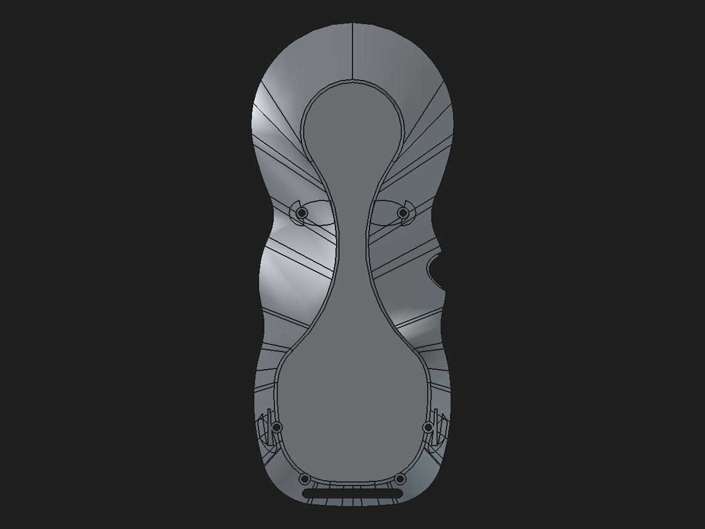
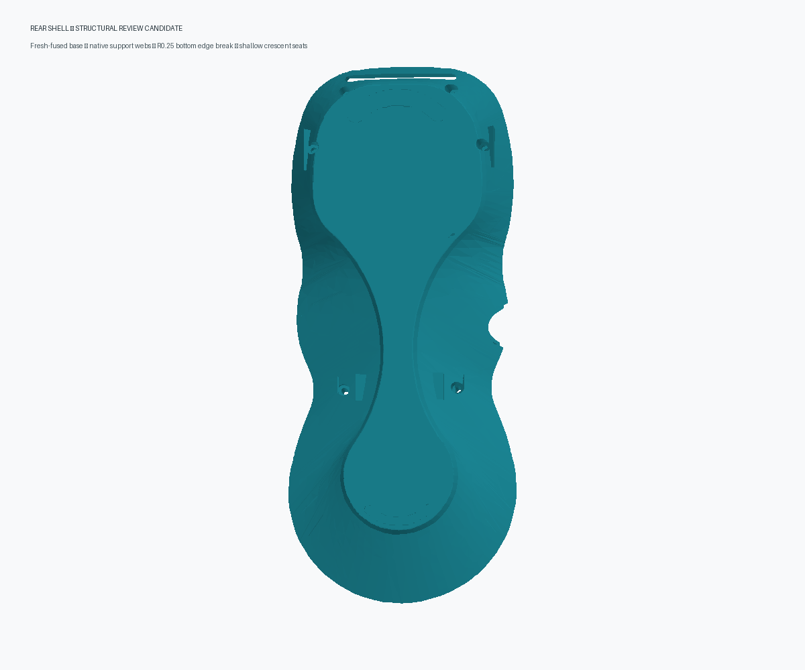

# Rear shell: fresh-fused base and structural finish review

Date: 2026-11-01  
Status: **Validated disposable review candidate. Do not replace the protected monolith or production assembly.**

## Candidate preview

The legacy saved rear shell is the model associated with the reported mesh defect. Its stored Tip shows the boss-to-wall construction and transition seams around the screw regions:

The disposable candidate below uses a freshly fused base, native support and web features, the previously validated R0.25 mm bottom-perimeter fillet, and shallow crescent anti-slip seats:

## What changed

The candidate starts from a new FreeCAD fuse of the saved `SmallHangerPocketBody002` and `Body002FullLandTransferTool` shapes. It does not use `removeSplitter()` or `Shape.fix()`. The resulting base has the same global bounds as the previous clean base and changes its saved volume by only `+0.040520 mm³`.

The candidate then recomputes the existing native sequence: four boss-to-wall support Pads, the M2-passage Pocket, two lower inner-web Pads, a 19-edge bottom-perimeter Fillet at `R0.25 mm`, and the `0.10 mm` crescent-seat Pocket. The six support sketches remain fully constrained and their 21 dimensions remain component-local spreadsheet parameters feeding 42 expressions.

## Validation

| Check | Fresh-fuse candidate |
|---|---:|
| Cold-open Body Tip | `FinishOrder_AntiSlipSeatPocket`, up to date |
| Final shape | Valid, one solid |
| Final volume / area | `40,847.861698 mm³` / `30,826.046428 mm²` |
| Final faces / edges | 522 / 1,509 |
| Bounds | `X −39.910…39.879`, `Y −88.312…86.688`, `Z −36.894…0 mm` |
| Mesh at 0.08 mm / 0.35 rad | 16,050 facets; closed |
| Mesh boundary / over-incident edges | 0 / 0 |
| Degenerate facets | 0 |
| BRep `Shape.check(runBopCheck=True)` errors | 42 |
| Prior review candidate BRep check errors | 352 |

The fresh base reduces BRep-check errors from 336 to 12. The native finishing chain raises that count to 42; this candidate is therefore **not BRep-clean**. The STL-style mesh generated from the cold-reopened Tip is manifold under the edge-incidence check, which addresses the slicer-reported non-manifold mesh symptom for this candidate. These two checks are distinct.

A disposable `Refine=False` probe on the support Pads was rejected: it reduced the first Pad's local BRep error count, but applying it across the full support/web chain raised the final count from 42 to 48. The verified `Refine=True` settings are retained.

### Where the remaining BRep errors are located

Face-level BOP checks localize the fresh-base candidate's inherited 12 errors to three cylindrical faces around the side USB tether passage/conformal seat, centered on the X axis at approximately `Y=3.031`, `Z=−13.445 mm` (radii `7.75`, `9.0`, and `10.25 mm`). The same surfaces occur in `USBEnclosureTetherPassage`, `USBConformalCoverSeatBody002`, `SmallHangerPocketBody002`, and `Body002FullLandTransferTool`. This issue is separate from the 475.702 mm³ cached volume delta, which belongs to the rear screw-boss load-path/shoulder/ramp stages.

The final candidate's 42 BOP error lines also localize to cylindrical faces around the screw-boss/support regions. The extra reported lines relative to the base are associated with those mounting regions and nearby blends. The trace identifies where to investigate next; it does not prove these surface errors caused the original open mesh or justify deleting reinforcement. The native mesh remains manifold despite these deeper BRep warnings.

I rebuilt `SmallHangerPocketBody002` as a native `PartDesign::Pocket` in an isolated disposable document using the same 4-geometry, 14-constraint fully constrained sketch and the saved 22 mm one-sided Pocket settings. The rebuilt result matched the saved shape's volume (`−1.46×10⁻¹¹ mm³` delta), area (`−3.64×10⁻¹² mm²` delta), 191 faces, 545 edges, and 8,908-facet mesh signature. It still reported the same 12 BOP errors. No document was saved or changed. This rules out a stale Pocket shape as the explanation and shows that rebuilding only the hanger Pocket does not repair the upstream invalid surface geometry; no such rebuild was promoted.

The final volume, area, face count, and edge count match the previous review candidate's measured values. This supports preservation at the measured level but does not establish exact BRep identity. The production monolith and modular assembly were not modified.

### Disposable assembly fit check

I replaced the rear-shell link in memory in the saved eight-link review assembly, preserved its original `LinkPlacement`, recomputed, and checked positive-volume intersections. The root remained a valid 11-solid assembly and the rear link remained one valid solid. The rear shell had zero common volume with the front shell, upper faceplate, fused encoder interim, display retainer, both faceplate locators, breakout board, and both TPU crescent inserts. The existing USB cover engagement remained `0.780472 mm³`.

I also changed the component-local `UpperBossXAbs` parameter from `24.8` to `24.9 mm`, then restored it. The component Tip and assembly link both changed by `−1.483425 mm³`; the assembly root changed by `−1.483451 mm³`. Restoring the parameter returned the component and link volumes exactly to baseline and the root within `3e−11 mm³`. This was a read-only in-memory check; the review assembly was not saved. It confirms this parameter reaches the linked assembly, but does not establish physical fit, tolerance margins, or structural capacity.

## What the 475.702 mm³ figure means

`475.701580 mm³` is the **net volume difference between saved cached Shapes** for `RearBossWallRamps45` and `Body002FullWidthSeat`:

| Saved stage | Volume change from previous stage |
|---|---:|
| `RearBossToWallLoadPaths` | `+383.733575 mm³` |
| `RearBossShoulderTransitions` | `−14.961450 mm³` |
| `RearBossWallRamps45` | `+106.929454 mm³` |

These features serve the screw-boss load path: they add boss-to-wall webs and shoulders around the mounting regions and ramp those transitions into the enclosure wall. The 475.702 figure is **not** an exact material symmetric difference because the saved legacy Tip has an open mesh and the source BReps fail BOPCheck.

The existing 0.5 mm occupancy sampling estimates about `262.875 mm³` of net changed occupancy in the four boss-to-wall regions, but it cannot classify exact solid material while the legacy mesh is open. In the native reconstruction, the upper wedges match the legacy Tip only inside their declared local prisms. Each lower web introduces about `10.56 mm³` in a local region where the saved legacy Tip had no sampled solid. The rest of the discrepancy remains spatially unresolved. No material has been declared redundant, and the strength of the changed load paths has not been established.

## Disposition and next work

This is a tangible mesh repair candidate: it recomputes, saves, reopens, and produces a closed manifold mesh while retaining editable native support/web features and the bottom finish. It is still a **hybrid component** because its starting shell base is a stored-shape feature; it is not an independently regenerating native shell, and it is not production-approved.

Next, continue the structural investigation around the four screw bosses and wall ramps. Reconcile the approximate occupancy regions with intended contact, wall thickness, and screw clearances, then improve the inherited 12 invalid curve-on-surface errors and 30 errors introduced by the native reinforcement/finish chain. Keep the production shell and assembly unchanged until the candidate has a mechanically justified geometry comparison and the broader assembly clearances are revalidated.

Structural capacity, including the PLA 5× complete-pendant proof-load target, remains unverified.

## Files

- Review component: [`rear-shell-fresh-fuse-structural-review-2026-11-01.FCStd`](../pendant-bodies/rear-shell-fresh-fuse-structural-review-2026-11-01.FCStd)
- Rebuild script: [`build_rear_shell_fresh_fuse_structural_review.py`](../scripts/build_rear_shell_fresh_fuse_structural_review.py)
- Machine-readable results: [JSON validation](rear-shell-fresh-fuse-structural-review-2026-11-01.json)
- Earlier validated bottom-fillet evidence: [R0.25 mm fillet validation](rear-shell-bottom-perimeter-fillet-validation-2026-10-31.md)
