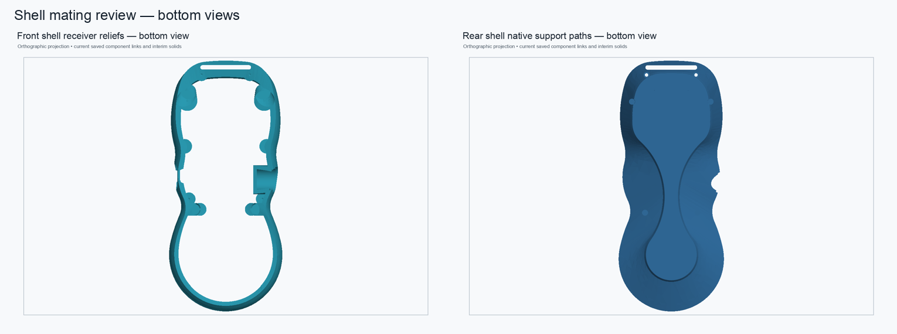

# Rear-shell load-path receiver review — 2026-11-01

Status: **validated disposable mating-review candidate; not production-approved.** The protected monolithic pendant and production modular assembly were not modified.

## Bottom-side previews

The front shell now has four parametric receiving reliefs for the rebuilt rear-shell boss-to-wall supports. The rear view shows the native support lofts, screw passages, R0.25 mm perimeter fillet, and shallow crescent-pad seats.

## What was causing the shell clash

The clean fused rear-shell base has **0 mm³** common volume with the original front shell. The clash is introduced by the four rebuilt support lofts. Their direct intersections with the front-shell BREP were measured at:

| Rear support path | Intersection with original front shell |
| --- | ---: |
| Middle left | 175.524 mm³ |
| Middle right | 175.221 mm³ |
| Lower left | 63.312 mm³ |
| Lower right | 63.312 mm³ |
| **Total** | **477.368 mm³** |

These supports bridge the rear screw bosses to the rear shell wall. The earlier **475.702 mm³** figure was a net difference across multiple historical stages; it was not a removable lump of redundant material. The support paths are retained in this candidate.

## Candidate geometry

The front receiver is built as four native, fully constrained `PartDesign::SubtractiveLoft` operations on a clearly labeled imported front-shell BREP baseline. Its sketches expose radial clearances through the local `Parameters` spreadsheet:

- Middle support roots: **0.40 mm** radial clearance.
- Lower support roots: **0.25 mm** radial clearance.
- All support wall ends: **0.40 mm** radial clearance.
- Receiver mouths start at the front shell's original underside plane, **Z = −19.0 mm**.
- Receiver end profiles stop at the corresponding rear support wall planes, **Z = −15.6 mm** for the middle paths and **Z = −14.9 mm** for the lower paths.

The front shell remains a valid single solid and keeps its original outer bounds to within **1.4 × 10⁻¹⁰ mm**. The receiver cuts remove **549.005 mm³** from the 37,683.517 mm³ front-shell baseline, about **1.46%**. That is an intentional change to the mating interface and needs design review; it is not a geometry-preserving refactor.

The four modeled screw-engagement check cylinders (R1.15 mm, Z = −14 to 0) intersected the baseline and candidate front shells by the same **125.149857 mm³**. The cuts therefore leave the tested upper engagement zone unchanged. This CAD volume check does not verify screw fit, torque, material strength, or print tolerance.

The front shell, rear shell, and four receiver lofts remain one valid solid each. At the recorded 0.12 mm / 0.18 rad mesh settings, the front baseline and modified front each had **0 boundary and 0 overincident edges**; the rear candidate had **0 and 0**. The front mesh check is a before/after comparison and does not substitute for the separate repair of the rear-shell export.

## Validation results

- Rear/front shell common volume after receiver cuts: **0 mm³** in the saved review assembly.
- Both shell links resolve after a cold open; both preserve their original identity placements.
- The shell module contains two live shell links and no static front/rear shell placeholders.
- The full assembly has **7 live links** and retains two unrelated static interim components: the upper faceplate and the fused encoder faceplate/pocket.
- All eight receiver sketches are fully constrained; all four lofts recompute as valid single-solid features.
- The front shell saved, closed, reopened, and recomputed as a valid single solid.
- Reversible spreadsheet probe: middle-root clearance 0.40 → 0.45 → 0.40 mm changed front volume by −2.799 mm³ and restored it within **7.3 × 10⁻¹² mm³**.
- The same reversible edit refreshed through the assembly link and restored within **7.3 × 10⁻¹² mm³**.
- The front bounding box and tested screw-engagement volume are unchanged.

Several overlaps with other assembled parts remain. Their measured volumes match the original assembly, so this shell change did not create them, but they still need an intentional-fit review:

| Pair | Original assembly overlap | Review assembly overlap |
| --- | ---: | ---: |
| Front shell / USB tethered cover | 5.483 mm³ | 5.483 mm³ |
| Rear shell / USB tethered cover | 0.780 mm³ | 0.780 mm³ |
| Front shell / upper faceplate | 12.956 mm³ | 12.956 mm³ |
| Front shell / fused encoder faceplate-pocket | 4.049 mm³ | 4.049 mm³ |
| Front shell / locator B | 37.710 mm³ | 37.710 mm³ |

No conclusion is made here about whether these existing overlaps are intended contact, fit allowance, or interference.

## Remaining limits

- The front component is a hybrid review component: the original front-shell shape is an imported BREP baseline; the new receiver cuts are editable native PartDesign features.
- The rear component also retains a stored fused BREP base, followed by native load-path lofts and finishing features.
- The rear BREP remains `Shape.isValid()` and its exported mesh is closed, but the earlier BOP check reported 42 findings, 12 already present in the fused base. This is not a BOP-clean production shell.
- No FEM analysis or physical load test was performed. The complete pendant mass is still unknown, so the 5× proof-load target is unverified.
- This candidate proves shell-to-shell geometric clearance at the measured CAD state. It does not establish print fit, adequate remaining wall thickness under load, or long-term PLA strength.

## Files

- [Front shell receiver component](../pendant-bodies/front-shell-rear-loadpath-receiver-r0p4-review-2026-11-01.FCStd)
- [Linked assembly review](../pendant-modular-rear-loadpath-receiver-r0p4-review-2026-11-01.FCStd)
- [Rear shell native load-path component](../pendant-bodies/rear-shell-native-loadpath-manifold-review-2026-11-01.FCStd)
- [Machine-readable validation](rear-shell-loadpath-receiver-review-2026-11-01.json)
- [Repeatable cold-open validator](../scripts/validate_rear_shell_receiver_review.py)
- [Earlier rear-shell reinforcement/manifold study](rear-shell-native-loadpath-manifold-review-2026-11-01.md)

The review assembly replaces the two shell placeholders only in this separate candidate file. Keep the production assembly and original pendant unchanged until the remaining shell thickness, existing component overlaps, topology findings, and load requirements receive their own review.
