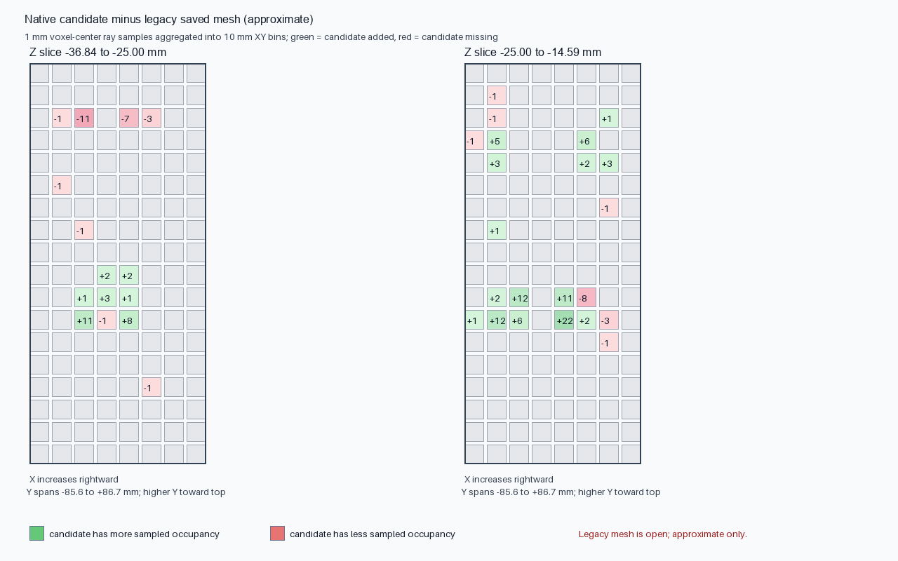

# Rear-shell lower-web magnet and screw clearance validation

Date: 2026-10-31  
Candidate: `rear-shell-webs-dimensioned-sketches-review-candidate.FCStd`  
Status: disposable hybrid component; clearance validation only, not production-approved.

## Measured geometry

Each lower-web profile is a fully constrained native sketch at `Y = −13.5 mm`, extruded 8.5 mm toward `−Y` as a PartDesign Pad. Reconstructing the raw profile prisms directly from the sketch wires gives `204.85 mm³` per side before fusion with the base shell. The resulting PartDesign Body remains one valid solid with its `LowerRightInnerWebPad` Tip after recomputation.

## Keep-out checks

The original monolith's removed-volume tools were reconstructed from the saved pre-pocket and post-pocket feature shapes. The M2 tool uses `RearTaperedSeats.Shape − Pocket018.Shape`; the magnet tools use `Pad007.Shape − Pocket.Shape` and `Pad019.Shape − Pocket015.Shape`. Each raw web-prism BRep was checked against those tools using OpenCascade common-volume and minimum-distance queries.

| Raw web prism | Magnet-clearance tool | Magnet-slot tool | Six M2 passage tool |
|---|---:|---:|---:|
| Left | `0 mm³` common; `60.515 mm` min distance | `0 mm³` common; `18.661 mm` min distance | `0 mm³` common; `2.950 mm` min distance |
| Right | `0 mm³` common; `60.515 mm` min distance | `0 mm³` common; `18.661 mm` min distance | `0 mm³` common; `2.950 mm` min distance |

All common results and all cutter shapes were valid. The magnet-slot tool is the relevant nearby magnet keep-out; the larger clearance-tool volumes are remote from these lower profiles. The candidate retains the source magnet geometry, and neither new pad fills the slot or crosses a screw passage.

## Scope and disposition

The candidate still has its known legacy-geometry discrepancy and does not have validated structural capacity. This check confirms only that the two new lower-web profiles do not intersect the original magnet-slot or M2 passage cut volumes. It does not validate magnet retention, shell mating, or the 5× PLA proof-load target.

Keep the component in review status. The full source/candidate mesh comparison and its limits are recorded in [`rear-shell-mesh-occupancy-localization-2026-10-31.md`](rear-shell-mesh-occupancy-localization-2026-10-31.md). Machine-readable results: [`rear-shell-lower-web-clearance-validation-2026-10-31.json`](rear-shell-lower-web-clearance-validation-2026-10-31.json).

The audit is reproducible with [`validate_rear_shell_lower_web_clearances.py`](../scripts/validate_rear_shell_lower_web_clearances.py). It opens the source and disposable candidate in a fresh FreeCADCmd process, recomputes the candidate in memory, checks the raw profile prisms against the original pocket tools, and closes without saving either CAD file. The 2026-10-31 headless run passed with the values above.

The same run now checks the recomputed Tip's tessellated edge incidence at 0.1 mm linear deflection, merging vertices within `1e-6 mm`. It produced 91,066 triangles and 136,599 unique edges; every edge had exactly two incident facets, with zero boundary edges, zero over-incident edges, and zero degenerate triangles. This is candidate mesh-topology evidence after a fresh open/recompute; it is not a structural rating and does not establish equivalence to the defective cached source mesh.

It also checks the two separate crescent insert Bodies in this combined candidate. Their downward-facing planar contact faces recompute as valid, one-solid pads with parallel normals and a plane-offset difference of `2.84×10⁻¹⁴ mm` (coplanar to numerical precision); measured contact areas are `165.094 mm²` upper and `60.503 mm²` lower. This confirms the designed tilted tabletop/contact datum is continuous across both pads, not that the material has a measured friction coefficient or verified holding force.
