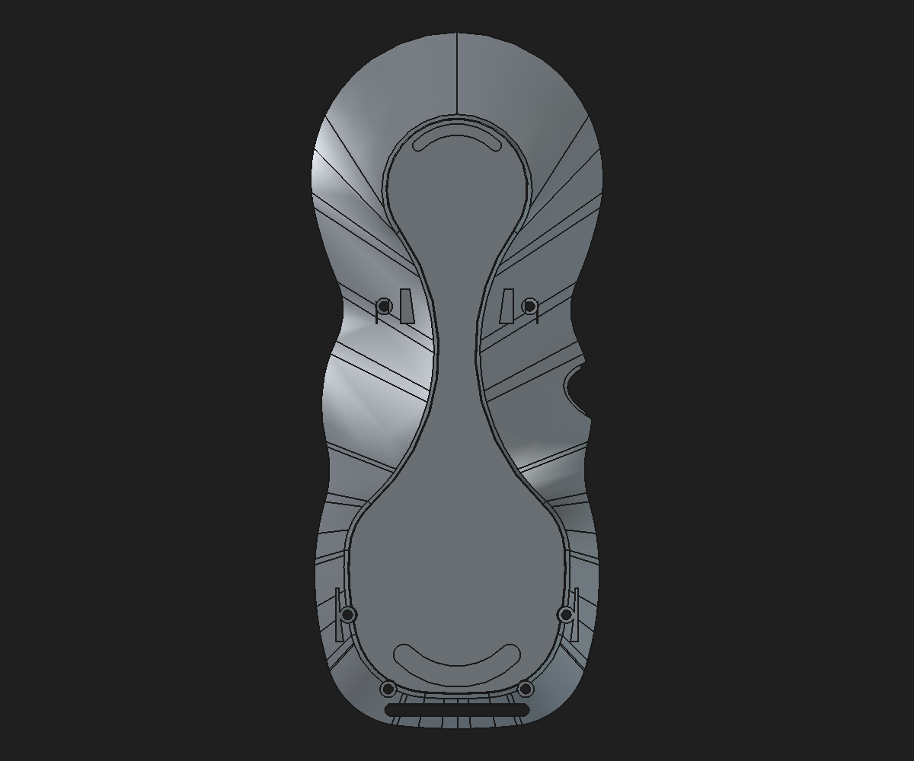

# Rear-shell lower-web named-parameter review

Date: 2026-10-31

Status: validated disposable CAD study; not production-approved

## Change

Bound the two existing fully constrained lower inner-web profiles and their 8.5 mm PartDesign Pad spans to a local spreadsheet named **Lower rear web parameters**. The 11 aliases describe five mirrored profile points and the shared Pad span. Both sketches retain their native constraints and coordinate frames; the rear shell remains based on the previously validated clean-base candidate.

## Validation

- Both web sketches remained fully constrained.
- Baseline recompute produced one valid Body solid: `40,847.861700 mm³`, 522 faces, 1,509 edges.
- Increasing `LowerWebPadSpan` reversibly from 8.5 to 8.6 mm changed the downstream Tip volume by `+3.316438 mm³`; restoring 8.5 mm returned to the original measured volume with zero reported restoration error.
- Save, close, reopen, and recompute passed. The reopened Body remained a valid single solid, and a mesh generated from a copied shape was closed with 16,020 facets.
- The reopened volume differs from the in-session value by about `0.0000024 mm³`, within recompute/serialization rounding; face count, edge count, and bounds match.
- No production document was opened for saving or modified.

The reusable builder is [`build_rear_shell_lower_web_named_parameter_review.py`](../scripts/build_rear_shell_lower_web_named_parameter_review.py); it refuses to overwrite its output and supports a new destination through `PENDANT_LOWER_WEB_OUTPUT`. Machine-readable measurements are in [JSON](rear-shell-lower-web-named-parameter-review-2026-10-31.json).

## Relationship to the unresolved reinforcement issue

This is a parametric-editability improvement to the existing lower-web candidate. It does **not** account for or classify the legacy `+475.701580 mm³` stored-stage difference, and it does not establish that the candidate is an equivalent replacement for the protected rear shell. The legacy stored reinforcement chain remains defective in the exported mesh; this report does not claim to repair it. The bottom R0.25 mm fillet remains the previously validated study feature and is not promoted to the production model.

No structural load rating is inferred. The 5× complete-pendant proof-load target remains unverified pending a measured complete assembly mass, load/contact assumptions, and physical testing.
