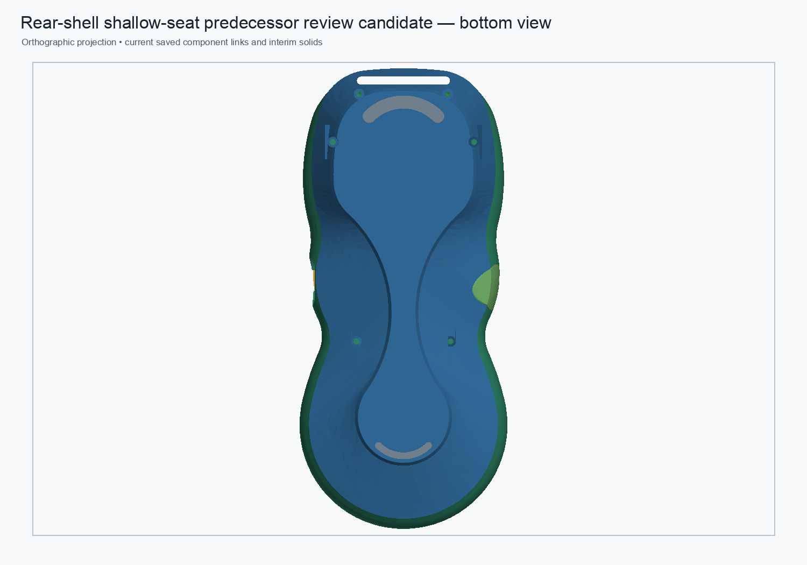
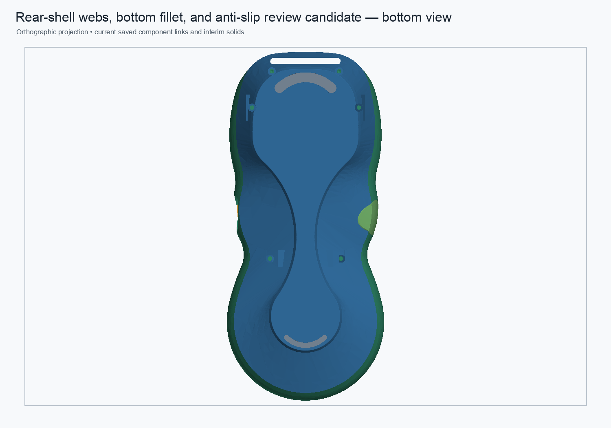

# Rear-shell lower-web sketch editability and linked refresh

Date: 2026-10-31  
Status: disposable review candidates; no production replacement.

## Change

Replaced the two lower inner-web profile sketches' per-segment `Block` constraints with connected line geometry and named native dimensional constraints. Each profile now has five Coincident constraints and ten named X/Z dimensions (`WebP0X`…`WebP4Z`); both sketches remain fully constrained. The native 8.5 mm PartDesign Pads, R0.25 mm bottom-perimeter fillet, and 0.10 mm anti-slip seats are retained.

This changes how the candidate sketches are edited, not their intended shape. It does not parameterize them from the master spreadsheet and does not resolve the candidate shell's remaining difference from the legacy saved Tip.

## Candidate preview

The candidate geometry is unchanged from the combined review candidate, so the same-view assembly previews below show its appearance. New features are internal lower webs and are not distinguishable in this underside overview.

## Validation

The dimensioned-sketch component was recomputed, saved, closed, reopened, and recomputed in a fresh FreeCAD process. Both sketches were fully constrained (15 constraints each) and up-to-date; the Body Tip remained `LowerRightInnerWebPad`.

| Check | Result |
|---|---:|
| Rear Body | Valid, one solid |
| Cold-reopen Tip volume | `40,847.861698 mm³` |
| Surface area / faces | `30,826.046429 mm²` / 522 |
| Bounds | Match the preceding combined review candidate |
| Tessellation | 92,560 facets; closed |
| Independent STL incidence audit | 138,840 welded edges; 0 boundary, 0 over-incident, 0 degenerate |
| Reversible sketch edit | `WebP0X −13.9 → −13.8 → −13.9 mm`; Tip delta `−1.546598 mm³`; restored volume error `0` |

STL hashes for the preceding and dimensioned-sketch candidates differ, so byte identity is not claimed. Their measured volume, area, bounds, face count, and tessellation facet count agree; the geometry-preserving judgment is based on these metrics and the reversible constraint edit, not the hashes.

## Assembly refresh validation

The disposable linked assembly was cold-opened at the original component state (linked rear volume `40,847.861698 mm³`). The component's `WebP0X` dimension was changed to −13.8 mm and saved; after cold-opening the assembly, the live link updated to `40,846.315100 mm³` (delta `−1.546598 mm³`, one valid solid). Restoring −13.9 mm and refreshing again returned the linked volume exactly to `40,847.861698 mm³`. The final assembly root is valid with 11 solids, eight links, and no broken links.

## Disposition and remaining work

Keep both files as review candidates. The edits make the lower-web sketches meaningfully dimension-editable and verify that component save/refresh propagates through the link. They do not establish exact reconstruction of the legacy boss-to-wall material, structural adequacy, magnet clearance, or assembly approval. The unresolved lower-web/legacy geometry difference and PLA 5× proof-load target remain open. Continue with a localized material map and load-path review before integrating this candidate into the production assembly.

Candidate component: [`rear-shell-webs-dimensioned-sketches-review-candidate.FCStd`](https://github.com/Cdaprod/lolin-s2-mini-cnc-mpg-pendant-controller/blob/hardware-integration/hardware/freecad/pendant-bodies/rear-shell-webs-dimensioned-sketches-review-candidate.FCStd).  
Disposable linked assembly: [`pendant-modular-rear-webs-dimensioned-sketches-review-candidate.FCStd`](https://github.com/Cdaprod/lolin-s2-mini-cnc-mpg-pendant-controller/blob/hardware-integration/hardware/freecad/pendant-modular-rear-webs-dimensioned-sketches-review-candidate.FCStd).  
Prior geometry and fillet validation: [`rear-shell-combined-web-fillet-anti-slip-candidate-2026-10-31.md`](rear-shell-combined-web-fillet-anti-slip-candidate-2026-10-31.md).
