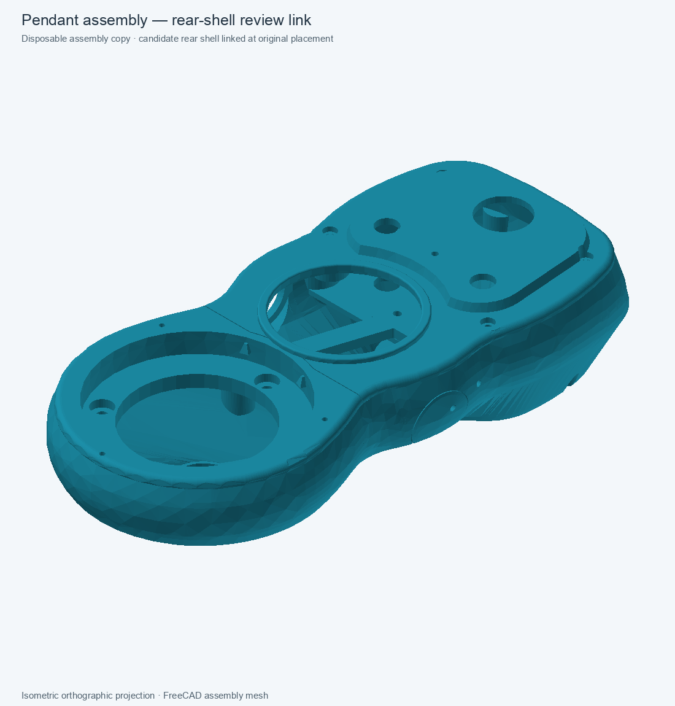

# Rear shell — linked assembly review

Status: **validated disposable link/refresh candidate with a failed front-shell fit check; not production-approved.** The candidate replaces the rear-shell live link in a copy of the combined finishing assembly. The protected production assembly and monolithic baseline remain unchanged.

## Preview

The view comes from the saved FreeCAD assembly candidate. The rear shell remains a review component with a stored-shape base and native downstream features.

## Validation

- Cold-opened and recomputed the candidate assembly with **all nine `App::Link` objects resolved**.
- The assembly root remains a valid 11-solid compound.
- The replacement rear-shell link preserves its previous `LinkPlacement` and is one valid solid.
- Both separate crescent pad links have zero-volume intersection with the replaced rear shell.
- The `BottomPerimeterFilletRadius` spreadsheet alias propagates through the external component link: 0.25 → 0.30 mm changed the linked rear-shell volume by −0.589326 mm³; restoring 0.25 mm returned it within 3×10⁻¹¹ mm³ and restored the valid 11-solid root.
- The linked component exports a manifold mesh with zero boundary or over-incident edges, as recorded in the component report.
- The full pairwise fit check found **300.811621 mm³ of overlap with the front-shell representation**. The original rear link in the source assembly had 0 mm³ of overlap with that same front shell. This is a new interference in the candidate; the assembly passes link/recompute checks but **fails shell mating clearance**.
- The candidate rear shell also overlaps the USB cover by 0.780472 mm³. This contact was present in earlier clean-base studies, but has not been shown equivalent for this new geometry.

## Still under investigation

The rear-shell component is not yet a production replacement: its base is a stored shape, it has the front-shell interference above, its final BRep still reports 42 OpenCascade BOP findings, and no structural capacity is claimed. Two disposable healing probes were rejected. `removeSplitter()` on the clean fused base increased BOP findings from 12 to 26. `Shape.fix(0.01, 0.001, 0.1)` left the base at 12 findings and the pre-seat reinforced shell at 40; it made only a 0.026 mm³ volume change and did not solve the topology issue. Neither probe was saved into the candidate.

The pairwise Boolean on the front shell exceeded the bounded recompute budget during a stage-localization attempt, so the exact first offending feature is not established. No full load test, FEM result, or 5× complete-pendant proof-load validation is included.

## Files

- [Disposable linked assembly](../master-driven-leadins-candidate/pendant-modular-combined-finishing-native-loadpath-review-2026-11-01.FCStd)
- [Rear-shell component review](../pendant-bodies/rear-shell-native-loadpath-manifold-review-2026-11-01.FCStd)
- [Component validation report](rear-shell-native-loadpath-manifold-review-2026-11-01.md)
- [Machine-readable assembly validation](rear-shell-native-loadpath-assembly-review-2026-11-01.json)

## Next step

Continue by localizing the front overlap without repeating broad full-history recomputes. Keep the assembly candidate disposable until the BRep topology and front/rear mating clearances are resolved.
