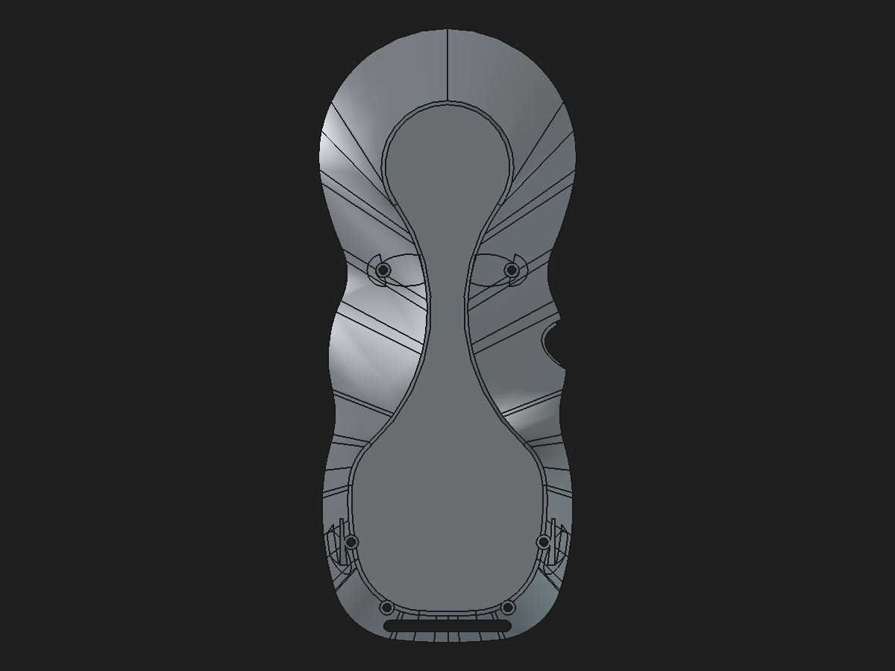
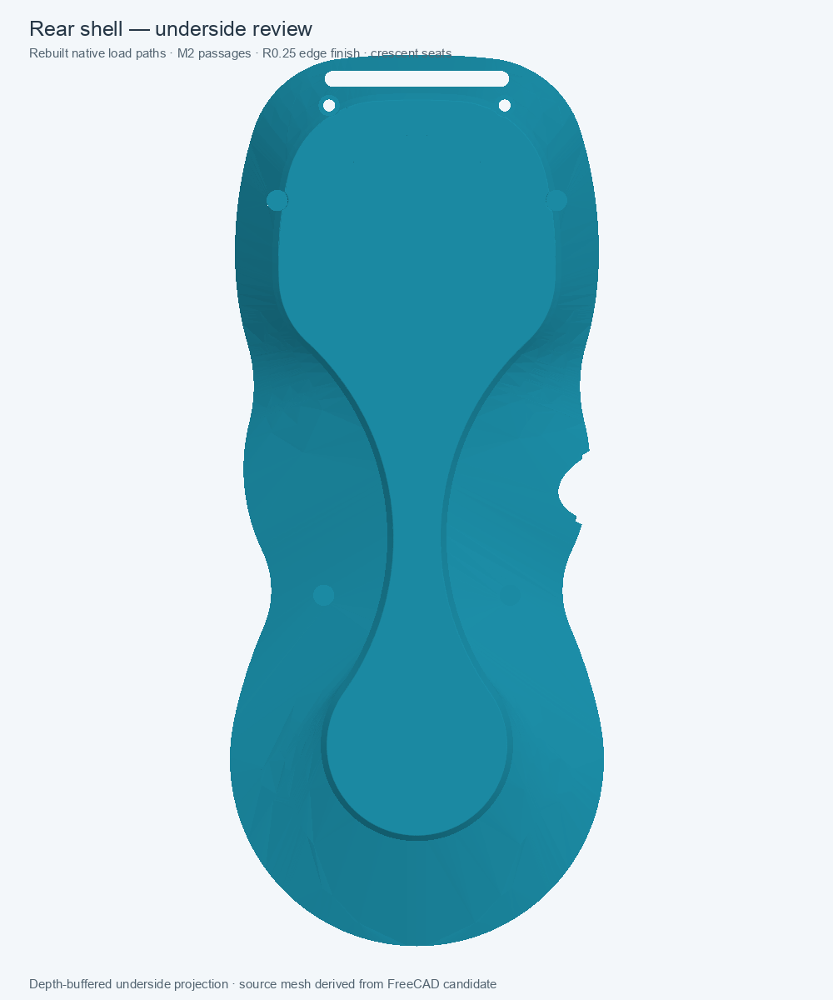

# Rear shell — native load paths and manifold-export review

Status: **validated disposable mesh-repair candidate; not production-approved or mating-fit approved.** The protected monolith and production modular assembly were not changed.

## Preview

The left image is the checked-in rear-shell mesh snapshot that FreeCAD/OrcaSlicer previously reported as non-manifold. The right image is a depth-buffered underside preview of the rebuilt candidate.

## What the 475.701580 mm³ difference represents

The archived saved-shape volume change from `Body002FullWidthSeat` to `RearBossWallRamps45` is a **net stage difference**, not one discrete chunk of removable material:

| Legacy stage | Volume change |
| --- | ---: |
| `RearBossToWallLoadPaths` | +383.733575 mm³ |
| `RearBossShoulderTransitions` | −14.961450 mm³ |
| `RearBossWallRamps45` | +106.929454 mm³ |
| **Net** | **+475.701580 mm³** |

The archived document also retains four individual historical boss-to-wall lofts. They form two upper/middle and two lower support paths between screw-boss roots and the shell wall. The root and wall profiles are distinct circular sketches, not redundant copies of the shell surface:

| Path | Root circle (center X,Y; radius) | Wall circle (center X,Y; radius) | Root/wall sketch Z |
| --- | --- | --- | --- |
| Middle left | (−27, 58.5; R7.0) | (−26, 65; R5.1) | −18.8 / −15.6 mm |
| Middle right | (+27, 58.5; R7.0) | (+26, 65; R5.1) | −18.8 / −15.6 mm |
| Lower left | (−18, −17.7566; R4.2) | (−22.196, −17.7566; R3.5) | −18.8 / −14.9 mm |
| Lower right | (+18, −17.7566; R4.2) | (+22.196, −17.7566; R3.5) | −18.8 / −14.9 mm |

Their historical saved fused preview adds about 650.493 mm³ over its clean base. The native AdditiveLoft reconstruction adds 650.358 mm³ before the screw and finishing cuts, within 0.094 mm³ of that preview. The difference from 475.702 mm³ is expected because the old figure includes two additional transition/ramp stages and is only a net saved-shape comparison. It is not evidence that any one support is redundant, and the old malformed geometry does not provide a trustworthy exact material-difference map.

## Candidate changes

The standalone review component contains:

- Four native `PartDesign::AdditiveLoft` boss-to-wall supports. Each uses a fully constrained root and wall circle sketch. A reversible root-radius edit, R7.0 → R7.1 → R7.0, changed the final shell volume by +4.374123 mm³ and restored the baseline exactly.
- A fully constrained six-circle native M2 passage sketch and a native Pocket after the supports. The passage circles are Ø2.30 mm and preserve the source screw keep-out: intersection with the archived six-passage clearance tool is 0 mm³.
- The validated R0.25 mm native bottom-perimeter fillet, now driven by the local spreadsheet alias `BottomPerimeterFilletRadius`. The 0.25 → 0.30 → 0.25 mm edit propagated and restored the baseline exactly; the 0.30 mm probe changed volume by −0.589326 mm³.
- The existing organic upper/lower crescent seat profiles as a native 0.10 mm Pocket. A 0.10 → 0.12 → 0.10 mm probe propagated and restored the baseline; the 0.12 mm probe removed another 4.762242 mm³. The six M2 clearances remained zero-overlap and the inherited magnet-clearance intersection remained 168.000373 mm³, unchanged from the base.

The closed hanger and original shell envelope remain in the stored base shape; this candidate does not enlarge or redesign the hanger. The base is still a stored-shape `PartDesign::Feature`, so this is not yet a fully native rear-shell history.

## Validation

- Final Body and Tip: valid, one solid; Tip is `RearCrescentAntiSlipSeatPocket`.
- Cold-open and full recompute: passed in a separate FreeCAD headless process.
- FreeCAD `Mesh.export` of the candidate: 94,342 triangles. An independent edge-incidence count found 141,513 edges used twice, **zero boundary edges**, and **zero edges used by more than two triangles**.
- The repository's current `rear-shell.stl` snapshot contains 335 boundary edges and 12 edges used by three triangles. (A slicer may display a different combined non-manifold count.)
- A later assembly Boolean check found **300.811621 mm³ of overlap with the front-shell representation**. The previous rear-shell link had zero overlap against that same front shell, so this candidate introduces a real mating interference and must not replace the link yet. The overlap spans the seam/land region. Stage-by-stage localization was deferred after the relevant Boolean exceeded the bounded headless runtime. The fresh-fused base includes front-derived land-transfer geometry and is the leading suspect, not a proven sole cause.
- The magnet-clearance intersection is inherited from the existing feature sequence and did not change; it is not a new collision.
- The disposable link preserves placement and both crescent inserts remain clear, but this does **not** establish shell mating: the front-shell overlap above is a failed fit check. No load-path FEM or physical 5× proof-load validation was performed.

### Remaining geometry-integrity limitation

The final BRep reports 42 OpenCascade BOP-check findings, including self-intersections, too-small edges, and invalid curve-on-surface records. Twelve are already present in the fused stored-shape base; additional findings appear during the support Loft operations. `Shape.isValid()` remains true, and the exported mesh is closed, but the BRep is **not BOP-clean**. Keep this as a review candidate and continue investigating the underlying surface/topology issue before promoting it to the modular assembly or production files.

The mesh export bounds also do not span the full saved BRep bounding box; the same tessellation envelope is present in the archived clean-base mesh. This candidate fixes the STL edge-incidence defect in the tested export, but that envelope difference and the BOP findings remain explicit review items.

Two isolated healing probes did not improve the BRep and were discarded. `removeSplitter()` on the fused base changed the volume by −0.040521 mm³ and increased BOP findings from 12 to 26. `Shape.fix(0.01, 0.001, 0.1)` left the base at 12 findings; on the pre-seat reinforced shape it left 40 findings and changed volume by only +0.025047 mm³. Neither result was saved into the candidate.

## Files

- [Native rear-shell review component](https://github.com/Cdaprod/lolin-s2-mini-cnc-mpg-pendant-controller/blob/hardware-integration/hardware/freecad/pendant-bodies/rear-shell-native-loadpath-manifold-review-2026-11-01.FCStd)
- [Machine-readable validation record](rear-shell-native-loadpath-manifold-review-2026-11-01.json)
- [Disposable linked-assembly review](rear-shell-native-loadpath-assembly-review-2026-11-01.md)
- [Existing R0.25 mm fillet study](rear-shell-bottom-perimeter-fillet-validation-2026-10-31.md)
- [Existing crescent-pad design study](rear-shell-anti-slip-contact-candidate-2026-10-31.md)

## Next step

Keep this candidate separate. Determine whether the front overlap originates in the fused base or the support features, then resolve the BOP findings. Do not replace the production shell until the fit and topology checks pass.
