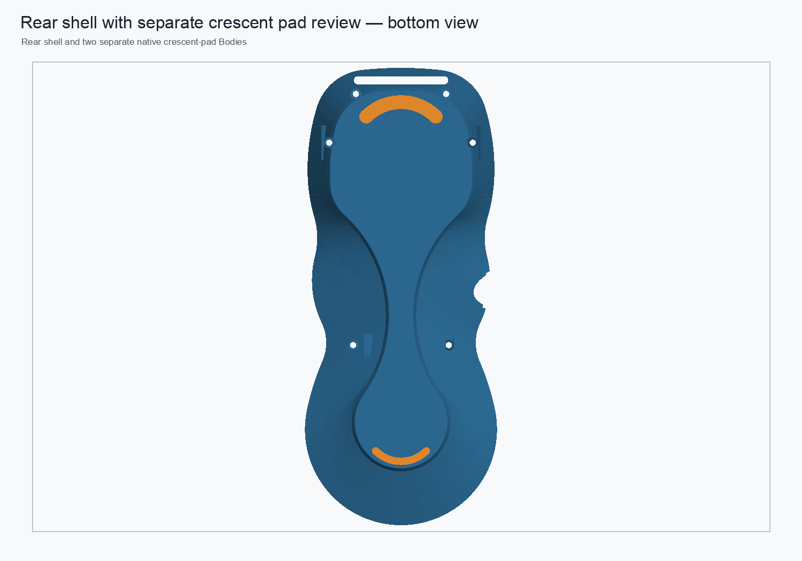

# Rear-shell native shoulder chamfer review — 2026-11-01

## Result

A disposable rear-shell candidate now has a native **1.0 mm PartDesign chamfer** on the two circular underside transitions at the upper screw-boss shoulders. The original edge intent was recovered from `RearBossShoulderTransitions`; the new edges were selected by curve type, global bounds, plane, and arc length rather than relying on the old edge numbers.

The candidate recomputed, saved, reopened, and recomputed again. It remains one valid solid with a closed triangle mesh: **16,116 facets, zero boundary edges, zero over-incident edges, and zero degenerate facets**. The 1.0 mm operation removes 15.509 mm³. The measured M2-passage intersection stays at zero, and magnet-clearance overlap changes by less than 3×10⁻¹³ mm³.

The chamfer also passed in a disposable assembly copy. All eight live links resolve, the rear link placement is unchanged, and the review assembly remains an 11-solid valid root. The measured USB-cover engagement is unchanged; no other new component intersections were detected.

## Geometry still under review

This is a review candidate, not a production repair. It is built on the fresh-fuse/native-support rear-shell candidate, not the malformed legacy load-path BREP. The candidate's volume is **40,832.352 mm³** after the chamfer; it must not be treated as an exact replacement for the original **40,961.359 mm³** cached Tip. The legacy `+475.701580 mm³` stage total remains a signed cached-volume difference, not a spatially exact reinforcement volume. The legacy feature outputs fail topology checks, so the detailed material difference and structural adequacy are still unresolved.

The original monolith, production assembly, master, and validated 0.25 mm bottom-perimeter fillet study were not modified. No 5× load capacity is claimed; assembly mass and a physical proof test are still outstanding.

## Embedded visual context

This underside review image shows the shell silhouette, reserved screw/magnet locations, and separate crescent contact-pad concept. It is context for the candidate architecture; it is not a close-up of the new shoulder chamfers.

## Files

- Native component: `../pendant-bodies/rear-shell-native-shoulder-chamfer-review-2026-11-01.FCStd`
- Disposable assembly copy: `../pendant-modular-fresh-fuse-tpu-crescent-shoulder-chamfer-review-2026-11-01.FCStd`
- Component metrics: `rear-shell-native-shoulder-chamfer-review-2026-11-01.json`
- Assembly metrics: `rear-shell-native-shoulder-chamfer-assembly-review-2026-11-01.json`
- Reproduction scripts: `../scripts/build_rear_shell_native_shoulder_chamfer_candidate.py` and `../scripts/integrate_rear_native_shoulder_chamfer_review.py`
