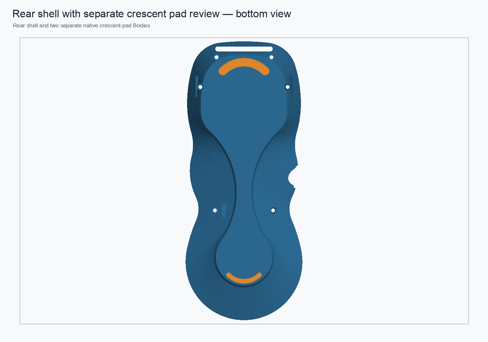

# Rear-shell native support parameter and assembly check — 2026-11-01

## Reversible support-profile edit

On a disposable copy of the native-support rear-shell candidate, I changed the named local parameter `LowerWebP2XAbs` from **9.9 mm to 10.0 mm**. It drives mirrored vertices in the two lower-inner-web sketches. All four boss-to-wall Pad profiles and both lower-web sketches remained fully constrained.

The change recomputed through the complete rear-shell chain, including the lower web Pads, 19-edge `R0.25 mm` bottom-perimeter fillet, anti-slip seat Pocket, and upper-boss chamfer. The valid one-solid Tip changed by **−5.854736 mm³** and retained a closed manifold mesh. Restoring the parameter returned the Tip with **0.0 mm³ measured BREP symmetric difference** from its baseline. After save, cold reopen, and recompute, the Tip still had one valid solid and a closed mesh with no boundary, over-incident, or degenerate edges.

## Review-assembly link

The restored component replaced the rear-shell link in a disposable assembly copy. All eight App::Links resolved after cold reopen, the rear link placement remained at the origin, and the assembly root remained valid with 11 solids. Component intersection volumes were unchanged, including the existing **0.780472 mm³** USB-cover engagement; the replacement introduced no additional overlap.

## Scope and limits

This validates a reversible native support-profile edit and its live-link refresh path. The candidate is still hybrid: its shell base is a static comparison shape, while the boss-to-wall supports and finishing operations are native features. The cached legacy reinforcement remains topologically defective, so this test does not prove exact recovery of its signed **475.701580 mm³** stage delta or structural capacity. The production monolith and production assembly were not modified. No 5× proof-load claim is made.

## Embedded visual context

This underside view shows the rear-shell silhouette and separate crescent contact-pad concept. It is context for the validated component/assembly candidate, not a visualization of the 0.1 mm parameter perturbation.

## Candidate files

- [Parameterized rear-shell review component](../pendant-bodies/rear-shell-native-support-propagation-review-2026-11-01.FCStd)
- [Disposable linked review assembly](../pendant-modular-rear-support-propagation-review-2026-11-01.FCStd)
- Component parameter metrics: `rear-shell-native-support-propagation-review-2026-11-01.json`
- Assembly-link metrics: `rear-shell-native-support-propagation-assembly-review-2026-11-01.json`
- Reproduction script: `../scripts/integrate_rear_shell_support_propagation_review.py`
