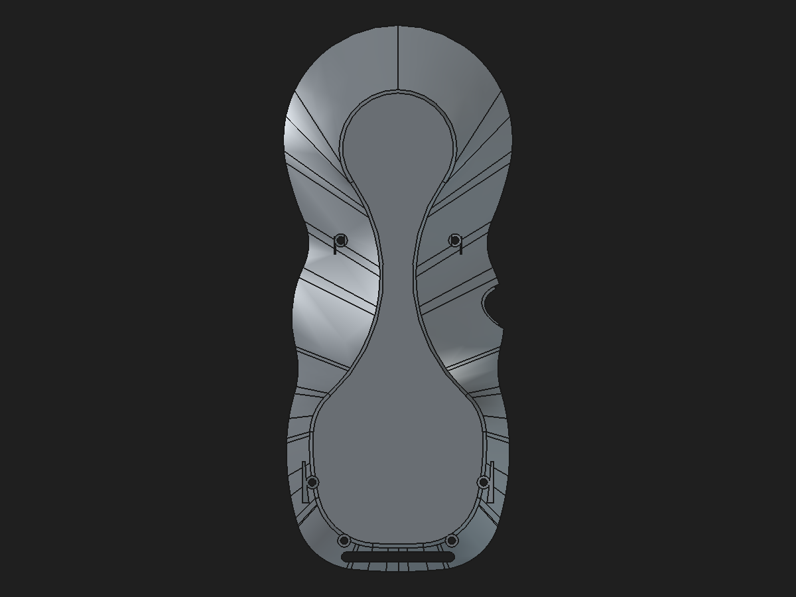

# Rear-shell non-manifold source audit

Date: 2026-10-30 · Branch: `hardware-integration` · Assembly source: `hardware/freecad/pendant-modular-assembly.FCStd` · Original document: `hardware/freecad/pendant.FCStd` (read-only; SHA-256 `dc2aeddf7be327c73022a1dc053bf8a27d5cf476e9cd68468a4ee73ab8264881`)

## Result

The rear-shell warning originates in the saved FreeCAD geometry, not in OrcaSlicer's plate setup. The currently tracked `rear-shell.stl` has 22,935 facets. Counting triangle-edge incidence after welding STL vertices at 0.00001 mm gives **335 boundary edges** (one incident facet) and **12 edges with three incident facets**. This is consistent with the 335-edge warning visible in the supplied photo; the user's accompanying message says 305.

The assembly's `Interim_Body002` is a valid, one-solid BREP by FreeCAD's ordinary `Shape.isValid()` test (40,961.359008 mm³, 534 faces). The stricter BOP check nevertheless reports 740 geometry errors: 694 self-intersection findings, 22 too-small edges, and 24 invalid curve-on-surface findings. Thus the ordinary solid-validity check did not establish that this shell can be exported as a closed print mesh.

## First feature that creates the mesh defect

Read-only BREP snapshots were extracted from the authoritative FCStd archive and checked individually with FreeCAD 1.1.1. These are saved feature outputs, not recomputed feature-history results.

| Rear feature output | Volume (mm³) | Faces | Strict BOP findings | FreeCAD mesh closed? |
|---|---:|---:|---:|---|
| `Body002FullWidthSeat` | 40,485.657428 | 400 | 336 | Yes |
| `RearBossToWallLoadPaths` | 40,869.391004 | 506 | 2,440 | **No** |
| `RearBossShoulderTransitions` | 40,854.429554 | 509 | 740 | No |
| `RearBossWallRamps45` (saved rear Tip) | 40,961.359008 | 534 | 740 | No |

`RearBossToWallLoadPaths` is therefore the first stage at which FreeCAD's tessellated result stops being a closed mesh. The downstream chamfer/transition and ramp do not restore closure. The earlier `Body002FullWidthSeat` has strict BOP findings of its own, but its tessellation is closed; those findings must not be confused with the edge-incidence defect.

The load-path feature is stored as a generic `PartDesign::Feature` whose saved properties include `BaseFeature=Body002FullWidthSeat` and a design note describing four boss-to-wall transitions. It has no profile, native loft inputs, or regeneration method. The four reinforcing paths are load-bearing design geometry, so suppressing or dropping the feature is not an acceptable repair.

## Spatial and historical localization

The saved rear Tip mesh and the `RearBossToWallLoadPaths` mesh were mapped by triangle-edge incidence in FreeCAD's tessellation. The load-path feature has 325 one-facet boundary edges and 12 three-facet edges. They cluster around the four rear screw-boss-to-wall regions, rather than around the encoder pocket or hanger opening:

| Region in model coordinates | Boundary edges | Three-facet edges |
|---|---:|---:|
| Upper left boss, X −28.24…−25.31, Y 56.45…60.52 mm | 33 | 0 |
| Upper right boss, X 24.98…27.96, Y 56.45…60.54 mm | 49 | 0 |
| Lower left boss, X −20.22…−15.95, Y −22.26…−13.25 mm | 185 | 5 |
| Lower right boss, X 15.95…20.79, Y −19.78…−13.44 mm | 58 | 7 |

The final `RearBossWallRamps45` Tip carries 335 boundary edges and the same 12 three-facet edges. Thus the later shoulder and wall-ramp operations preserve the original defect and add ten more open edges.

Git history narrows the first appearance: `376b7c1` has a closed tessellation for its then-current `Body002FullWidthSeat` (40,589.289 mm³, 417 faces), while `e2be498` is the first later commit changing `pendant.FCStd`; that version contains the defective `RearBossToWallLoadPaths` output. The old `Body002FullWidthSeat` is a different, earlier design state and is not a safe substitute because it omits the current reinforced feature history.

The protected pre-load-path backup contains four suppressed legacy additive-loft features. Their saved shape deltas do not match the active integrated reinforcement. Rebuilding those lofts directly from their stale sketches produces four detached solids when fused with the current shell base, so they are rejected as a repair source. Mesh `fixSelfIntersections` also splits the rear shell into four components and removes about 211 mm³; hole filling and non-manifold removal do not close it. Those mesh repairs are rejected because they alter or fragment load-bearing geometry.

## Repair trials rejected

All trials used copies or extracted BREP snapshots; no production CAD file or STL was changed.

- `Shape.removeSplitter()` produced an invalid shape and changed volume from 40,961.359008 to 40,713.248142 mm³; rejected.
- `Shape.sewShape()` left the mesh open with unchanged volume and face count, while its returned shape had zero solids; rejected.
- A small-tolerance `Shape.fix(1e-7, 1e-7, 1e-5)` left the mesh open and did not reduce strict BOP findings; rejected.
- A higher-tolerance shape fix also left the mesh open and altered the effective bounds; rejected.
- Boolean extraction of the new load-path material with `RearBossToWallLoadPaths.cut(Body002FullWidthSeat)` returned a null shape, so the saved result cannot be cleanly separated into the original base and reinforcement solids by that operation.
- Changing mesh deflection and using direct BREP tessellation did not produce a closed mesh.

These outcomes rule out a safe one-click BREP cleanup or a slicer-side patch as the repair.

## Follow-up: native reconstruction and healing tests (2026-10-31)

A disposable hybrid candidate now replaces the stored reinforcement chain with four fully constrained sketch profiles, four native PartDesign Pads, and a native six-hole M2 clearance Pocket. After recompute and save/reopen, its Tip is one valid solid and its mesh has 13,600 facets, zero boundary edges, and zero over-incident edges. The constrained upper-left boss coordinate also passed a reversible edit/restore test. The [candidate validation](rear-shell-parametric-support-profile-candidate-validation-2026-10-31.md) embeds the underside preview:

This is tangible topology progress, not a production replacement: the hybrid candidate retains `Body002FullWidthSeat` as a static imported base and is 351.665996 mm³ below the saved legacy Tip. It adds 158.935703 mm³ through the four Pads before the M2 clearance Pocket and finishes 124.035584 mm³ above the clean base. The historical stage deltas are +383.733575 mm³ at `RearBossToWallLoadPaths`, −14.961450 mm³ at `RearBossShoulderTransitions`, and +106.929454 mm³ at `RearBossWallRamps45`, for a net +475.701580 mm³ over the clean base. This total is feature-stage accounting; it is not a spatially partitioned volume of sound reinforcement.

The best available localized native-profile prism comparison shows the two upper candidate wedges matching the legacy Tip within 6.5×10⁻⁷ mm³. In the lower comparison prisms, the legacy saved Tip is about 49.134 mm³ below the clean base on each side, while the candidate adds about 10.557 mm³ per side. The legacy lower subtraction is not copied into the candidate because it intersects the known defective stored-shape history and is not evidence of intentional load-path removal. These local numbers do not explain all 351.666 mm³; whole-shape and localized Boolean differences through defective stored shapes remain unreliable. The mesh-edge map still identifies the four boss-to-wall zones as the defect locations and the feature labels/history indicate their intended function is screw-boss reinforcement into the shell wall.

Additional detached-shape cleanup trials on the saved `RearBossToWallLoadPaths` and final Tip did not repair the mesh. At 0.08 mm / 0.2 rad meshing and 0.00001 mm weld tolerance:

| Operation | Shape | Volume change (mm³) | Boundary edges | Over-incident edges | Result |
|---|---|---:|---:|---:|---|
| Baseline | Load-path feature | — | 325 | 12 | Defective mesh |
| `removeSplitter()` | Load-path feature | +0.016311 | 325 | 12 | No topology improvement |
| `Shape.fix()` | Load-path feature | +0.334033 | 327 | 12 | Worse mesh |
| `ShapeFix.Shape.perform()` | Final Tip | −88.904591 | 337 | 12 | Worse mesh; rejected |
| `removeSplitter()` | Final Tip | −248.110866 | 333 | 8 | Invalid shape and still defective; rejected |

Welding the tessellation at tolerances from 0.001 to 0.1 mm also reduced some boundary counts while rapidly creating 88 to 1,969 over-incident edges and degenerate triangles; increasing the weld tolerance is not a valid repair. A global-Z section through the lower comparison region shows discontinuous/open loops in the saved load-path feature, consistent with malformed stored geometry; clipped local Booleans do not provide a trustworthy exact material map. Preserve the native candidate and do not treat the 475.701580 mm³ feature delta as wholly usable reinforcement. Next, reconstruct the still-unmatched support/shoulder geometry as native operations from stable shell and boss references, with a regional material map and unchanged screw/magnet clearances, then cold-reopen and repeat the one-solid/manifold checks.

## Files and validation state

- `pendant.FCStd`, `pendant-master.FCStd`, `pendant-modular-assembly.FCStd`, `rear-shell.stl`, and the OrcaSlicer 3MF were not modified by this audit.
- The user's pre-existing modified `pendant-orcaslicer.3mf` and untracked recovery files remain untouched.
- `build_meshes.py` now stages a full candidate export and refuses to promote it unless every mesh passes FreeCAD's closed-solid test. This prevents a failed rear-shell mesh from silently overwriting the rest of the delivered print set.
- The exporter now includes boundary/over-incident edge counts and local 5 mm hotspot bins in the failure message. Its disposable test reports the same 335 boundary plus 12 three-facet edges and leaves all tracked print meshes untouched.
- No mesh healing in OrcaSlicer or FreeCAD was treated as a geometry repair.

## Disposition

The defect is in the saved FreeCAD load-path BREP, not in OrcaSlicer. No production geometry has been modified. The active feature contains no recoverable native generation recipe, and the historical loft source is not geometrically equivalent. A first native, manifold reconstruction candidate exists, but its difference from the legacy Tip remains mechanically unresolved; do not replace or suppress the legacy reinforcement in production. Continue in disposable files until the remaining support geometry, internal clearances, shell fit, and load path are validated.
