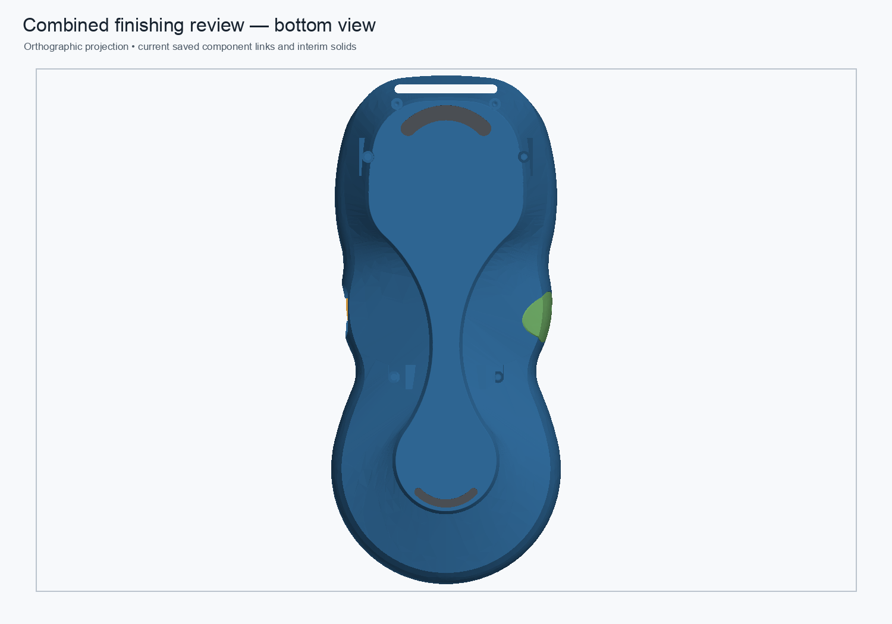

# Rear shell — named bottom-perimeter fillet parameter

Status: **validated disposable component and linked-assembly review; not production-approved.**

The reviewed rear shell now exposes the existing 0.25 mm bottom-perimeter PartDesign fillet as `BottomPerimeterFilletRadius` in its local parameter sheet. The setting is reversible and updates the chamfered rear-shell Body and the live assembly link.

## Validation

The 0.25 → 0.30 → 0.25 mm probe recomputed the complete component feature chain. At 0.30 mm, the Tip volume changed by −0.589163 mm³; restoring 0.25 mm returned the volume, area, face count, and bounds to baseline. The cold-open component and linked assembly recomputed successfully. In the assembly, the rear link kept its placement, the root remained a valid 11-solid compound, and a second 0.25 → 0.30 → 0.25 mm edit propagated through the external link and restored the original geometry.

The rear shell remained one valid solid with a closed mesh: zero boundary, over-incident, or degenerate edges. Both crescent pads retained zero-volume intersection with the shell. This verifies the review mesh and parameter update; it does not establish the shell's load rating.

## Limits

The component still starts from a stored-shape base. The 475.701580 mm³ saved-stage delta in the legacy load-path/shoulder/ramp chain remains unreconciled as an exact spatial material map. No reinforcement has been declared redundant, and the 5× PLA proof-load target remains unverified. Keep this review candidate separate from the protected monolith and production assembly.

## Files

- [Parametric rear-shell component](../pendant-bodies/rear-shell-parametric-bottom-fillet-review-2026-11-01.FCStd)
- [Combined linked review assembly](../master-driven-leadins-candidate/pendant-modular-combined-finishing-0p6-parametric-bottom-fillet-review-2026-11-01.FCStd)
- [Component builder and reversible-radius validation](../scripts/build_parametric_bottom_fillet_review.py)
- [Assembly integration and link validation](../scripts/integrate_parametric_bottom_fillet_review_assembly.py)
- [Machine-readable assembly results](combined-finishing-0p6-parametric-bottom-fillet-review-2026-11-01.json)
- [Machine-readable component results](rear-shell-parametric-bottom-fillet-review-2026-11-01.json)
