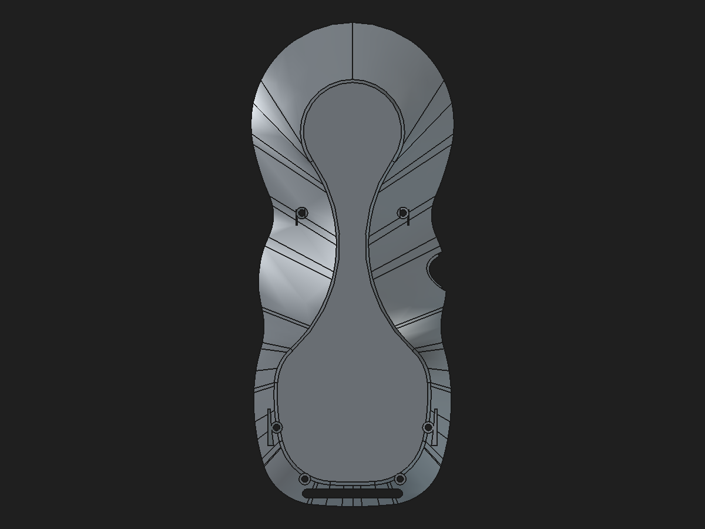

# Rear-shell constrained-profile assembly review candidate

Date: 2026-10-31  
Status: disposable modular review assembly; not a production replacement.

## Candidate

The review assembly replaces the previous rear-shell source in a copy of the modular repair assembly with the validated constrained-profile source at [`pendant-bodies/rear-shell-loadpath-parametric-profile-candidate.FCStd`](https://github.com/Cdaprod/lolin-s2-mini-cnc-mpg-pendant-controller/blob/hardware-integration/hardware/freecad/pendant-bodies/rear-shell-loadpath-parametric-profile-candidate.FCStd). The source is an editable PartDesign Body with four fully constrained support profiles, four native support Pads, and the M2 passage Pocket. Its imported clean shell base remains a static reference BREP, and its legacy-geometry difference remains unresolved.

Review file: [`pendant-modular-rear-parametric-profile-candidate.FCStd`](https://github.com/Cdaprod/lolin-s2-mini-cnc-mpg-pendant-controller/blob/hardware-integration/hardware/freecad/pendant-modular-rear-parametric-profile-candidate.FCStd). The protected production assembly and monolith were not saved or changed.

## Embedded component preview

## Link and geometry validation

FreeCAD reopened the saved review assembly and recomputed it twice in separate cold opens. On both opens, all six `App::Link` objects resolved. `Interim_Body002` resolved to `RearShell` in the constrained-profile source file. Before tessellation, the linked shape and source Body matched in volume and all six bounds; the link placement remained zero translation/rotation. The linked rear shape was a valid single solid at 40,609.693012 mm³.

The linked shape was tessellated on a copy at 0.08 mm linear deflection and 0.35° angular deflection. The mesh had 13,600 facets, zero boundary edges, and zero edges incident to more than two facets. The matching metrics were stable after save/reopen/recompute. Machine-readable output is in [`rear-shell-parametric-profile-assembly-validation-2026-10-31.json`](rear-shell-parametric-profile-assembly-validation-2026-10-31.json).

This validates the source link and manifold rear component in the review assembly. It does not validate physical strength, the unresolved 351.665996 mm³ legacy-shape difference, or every assembly interference. It does not make the imported base independently parametric. Keep the candidate separate from production until the structural reconstruction is resolved.
