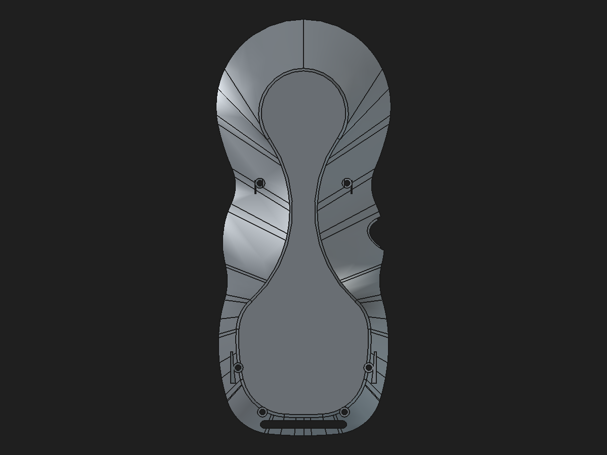

# Rear-shell parametric support-profile candidate

Date: 2026-10-31  
Status: disposable candidate; not promoted to the production assembly.

## What changed

The four rear screw-boss-to-wall support Pad profiles in the existing hybrid repair candidate were converted from unconstrained triangle sketches into fully constrained native sketches. Each profile now has nine named dimensional/geometric constraints (`CloseAtWallTop`, `CloseAtBossTop`, `CloseAtWallBase`, `WallVertical`, `BossTopHorizontal`, `WallX`, `WallBottomZ`, `BossTopZ`, and `BossX`). The established coordinates and pad lengths were retained. The candidate is at [`rear-shell-loadpath-parametric-profile-candidate.FCStd`](../pendant-bodies/rear-shell-loadpath-parametric-profile-candidate.FCStd).

This makes the four reinforcement profiles editable and predictably constrained. It does **not** convert the imported `BaseShell` comparison shape into native shell history, and it does not establish that the candidate's smaller load-path volume is structurally equivalent to the legacy transition features.

## Preview

## Validation

The candidate was opened and recomputed in headless FreeCAD, saved, closed, reopened, and recomputed again. Before and after reopen, the active `RearM2PassageClearance` Tip had the same measured shape:

| Measurement | Result |
| --- | ---: |
| Valid PartDesign Tip | Yes |
| Solid count | 1 |
| Volume | 40,609.693012 mm³ |
| Surface area | 30,634.260537 mm² |
| Faces | 460 |
| Bounds (X, Y, Z), mm | [−36.1371, 36.1371] × [−85.5643, 86.6876] × [−36.8438, −14.5857] |
| All four support sketches fully constrained | Yes; 9 constraints each |
| Feature error states after recompute | None reported |
| Mesh, 0.08 mm linear / 0.35° angular | 13,600 facets; 20,400 edges each used by exactly 2 facets |
| Boundary / over-incident mesh edges | 0 / 0 |

### Reversible edit check

On the reopened candidate, `UpperLeftProfile.BossX` was changed from −24.8 mm to −24.7 mm. The Tip volume changed from 40,609.693012 to 40,610.416110 mm³ (+0.723097 mm³). Restoring −24.8 mm returned the volume within 2.9×10⁻¹¹ mm³ of baseline; the Tip remained valid with one solid and the sketch remained fully constrained. The original value was restored and the candidate saved.

## Structural difference remains unresolved

The saved legacy feature chain adds a net 475.701580 mm³ over `Body002FullWidthSeat`: `RearBossToWallLoadPaths` adds 383.733575 mm³, `RearBossShoulderTransitions` trims 14.961450 mm³, and `RearBossWallRamps45` adds 106.929454 mm³. The existing mesh audit localizes open/over-incident facet clusters to the four screw-boss-to-wall transitions (upper left, upper right, lower left, lower right); this is consistent with intended boss reinforcement, but does not demonstrate its load capacity.

This candidate has 40,609.693012 mm³ at its Tip, 351.665996 mm³ below the stored legacy Tip at 40,961.359008 mm³. Its four Pads add only 158.935703 mm³ over the clean shell base before the screw-passage clearance Pocket. The earlier local prism comparison found the two upper rib regions reproduce their declared legacy wedges, while the lower profiles add material where the legacy saved Tip has none. The rest of the legacy load-path/shoulder difference has not been spatially partitioned reliably: whole-shape Boolean difference against the defective legacy shape returned null results. Therefore this candidate is **not** claimed to preserve the legacy reinforcement or be mechanically adequate.

The prior native R0.25 mm bottom-perimeter fillet remains a separate study on the clean pre-load-path shell. It is deliberately not merged into this candidate until the reinforcement geometry and affected clearances are resolved. See [the fillet/load-path study](rear-shell-bottom-perimeter-fillet-validation-2026-10-31.md).

## Decision

Keep this candidate as a bounded, validated improvement to sketch editability and manifold tessellation. Do not replace the production shell with it. Next work should identify and classify the remaining 351.666 mm³ by boss region and downstream interface, then reconstruct only the intended support material with native features before applying the bottom-perimeter fillet. The pendant mass is still unknown and no proof-load claim is made.
