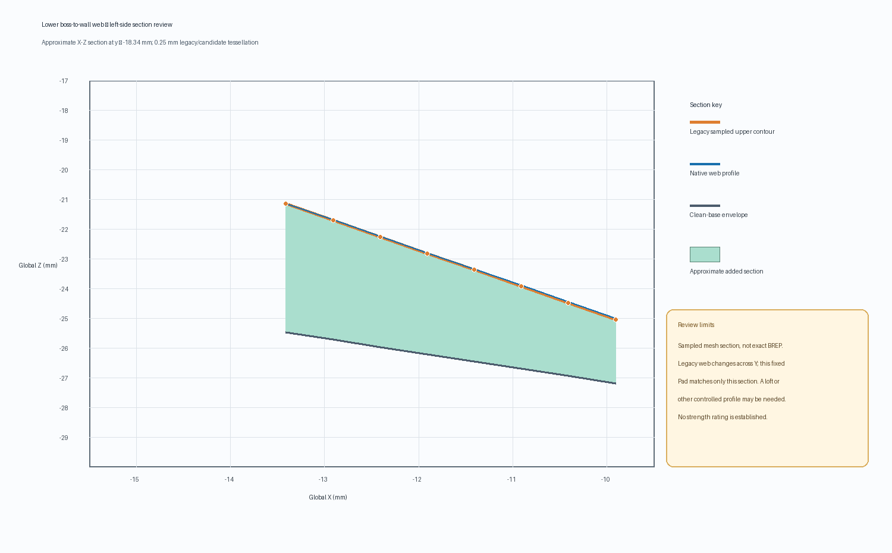

# Rear-shell native screw-pad reinforcement recovery candidate

Date: 2026-10-31
Status: cold-opened disposable review candidate; **not production-approved**.

## What the 475.702 mm³ represents

The protected monolith's saved `Body002FullWidthSeat` measures `40,485.657428 mm³`. Its saved `RearBossWallRamps45` Tip measures `40,961.359008 mm³`, a net increase of `475.701580 mm³` across three stored-shape stages:

| Stored feature stage | Net volume change |
|---|---:|
| `RearBossToWallLoadPaths` | +383.733575 mm³ |
| `RearBossShoulderTransitions` | −14.961450 mm³ |
| `RearBossWallRamps45` | +106.929454 mm³ |

The original Tip mesh is not watertight: at 0.08 mm linear / 0.35 rad angular deflection it has 313 boundary edges and 3 over-incident edges. Existing 0.5 mm occupancy sampling locates `+262.875 mm³` net sampled change in the four screw-boss-to-wall regions: upper-left `+42.750`, upper-right `+40.625`, lower-left `+90.625`, and lower-right `+88.875 mm³`. Whole-shell 1 mm occupancy gives `+258 mm³`. These are approximate spatial samples, not exact BRep differences. They locate the likely reinforcement function but do **not** classify the entire 475.702 mm³ or justify deleting the residual geometry.

The occupancy comparison's 0.5 mm lower-web section is useful context for the latest reconstruction:

## Native reconstruction tested

The candidate retains the existing disposable hybrid base and native support chain, including four wall-to-boss Pads, six M2 passages, the R0.25 mm bottom-perimeter fillet, 0.10 mm anti-slip seats, and the two lower inner-web Pads. It then recovers the source model's fully constrained `RearMountReinforcementSketch` as `RecoveredRearMountReinforcementSketch` and adds a native 6.0 mm reversed PartDesign Pad. The source sketch contains six circles on `Z = −19 mm`: radii 4.5 mm at `X = ±18, Y = −17.756618`; radii 7.0 mm at `X = ±27, Y = 58.5`; and radii 4.5 mm at `X = ±16.97, Y = 76.85`. A native 20 mm Pocket based on the candidate's six-hole M2 clearance sketch restores all screw passages through this added material.

The resulting tip is `RecoveredRearM2Clearance`. On cold open and recompute:

| Check | Result |
|---|---:|
| Body / Tip | `RearShell` / `RecoveredRearM2Clearance`, up to date |
| Valid solid count | 1 |
| Candidate volume | 41,211.579934 mm³ |
| Relative to saved legacy Tip | +250.220925 mm³ |
| Relative to clean base | +725.922505 mm³ |
| Mesh at 0.08 mm / 0.35 rad | 16,258 facets; 0 boundary, 0 over-incident, 0 degenerate facets |
| Six-circle source sketch | 6 geometries, 16 constraints, fully constrained |
| Reversible Pad length probe | 6.0 → 6.1 → 6.0 mm; +23.653668 mm³ then restored within 1.5×10⁻¹¹ mm³ |

The nonzero difference from the legacy Tip means the candidate is a geometry redesign, not an equivalent repair. The candidate deliberately retains and adds boss/web support geometry rather than dropping the malformed stored features. Its volume being larger does not establish that the material is correctly placed or structurally sufficient.

## Assembly and clearances

The disposable review assembly cold-opens with a valid `AssemblyRoot`, 11 solids, and 8 resolved App::Links; the rear-shell link targets this review component at the original placement. The earlier pairwise comparison found no new component intersections; the existing USB cover / rear shell engagement remains `0.780471885 mm³` and was unchanged. The six M2 passages were restored with the native clearance Pocket and prior candidate checks found zero common volume with the screw-passage tool. The magnet-tool intersection is nonzero in both the baseline and candidate, so no absolute magnet-clearance pass is claimed.

No complete shell-mating clearance, PLA load capacity, or 5× pendant-weight proof-load result is established. Complete pendant mass and physical loading conditions remain unknown. The file is a development candidate for further design review, not a recommended print or a validated load-bearing part.

## Files and reproducibility

- Candidate component: [`rear-shell-recovered-screw-pad-review-candidate-2026-10-31.FCStd`](../pendant-bodies/rear-shell-recovered-screw-pad-review-candidate-2026-10-31.FCStd)
- Disposable linked assembly: [`pendant-modular-recovered-screw-pad-review-assembly-2026-10-31.FCStd`](../pendant-modular-recovered-screw-pad-review-assembly-2026-10-31.FCStd)
- Cold-open validator: [`validate_rear_shell_recovered_screw_pad_candidate.py`](../scripts/validate_rear_shell_recovered_screw_pad_candidate.py)
- Machine-readable results: [`rear-shell-recovered-screw-pad-candidate-validation-2026-10-31.json`](rear-shell-recovered-screw-pad-candidate-validation-2026-10-31.json)

The validator reads the protected monolith without recomputing or saving it, recomputes the candidate and review assembly in memory, measures the source and candidate mesh edge incidence, checks native feature states and the reversible Pad probe, and writes JSON. It does not save any CAD document. The input candidate is not modified by the validator.

## Disposition

Keep the protected monolith and production modular assembly unchanged. Preserve this candidate because it proves a native, editable support-pad chain can recompute to a valid one-solid watertight mesh. Do not promote it yet: its +250.221 mm³ difference from the saved legacy Tip is unresolved, and its mesh cleanliness and feature editability do not establish geometry intent or structural strength. Next work should inspect the six-pad and four-rib material against the actual bracket load path and surrounding shell, compare the M2 boss wall sections, and refine the candidate only with measured design criteria. Keep the existing 0.25 mm bottom fillet and anti-slip surfaces as candidate features, then continue faceplate and enclosure finishing independently.
