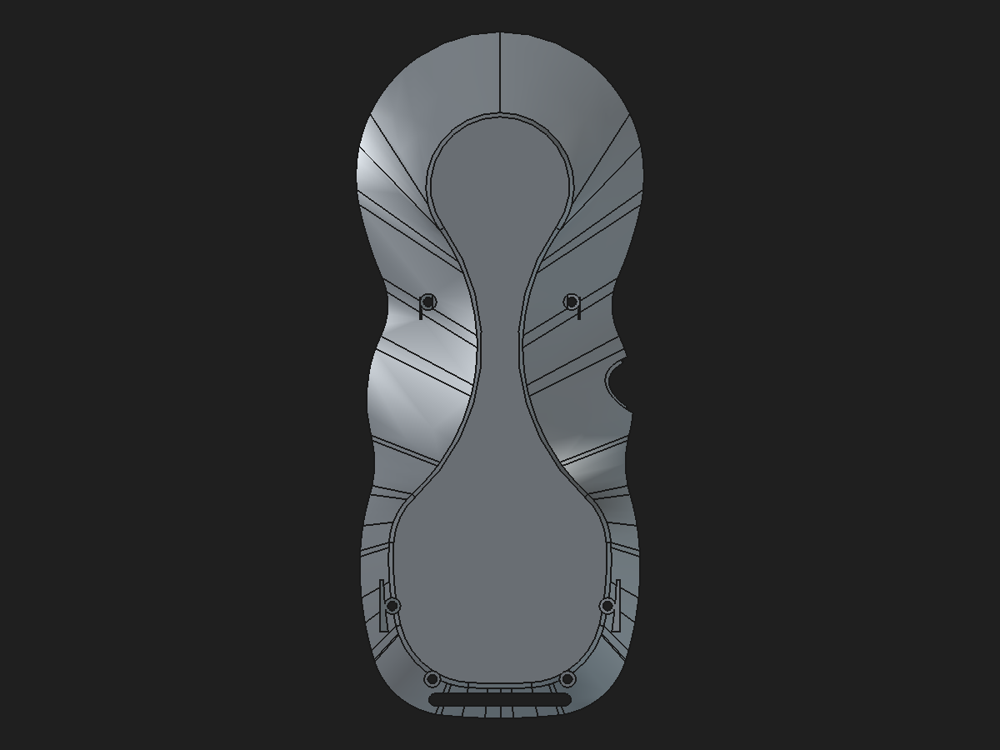

# Rear-shell reinforced candidate with bottom-perimeter fillet

Date: 2026-10-31  
Status: validated disposable geometry candidate; not a production replacement.

## CAD change

Applied a native `PartDesign::Fillet` (`BottomPerimeterFinish`, R = 0.25 mm) after the four native, fully constrained boss-to-wall support Pads and the M2 clearance Pocket. The selected edges are the 19 edges of the largest lower contact face's outer wire. The face area is 4,243.2289 mm² and its normal is `(0, −0.04362, −0.99905)`, approximately 2.5° from −Z. Edge references were mapped from the face wire to the solid's edge names using topological identity; no guessed numbering range was used.

Candidate component: [`rear-shell-loadpath-parametric-profile-bottom-fillet-candidate.FCStd`](../pendant-bodies/rear-shell-loadpath-parametric-profile-bottom-fillet-candidate.FCStd).  
Review assembly: [`pendant-modular-rear-bottom-fillet-review-candidate.FCStd`](../pendant-modular-rear-bottom-fillet-review-candidate.FCStd).

## Before and after previews

Before:

After:

Detail before:

Detail after:

## Validation

The PartDesign feature recomputed, saved, closed, reopened, and recomputed again. The final Tip is `BottomPerimeterFinish`, up to date, valid, and one solid. Its 0.08 mm / 0.35° tessellation has zero boundary edges and zero edges with more than two incident facets. The four support sketches remain fully constrained.

| Measurement | Before fillet | After fillet |
| --- | ---: | ---: |
| Volume (mm³) | 40,609.693012 | 40,608.354897 |
| Surface area (mm²) | 30,634.260537 | 30,623.607808 |
| Faces | 460 | 478 |
| Mesh facets | 13,600 | 15,418 after reopen |
| One valid solid / closed mesh | Yes / Yes | Yes / Yes |

The edge break removes 1.338115 mm³ from this reinforced candidate. Its bounds are unchanged except the minimum Z moves from −36.844985 to −36.894468 mm; that 0.049484 mm envelope change is recorded as part of the fillet geometry.

### Parametric propagation

On a disposable copy, `UpperLeftProfile.BossX` was changed from −24.8 mm to −24.7 mm. The final Tip changed by +0.723096 mm³ while the PartDesign Fillet remained up to date and the Body remained one valid solid. Restoring −24.8 mm returned the baseline volume exactly in that run. Save/reopen/recompute retained the restored value and `BottomPerimeterFinish` Tip.

### Clearance and assembly checks

The measured overlap with the extracted magnet-pocket tool is unchanged relative to the unfilleted support candidate within 2.9×10⁻¹³ mm³; the screw-passage tool intersection is unchanged at zero. The magnet-tool intersection itself is nonzero (168.000280 mm³) for the clean base as well, so this comparison proves only that the fillet did not change that metric. It is **not** an absolute magnet-clearance pass; the tool and shell coordinate alignment must be resolved before making that claim.

The review assembly cold-opens and recomputes with six resolved App::Links. The rear link targets this filleted component, matches its source Body before tessellation, and remains a valid one-solid shape. Its tessellation has 15,418 facets, zero boundary edges, and zero over-incident edges. This validates link persistence and topology, not every assembly clearance.

Machine-readable measurements are in [`rear-shell-reinforced-bottom-fillet-validation-2026-10-31.json`](rear-shell-reinforced-bottom-fillet-validation-2026-10-31.json).

## Design limits

The support candidate replaces the defective stored-shape transition chain with four native support Pads and a clearance Pocket, but its volume is 351.665996 mm³ below the legacy saved Tip before this fillet. The legacy chain adds a net 475.701580 mm³ over the clean base. The candidate therefore remains a redesign candidate; exact spatial equivalence and the structural role of the omitted material are unresolved. The added perimeter finish increases the legacy-to-candidate volume difference to about 353.004111 mm³.

No proof-load capacity is claimed. Pendant mass is still unknown, and physical load testing remains necessary for the stated 5× target. Keep the original monolith, production assembly, and previous candidates unchanged. The 0.25 mm treatment is now integrated only into this review candidate, not the production shell.
