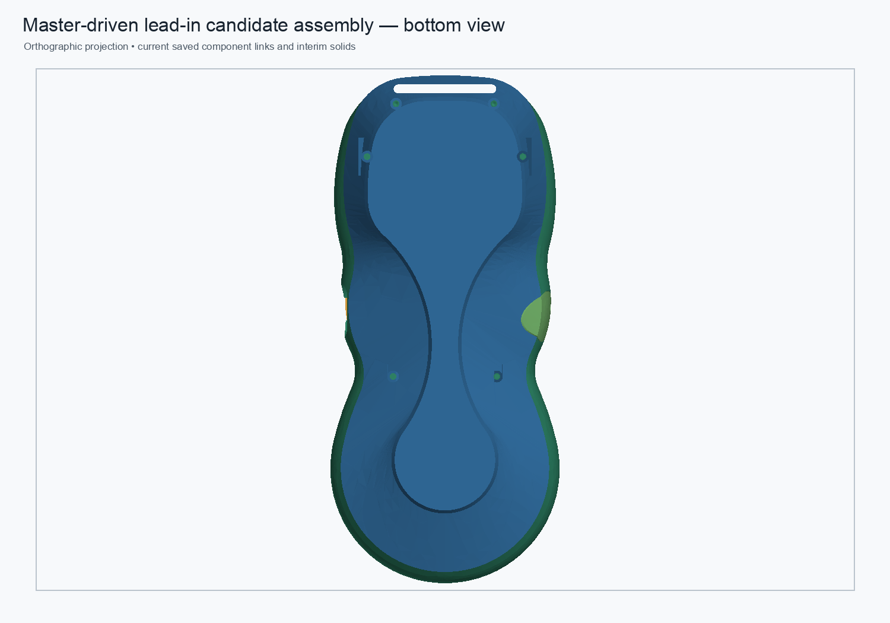

# Rear-shell repair candidate — volume-difference localization

## Finding

The current hybrid candidate is **351.665996 mm³ smaller** than the saved legacy rear-shell Tip (`40,609.693012` vs `40,961.359008 mm³`). Its native candidate Pad/Pocket chain recomputes to one valid solid, with the same outer bounds as the original. The source `Body002` also loads as a valid one-solid BREP, although its prior mesh audit found non-manifold edge incidence and the full legacy history has not completed a bounded recompute.

The discrepancy is a **known, intentional reconstruction difference**, not an unexplained drift: the candidate replaces the old `RearBossToWallLoadPaths → RearBossShoulderTransitions → RearBossWallRamps45` stored-shape sequence with a clean `Body002FullWidthSeat` base, four newly modeled support profiles, and a clearance Pocket. The upper two prisms reproduce the local upper ramp wedges, but the wider upstream load-path and shoulder material is not reconstructed. The two lower profiles add new material where the legacy final Tip has none. The difference is therefore not yet approved as mechanically equivalent or acceptable.

| History stage | Volume (mm³) | Change from prior stage (mm³) |
|---|---:|---:|
| Clean base — `Body002FullWidthSeat` | 40,485.657428 | — |
| Saved `RearBossToWallLoadPaths` | 40,869.391004 | +383.733575 |
| Saved `RearBossShoulderTransitions` | 40,854.429554 | −14.961450 |
| Saved active Tip — `RearBossWallRamps45` | 40,961.359008 | +106.929454 |
| Candidate after four native Pads, before clearance Pocket | 40,644.593132 | +158.935703 from clean base |
| Candidate Tip — `RearM2PassageClearance` | 40,609.693012 | +124.035584 from clean base |

## Where the legacy mesh defect begins

A read-only cold-open inspection tessellated each saved feature output at 0.08 mm / 0.35 rad angular deflection. The clean `Body002FullWidthSeat` starts as one closed mesh with no boundary or over-incident edges. The first stored reinforcement, `RearBossToWallLoadPaths` (four boss-to-wall webs), is where the mesh ceases to be solid: it introduces 303 boundary edges and 3 edges incident to more than two facets. `RearBossShoulderTransitions` raises those counts to 313 and 3; the active 45° ramps retain 313 and 3. No degenerate facets were found. This isolates the defect onset to the stored load-path feature, while confirming the subsequent transitions preserve rather than repair the defect.

| Saved shape | Net volume change (mm³) | Mesh facets | Boundary edges | Over-incident edges | Closed mesh |
|---|---:|---:|---:|---:|---|
| `Body002FullWidthSeat` | — | 12,928 | 0 | 0 | Yes |
| `RearBossToWallLoadPaths` | +383.733575 | 14,780 | 303 | 3 | No |
| `RearBossShoulderTransitions` | −14.961450 | 14,832 | 313 | 3 | No |
| `RearBossWallRamps45` | +106.929454 | 15,472 | 313 | 3 | No |

The feature labels and the prior 0.5 mm regional occupancy audit place the affected and added material around all four screw-boss-to-wall zones. That supports the intended function—transferring screw/boss loads into the enclosure wall through webs, shoulders, and ramps—but does not identify every triangle or prove how much of the 475.701580 mm³ must be retained. The 0.5 mm map estimates 262.875 mm³ net changed occupancy in the four zones and is explicitly approximate because the legacy mesh is open.

Direct stage-to-stage shape cuts were also attempted. The first two transition pairs returned null cut shapes; the final pair returned invalid multi-solid cuts. Those Boolean differences are unusable as an exact material map. Therefore the volume deltas remain exact saved-shape measurements, while the regional map and structural purpose are supported but approximate. Keep all four boss regions in the redesign until their geometry is reconstructed and checked against screw clearances and the intended load path.

Localized intersections against the four declared triangular pad prisms show the upper-left and upper-right candidate intersections match the saved legacy Tip within `6.5e-7 mm³`. In the lower-left and lower-right prisms, the saved legacy Tip contains no material while the candidate adds about `10.56 mm³` over the clean base in each. The lower ribs are deliberate new geometry in this reconstruction recipe; their load-path value and clearance to nearby internal components are not established here.

The old support and finishing chain contributes substantially more volume than the current replacement. The exact removed-material map outside the four local prisms remains unknown: whole-shell symmetric-difference Booleans on the defective legacy shell were unreliable or too slow, and prior full-history recomputation exceeded 170 seconds. This audit therefore does not claim exact BREP equivalence. It classifies the net difference as intentional but mechanically unresolved, with the omitted upstream load-path and shoulder geometry as the primary design gap.

## Candidate assembly appearance

The candidate assembly remains a linked, nine-solid review model. The three static interim representations and hybrid rear-shell source are identified as such; this preview is not a structural analysis.

## Validation scope

The source monolith was opened read-only and its saved feature-stage shapes were measured without recomputing the whole legacy chain. The isolated hybrid rear component was recomputed in FreeCAD and its native Pad/Pocket stages measured. Local comparisons use FreeCAD `Shape.common(profile_prism)` intersection volumes; no CAD document was saved or changed. The reproducible audit is `scripts/audit_rear_shell_repair_difference.py`, with machine-readable values in `rear-shell-repair-difference-localization-2026-10-31.json`.

The existing screw and magnet clearance checks, assembly placement checks, and zero-intersection result against the front shell remain candidate-level evidence from the prior rear-shell validation. They do not validate the newly added lower ribs against all internal parts, nor demonstrate strength. Keep the rear-shell candidate unpromoted until the omitted transitions are characterized and fit/load-path requirements are reviewed.
