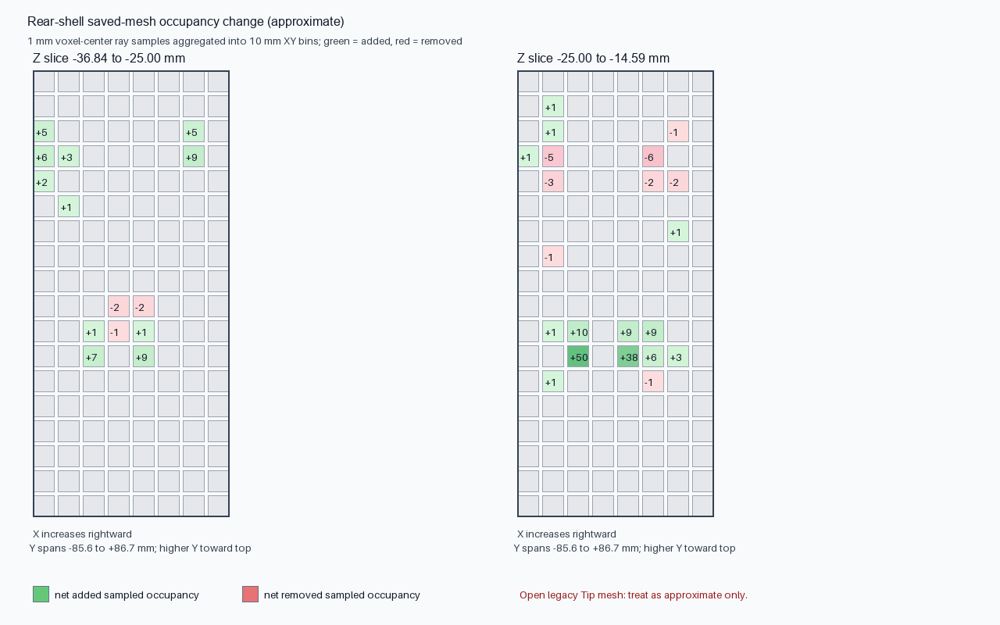
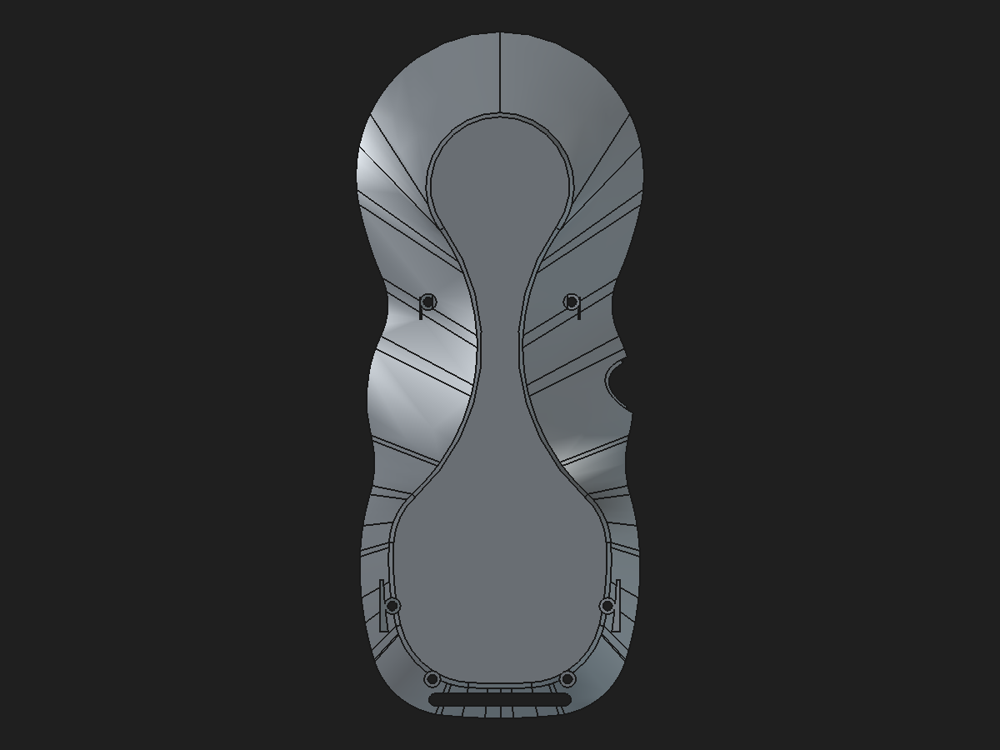

# Rear-shell structural-first finish with base reinforcement preserved

Date: 2026-10-31

Status: **Validated disposable component and linked review assembly; not production-approved.**

## Source-history correction

The original `RearMountReinforcement` six-circle Pad is already in the protected rear Tip's dependency ancestry and upstream of `Body002FullWidthSeat`. That means the `BaseShell` imported into these hybrid candidates already includes the downstream result of that native feature. The earlier review variant that appended another six-circle Pad is therefore retained only as a comparison candidate; it must not be described as recovering a missing feature or used as the default replacement. Its added material may overlap or restore regions altered by later operations, and the Boolean localization attempt did not conserve volume well enough to classify it.

This new candidate preserves the imported clean base unchanged and reconstructs only the four boss-to-wall support Pads and two lower inner-web Pads. It does not add another copy of the six-circle Pad. The legacy saved-stage increase of `475.701580 mm³` is still not fully accounted for spatially. The four screw-boss regions show `+262.875 mm³` net approximate occupancy at 0.5 mm sampling, but that sampling is not an exact BRep difference and identifies no material as redundant.

## Native feature sequence and finish

The candidate imports the saved `Body002FullWidthSeat` output as its base, adds four fully constrained native boss-to-wall support Pads, restores six M2 passages with a native Pocket, adds two fully constrained native lower inner-web Pads, then applies a native R0.25 mm bottom-perimeter Fillet and cuts the 0.10 mm swept-crescent anti-slip seats last.

The fillet follows the support geometry. It selects the 19 edges of the broad downward-facing contact face's outer wire by face/edge identity. The source face is `4,243.228864 mm²` with normal `(0, −0.043619, −0.999048)`. The fillet removes `1.338439 mm³`. The later seat Pocket removes `23.809526 mm³`.

Current candidate, captured directly from FreeCAD in bottom view:

The before/after pictures below are the existing preview of the same perimeter treatment on this contact face. The new structural-first component independently repeats the selection and passes cold-open validation.

Before:

After:

## Validation

| Check | Result |
|---|---:|
| Final Tip | `FinishOrder_AntiSlipSeatPocket`, up to date |
| Tip shape | 1 valid solid; `40,847.861700 mm³` |
| Mesh at 0.08 mm / 0.35 rad | 16,020 facets; 0 boundary, 0 over-incident, 0 degenerate facets |
| Six M2 passage keep-out common volume | 0 mm³ |
| Existing magnet-slot keep-out common volume | 0 mm³ |
| Review assembly after cold reopen | Valid root; 11 solids; 8 resolved links |
| Neighbor overlap comparison | No changes relative to the previous review assembly |
| Reversible support Pad edit through App::Link | 13.0→13.1→13.0 mm; change propagated and restored in component and assembly |

The candidate's net volume is `+362.204272 mm³` over the clean imported base and `−113.497308 mm³` relative to the saved legacy Tip. The latter is a volume comparison only. The original Tip mesh is non-manifold and its cached BRep cannot be treated as an unquestioned design target. Exact geometry equivalence and load capacity remain unproven.

The existing USB cover / rear shell engagement remains `0.780471885 mm³` and is unchanged. There is no measured positive common volume with the tested front shell, upper faceplate, fused encoder interim, display retainer, faceplate locator links, breakout board, or anti-slip insert links. These checks cover this review assembly configuration, not physical tolerances or fatigue.

The candidate was rebuilt by the saved macro to a separate temporary path. Both the repository candidate and rebuilt copy cold-opened and recomputed to the same volume, face count, bounds, and closed-mesh result. The validator reads the protected monolith without recomputing or saving it and does not save either review CAD document.

## Files

- Component: [`rear-shell-structural-first-fillet-no-duplicate-pad-2026-10-31.FCStd`](https://github.com/Cdaprod/lolin-s2-mini-cnc-mpg-pendant-controller/blob/hardware-integration/hardware/freecad/pendant-bodies/rear-shell-structural-first-fillet-no-duplicate-pad-2026-10-31.FCStd)
- Review assembly: [`pendant-modular-structural-first-fillet-no-duplicate-review-assembly-2026-10-31.FCStd`](https://github.com/Cdaprod/lolin-s2-mini-cnc-mpg-pendant-controller/blob/hardware-integration/hardware/freecad/pendant-modular-structural-first-fillet-no-duplicate-review-assembly-2026-10-31.FCStd)
- Rebuild macro: [`build_rear_shell_structural_first_fillet_base_preserving.FCMacro`](../scripts/build_rear_shell_structural_first_fillet_base_preserving.FCMacro)
- Cold-open validator: [`validate_rear_shell_structural_first_fillet_base_preserving.py`](../scripts/validate_rear_shell_structural_first_fillet_base_preserving.py)
- Machine-readable evidence: [`rear-shell-structural-first-fillet-base-preserving-validation-2026-10-31.json`](rear-shell-structural-first-fillet-base-preserving-validation-2026-10-31.json)

## Disposition

This is the preferable current rear-shell review variant because it carries forward the source base that already includes the original six-circle Pad, adds native boss/web supports, preserves the M2 and magnet-slot keep-outs, applies the bottom fillet after structural features, and tessellates to a closed mesh. Keep it disposable: the `113.497 mm³` difference to the defective saved legacy Tip still needs spatial reconciliation, the shell base is imported static geometry, and the stated PLA 5× proof-load target has not been validated. Do not replace the protected monolith or production assembly.
