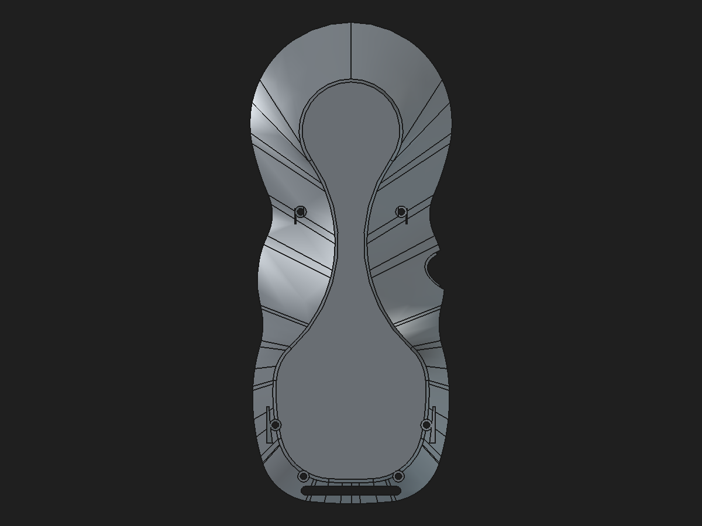

# Rear-shell structural-first finishing candidate

Date: 2026-10-31

Status: **Validated disposable component and review assembly; not production-approved.**

## CAD change

Rebuilt the rear review component so structural geometry is established before edge finishing. The PartDesign sequence is four boss-to-wall support Pads, a six-hole M2 Pocket, two lower inner-web Pads, the recovered fully constrained six-circle mounting reinforcement Pad, a second six-hole M2 Pocket, the R0.25 mm bottom perimeter Fillet, and finally the 0.10 mm crescent anti-slip seat Pocket. This places finishing after the rebuilt load path as requested.

The fillet is selected from the broad downward-facing contact face’s outer wire by topological identity. The face is `4,243.228864 mm²` with normal `(0, −0.043619, −0.999048)`; its 19 edges are resolved from the face wire, rather than guessed by an edge-number range. The R0.25 mm treatment removes `1.338336 mm³`. The post-fillet seat Pocket removes `23.809522 mm³` and remains the final feature.

The images below are the earlier preview of this same R0.25 mm treatment on the same lower contact face. The current structural-first candidate independently reselects the 19-edge outer wire and passes cold-open validation; its file is linked below.

Before:

After:

## Validation results

| Check | Result |
|---|---:|
| Final Tip | `FinishOrder_AntiSlipSeatPocket`, up to date |
| Solid validity | 1 valid solid |
| Mesh, 0.08 mm / 0.35 rad | 16,260 facets; 0 boundary, 0 over-incident, 0 degenerate facets |
| Bounds | `X −39.9097…39.8792`, `Y −88.3123…86.6885`, `Z −36.8945…0 mm` |
| M2 passage tool intersection | 0 mm³ across six screw clearances |
| Cold-open review assembly | Valid root; 11 solids; 8 resolved App::Links |
| Reversible source edit through rear App::Link | 6.0→6.1→6.0 mm; assembly responds and returns to baseline volume |
| Neighbor intersection comparison | No change; all tested overlaps match the prior review assembly |

The existing USB-cover/rear-shell engagement remains `0.780471885 mm³`; it did not increase. The candidate has zero measured common volume with the front shell, upper faceplate, fused encoder interim, display retainer, both locator links, breakout board, and both crescent pad links in the tested assembly. These checks establish the measured assembly fit for this review configuration, not full tolerance or physical fit.

The final candidate volume is `41,211.579931 mm³`, which is `+250.220923 mm³` relative to the saved legacy rear Tip and `+725.922503 mm³` relative to the clean base. The original saved legacy Tip mesh measures 313 boundary and 3 over-incident edges. Previous 0.5 mm occupancy sampling places `+262.875 mm³` net sampled change around the four screw-boss transitions, but it does not account for the entire `+475.701580 mm³` saved-stage BRep difference. No material has been called redundant. The spatial map below is approximate occupancy sampling, not exact BRep subtraction.

The candidate and a fresh run of the builder script produced matching volume, area, face count, bounds, and closed-mesh result. Save, close, and reopen recomputation passed for the component through its linked assembly. Validation is reproducible with [`validate_rear_shell_structural_first_fillet_candidate.py`](../scripts/validate_rear_shell_structural_first_fillet_candidate.py); the machine-readable result is [`rear-shell-structural-first-fillet-validation-2026-10-31.json`](rear-shell-structural-first-fillet-validation-2026-10-31.json). The CAD construction is reproducible with [`build_rear_shell_structural_first_fillet_candidate.FCMacro`](../scripts/build_rear_shell_structural_first_fillet_candidate.FCMacro) using a new output path; it refuses to overwrite files.

## Candidate files

- Component: [`rear-shell-structural-first-fillet-candidate-2026-10-31.FCStd`](https://github.com/Cdaprod/lolin-s2-mini-cnc-mpg-pendant-controller/blob/hardware-integration/hardware/freecad/pendant-bodies/rear-shell-structural-first-fillet-candidate-2026-10-31.FCStd)
- Review assembly: [`pendant-modular-structural-first-fillet-review-assembly-2026-10-31.FCStd`](https://github.com/Cdaprod/lolin-s2-mini-cnc-mpg-pendant-controller/blob/hardware-integration/hardware/freecad/pendant-modular-structural-first-fillet-review-assembly-2026-10-31.FCStd)

Both are disposable candidates. The production monolith and production modular assembly are unchanged.

## Disposition and next work

The candidate resolves the slicer’s visible non-manifold defect in the reconstructed rear shell and retains editable native reinforcement sketches and features, with the perimeter edge treatment applied after those structural features. It is still a hybrid component with an imported static shell base and it is **not an equivalent replacement** for the saved legacy Tip. A closed mesh is not proof of strength. Do not claim the PLA 5× complete-pendant-weight target until the full mass, bracket contact/load direction, and physical load test are known.

Next, inspect support cross-sections and remaining wall thickness around all six mounting circles, then refine only where screw, magnet, hanger, and shell-mating keep-outs permit. Preserve the current candidate as a checkpoint. Continue the faceplate and enclosure finishing work separately; do not replace production CAD from this review branch.
