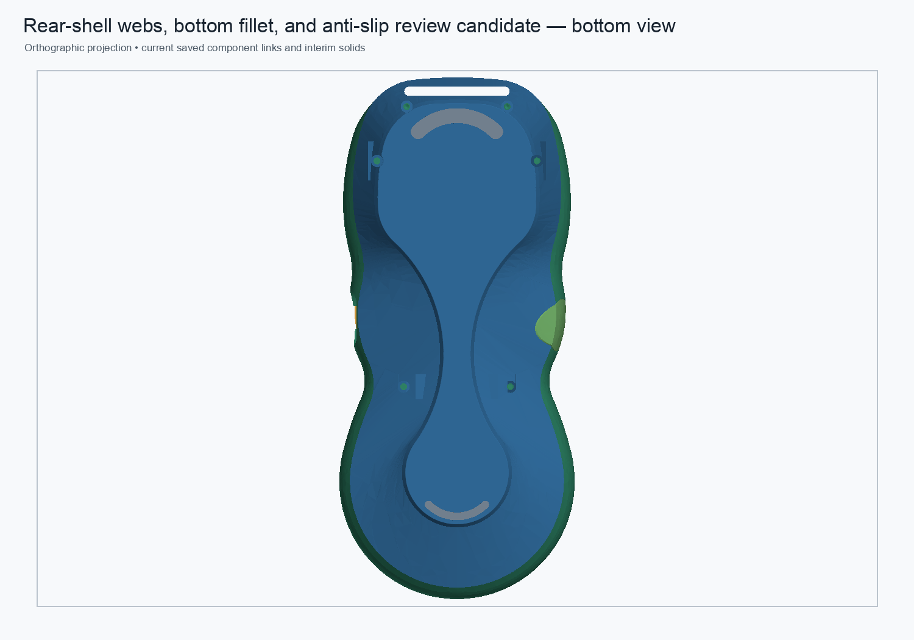

# Rear-shell structural support parameter review assembly

Date: 2026-11-01

Status: disposable review assembly; not production-approved

The review assembly now links its rear-shell entry to the named-parameter candidate while retaining separate live crescent-pad links and the existing other component links. The shell link placement was preserved. A reversible change to `UpperBossXAbs` propagated into the assembly link; restoring 24.8 mm returned the original link volume. The two crescent pads have zero Boolean intersection with the shell and remain independent Bodies.

The candidate saved, cold-opened, and recomputed with all eight App::Link objects resolved. Evidence and measurements are in the [JSON validation record](rear-shell-structural-support-param-review-assembly-2026-11-01.json). The builder [`integrate_rear_support_param_candidate_review_assembly.py`](../scripts/integrate_rear_support_param_candidate_review_assembly.py) copies the existing review assembly to a new path, refuses overwrite, and leaves the production assembly untouched.

This assembly is for review only. The rear shell is still a hybrid: its clean base is a stored-shape feature, with the reconstructed support, lower-web, bottom-fillet, and seat features native and editable. The remaining `113.497311 mm³` difference from the saved legacy rear Tip is unresolved, so this candidate is not presented as an equivalent production replacement.
