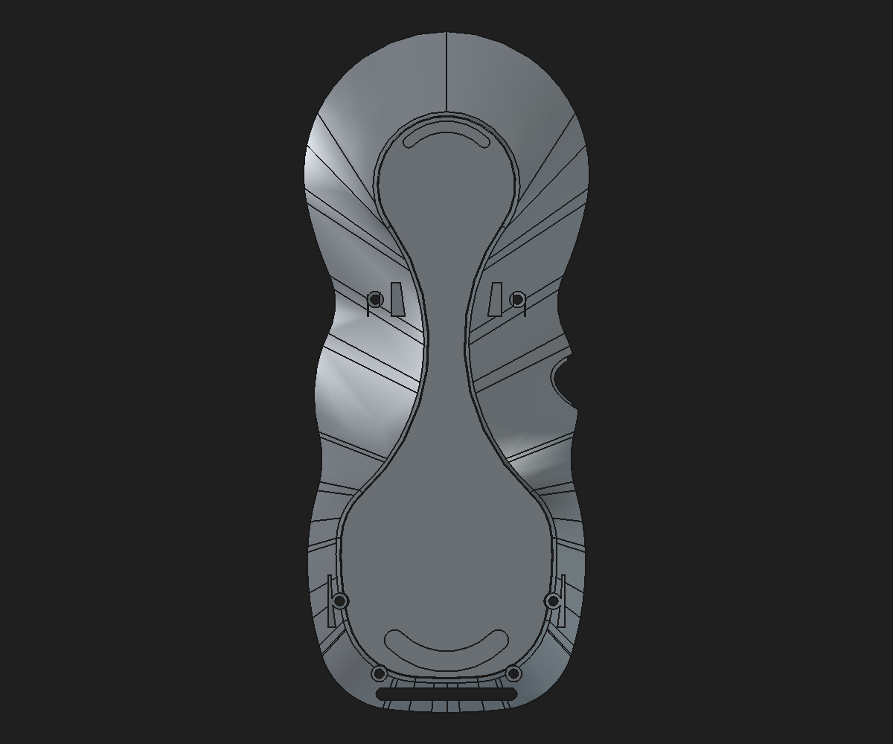

# Rear-shell structural support parameter review

Date: 2026-11-01

Status: validated disposable CAD study; not production-approved

## Native feature editability

The four reconstructed boss-to-wall support profiles and two lower inner-web profiles now read their dimensions from a single local **Rear support and web parameters** spreadsheet. Each profile remains fully constrained, and all six native PartDesign Pad lengths are expression-driven. The candidate preserves the previously reviewed 0.25 mm bottom-perimeter fillet and shallow anti-slip seats.

The builder [`build_rear_shell_structural_support_parameter_review.py`](../scripts/build_rear_shell_structural_support_parameter_review.py) makes a new file and refuses to overwrite an existing candidate. It does not open the protected monolith or production assembly for saving.

## Validation

- All six support sketches remained fully constrained after rebinding 42 expressions to 21 named dimensions.
- The baseline recomputed as a valid single solid with volume `40,847.861698 mm³`, 522 faces, and 1,509 edges.
- Moving `UpperBossXAbs` from 24.8 to 24.9 mm changed the Tip volume by `−1.483425 mm³`; restoring it returned to the original measured value.
- Increasing `UpperSupportPadSpan` from 13.0 to 13.1 mm changed the Tip volume by `+0.181494 mm³`; restoring it returned to baseline.
- Save, cold reopen, and recompute passed. The Body remained valid with one solid. A mesh generated from a copy of the reopened Body shape was closed with 16,020 facets.
- The protected monolith and production assembly were not modified.

Machine-readable evidence: [JSON validation](rear-shell-structural-support-parameter-review-2026-11-01.json).

## Structural material remains unresolved

The source cached Shapes report signed volume deltas of `+383.733575 mm³` at `RearBossToWallLoadPaths`, `−14.961450 mm³` at `RearBossShoulderTransitions`, and `+106.929454 mm³` at `RearBossWallRamps45`, for a saved-shape volume difference of `+475.701580 mm³` relative to `Body002FullWidthSeat`. Because the clean base and later cached Shapes fail BOPCheck, this number is **not** an exact material symmetric difference and should not be described as a precise amount of added physical material.

The archived four-profile reconstruction produces a saved-shape volume increase of `124.036209 mm³` over the clean base and a valid one-solid closed mesh. Its saved-shape volume remains `351.665371 mm³` below the legacy Tip before the newer lower-web and finishing operations. The current parameterized candidate is `113.497311 mm³` below that cached Tip after the lower webs, bottom fillet, and shallow seat cuts. These are volume comparisons, not exact material difference measurements.

The profile recreation therefore demonstrates a manifold native construction method, but does **not** account for the full saved-shape volume difference or prove the remaining difference is redundant. The prior occupancy maps place much of the sampled change near the four boss-to-wall transitions, while BRep/mesh disagreement, BOPCheck errors, and failed whole-shape Booleans prevent exact spatial classification. Do not remove or promote geometry on the basis of these volume comparisons alone.

A focused in-memory remesh check confirms the issue is not resolved by tessellation density alone. The clean base `Body002FullWidthSeat` meshed closed at linear deflections 0.20, 0.08, 0.05, and 0.02 mm. The first cached reinforcement stage, `RearBossToWallLoadPaths`, and both downstream cached stages remained open at every tested setting. The native reconstructed candidate remains closed at its validated 0.08 mm setting. This supports replacing the defective stored-shape feature chain in the model rather than relying on slicer repair or a finer export mesh.

### Additional BRep check

FreeCAD's deeper `Shape.check(runBopCheck=True)` reports errors even where `Shape.isValid()` returns true. Cached upstream shapes through `RearMountReinforcement` pass this check. The first two errors appear at `ConformRearReinforcementToLoft`; the hanger-pocket stage has 12 invalid curve-on-surface errors. The composed `Body002FullWidthSeat` has 336 BOPCheck errors, the first load-path stage has 2,440, and the shoulder and ramp stages each have 740. The native review candidate keeps a closed mesh and reduces the final BOPCheck count to 352, but its clean-base feature still has 336 errors and support seams add some more. So the candidate repairs exported mesh closure, but it is **not** a fully BOP-clean solid. A disposable `Shape.fix()` attempt reduced the clean-base count only from 336 to 334 while changing volume by `0.026 mm³`; that fix was discarded. The candidate remains review-only until its structural geometry and inherited base topology are adequately resolved.

The original native-profile reconstruction routine is available as [`regenerate_rear_boss_wall_loadpaths.py`](../regenerate_rear_boss_wall_loadpaths.py); its four triangular profiles explain only part of the saved legacy volume and are not treated as a complete replacement for the original geometry.

Structural capacity, including the 5× complete-pendant proof-load target, remains unverified. This review candidate is a parametric repair study, not the production rear shell.
