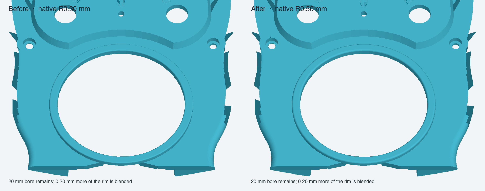

# Upper-faceplate bezel R0.50 mm review candidate

Status: **validated disposable CAD candidate; not applied to the protected monolith or production assembly.**

The editable spreadsheet parameter `BezelParameters.DisplayBezelFilletRadius` was changed from 0.30 to 0.50 mm in a copied component document. The native `PartDesign::Fillet` recomputed, and the revised component was saved, cold-opened, and recomputed again. A copy of the linked review assembly was retargeted to the revised component while preserving the original link placement.

## Geometry and fit checks

| Check | R0.30 baseline | R0.50 review candidate |
|---|---:|---:|
| Fillet radius | 0.30 mm | 0.50 mm |
| Shape | 1 valid solid | 1 valid solid |
| Volume | 13,358.173073 mm³ | 13,349.004070 mm³ |
| Material removed by the revision | — | 9.169005 mm³ |
| Material added | — | 0 mm³ |
| Bounding box | unchanged | unchanged |
| Faces | 227 | 227 |
| Tessellated faces | — | 13,626 |
| Boundary / over-incident / degenerate mesh edges/facets | — | 0 / 0 / 0 |

The central cylindrical bore remains radius 20 mm, and the adjacent outer cylindrical rim remains radius 22.5 mm. The selected top-edge blend reduces each cylindrical lip's straight axial span by 0.20 mm. With both blends at R0.50, the nominal 2.5 mm radial annulus has about 1.5 mm of flat land remaining between the tangent regions. The fillet changes the edge profile locally; it does not change the overall part envelope.

The cold-open review assembly has seven resolved `App::Link` objects and no broken links. The bezel link retains its placement and matches the component's volume. Its measured Boolean intersections with the six other links are all zero in this assembly candidate.

## Disposition

R0.50 provides a softer edge than the prior R0.30 candidate while keeping the measured cylindrical radii and assembly clearances. Keep this as a review option until the user accepts the feel and appearance. The component's underlying faceplate base is still imported static geometry; this milestone validates only the native bezel fillet and its linked assembly behavior. It does not complete independent parametric reconstruction of the upper faceplate.

This does not resolve the separate rear-shell legacy load-path difference. The rear shell's preferred base-preserving native-support review component remains a valid one-solid, closed-mesh candidate with its R0.25 bottom-perimeter fillet and crescent seats. Its Tip is 113.497 mm³ below the cached legacy Tip, and spatial/structural reconciliation is still required before production substitution. The original malformed stored-shape reinforcement remains preserved pending that work.

## Reproduction files

- [R0.50 hybrid component](https://github.com/Cdaprod/lolin-s2-mini-cnc-mpg-pendant-controller/blob/hardware-integration/hardware/freecad/master-driven-leadins-candidate/pendant-bodies/upper-faceplate-bezel-hybrid-r0p50-review.FCStd)
- [R0.50 linked review assembly](https://github.com/Cdaprod/lolin-s2-mini-cnc-mpg-pendant-controller/blob/hardware-integration/hardware/freecad/master-driven-leadins-candidate/pendant-modular-assembly-bezel-r0p50-review.FCStd)
- [Candidate creation and cold-open validator](../scripts/create_display_bezel_r050_review_candidate.py)
- [Machine-readable results](upper-faceplate-bezel-r050-review-validation-2026-10-31.json)
