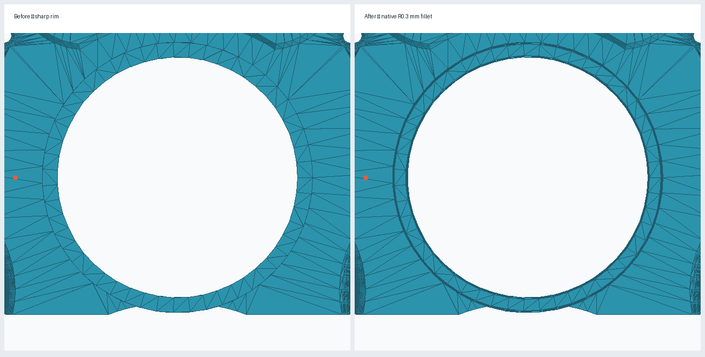
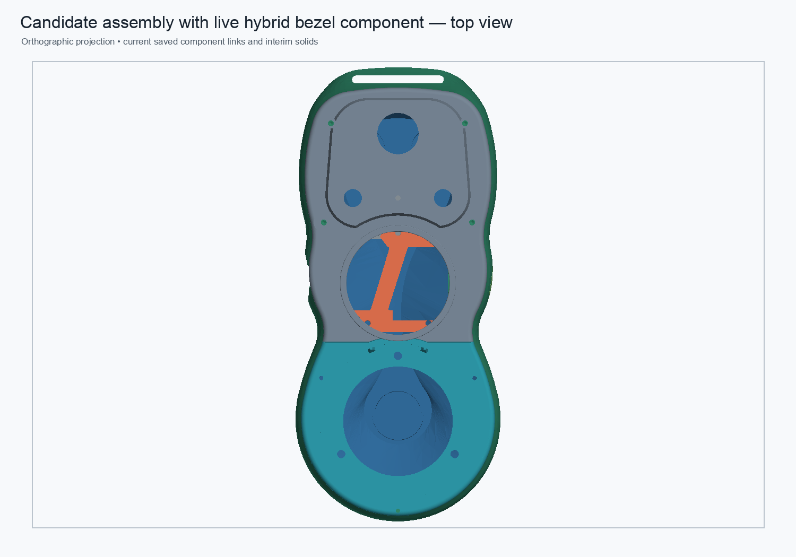
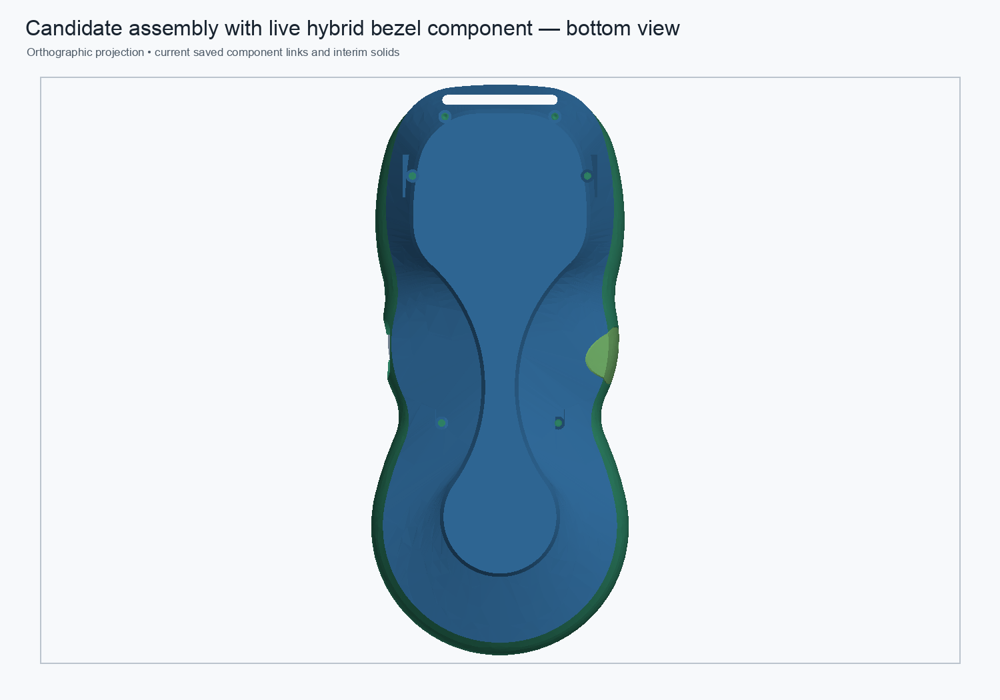
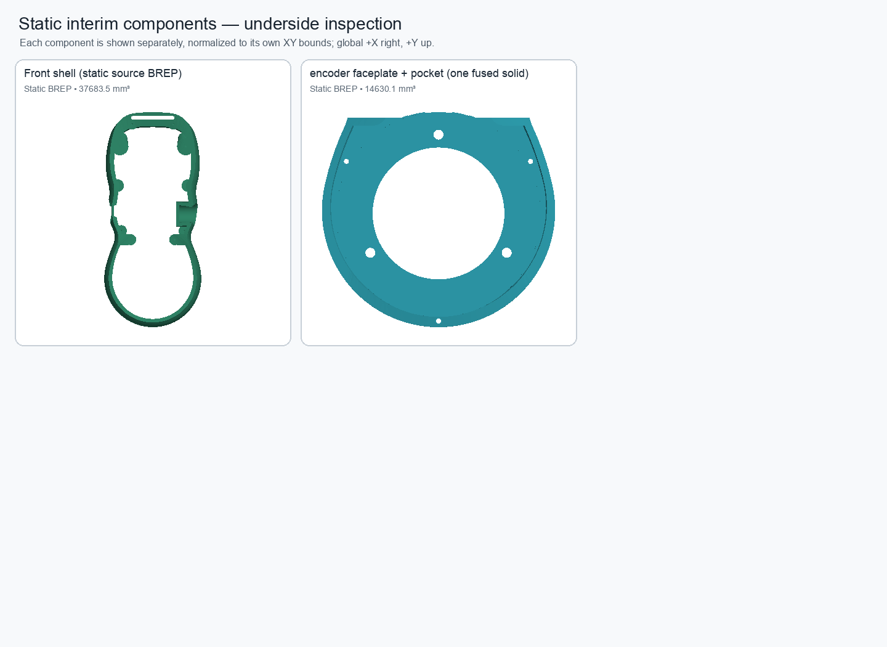

# Upper faceplate live bezel candidate — validation

**Status: validated disposable candidate; not promoted to the production assembly.**

The existing 0.30 mm display-bezel lead-in was made editable at the assembly level. The candidate replaces the static upper-faceplate interim object with an `App::Link` to a separate FreeCAD document. The candidate component is deliberately described as **hybrid**: its pre-fillet upper-faceplate base is imported static geometry; the R0.30 bezel treatment is a native `PartDesign::Fillet` driven by the component spreadsheet alias `DisplayBezelFilletRadius`.

## Native feature check

The saved component was cold-opened and recomputed. Its Body Tip is `DisplayBezelSoftEdge`, a valid single solid, and its radius expression resolves to `BezelParameters.DisplayBezelFilletRadius`.

A reversible local test changed the radius from 0.30 mm to 0.35 mm and restored it:

- Nominal volume: 13,358.173073 mm³.
- Test volume: 13,356.310620 mm³.
- Nominal/test symmetric difference: 1.862454 mm³.
- Restored/nominal symmetric difference: 0.000000 mm³.
- Nominal fillet vs imported base: 5.157565 mm³ removed, no material added; bounds unchanged.

## Assembly check

The saved candidate assembly cold-opens with seven live links and two static interim shapes. All nine displayed component shapes are valid single solids. The assembly root remains valid with nine solids and a nominal volume of 111,841.773974 mm³. The new link resolves to the relative sibling path `pendant-bodies/upper-faceplate-bezel-hybrid-candidate.FCStd`.

A linked radius test propagated the 0.35 mm change through the assembly: the root volume changed to 111,839.911520 mm³. Restoring 0.30 mm returned the linked faceplate to zero symmetric difference from nominal and the assembly root to zero symmetric difference from its saved nominal shape. Cold-open/recompute checks were then performed in separate headless FreeCAD processes. A later attempt to combine every check into one process exceeded the MCP call limit during an expensive full-root comparison; the already saved files were separately reopened and validated, and the report uses the completed bounded checks rather than claiming that timed-out combined run passed.

## Previews

The bezel edge treatment is shown before and after below. The complete candidate assembly previews are generated from the saved, cold-openable assembly and contain seven links plus two static interim components.

## Limitations and next work

This validates the native bezel feature and its assembly-level parameter propagation, not a complete independently editable upper faceplate. The upstream faceplate base still has no preserved native source history in this hybrid document. The assembly still includes two static interim parts, including the encoder faceplate/pocket handoff. Shell mating, full wall-thickness analysis, hanger load-path adequacy, and global interference checks are not established by this bezel milestone. The repaired rear shell remains a candidate with an approximately 351.666 mm³ geometry difference; do not substitute it for the current representation until the missing load-path material and fit are resolved.

The original `pendant.FCStd`, production master, and production assembly were not modified. The full monolithic CAD file SHA-256 remains `dc2aeddf7be327c73022a1dc053bf8a27d5cf476e9cd68468a4ee73ab8264881`.
